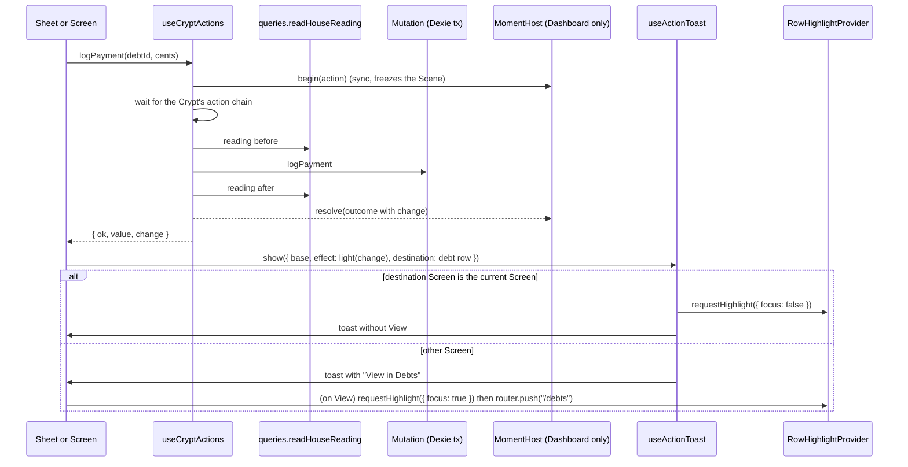
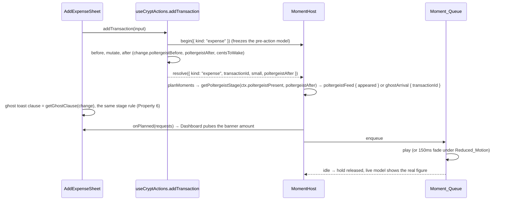

# Design Document

## Overview

This feature makes every user action explain itself. It adds four things on top of `app-screens` and `house-scene` and changes no engine, planner or Mutation:

1. **Measured light effect.** The action hooks read the light score before and after each Mutation and hand the change to the toast, which states it with one decimal (Requirements 1 and 2).
2. **Where it went.** A small highlight service lets a toast's "View" action open the right Screen, focus the row and highlight it, or highlight the row in place (Requirement 3).
3. **Three new Moments.** Poltergeist fed, ghost arrival and candle flicker, played through the existing Moment_Queue on the Dashboard (Requirements 4, 8 and 11).
4. **Smaller fixes.** The Guide card, initial focus in sheets, focus kept on a control while it saves, a plan checkbox that opens the Do it sheet, a Landing with a static house preview, and three quick actions (Requirements 5, 6, 7, 9 and 10).

Every rule of the `house-scene` Moment framework still applies to the new Moments: Dashboard only, one queue, wall-clock timing through `driveOnWallClock`, Reduced_Motion fades, Skip_Input, the hard cap and exactly-once resolution.

### Numbers measured on the level-4 demo

Measured with the real Mutations against `fake-indexeddb` (`loadScenario("level-4", "2025-06-02")`, then the steps in order, reading `computeHouseState(toFinancialSnapshot(readAllRows(db), now)).lightScore` before and after each step):

| Step | Light before → after | Light_Delta | Light_Clause |
|---|---|---|---|
| Add an $8 Coffee expense | 32.735 → 32.735 | 0.000 | fixed expense text |
| $150 minimum payment on the Car loan | 32.735 → 32.847 | +0.112 | "Light +0.1" |
| Cancel Wraithcast (with Auto_Completion) | 32.847 → 38.065 | +5.217 | "Light +5.2" |
| Tick "Cut Coffee by $60" | 38.065 → 39.065 | +1.000 | "Light +1.0" |
| Pay $300 extra plus the minimum on Scarlet Moth Card | 39.065 → 43.605 | +4.540 | "Light +4.5" |

The minimum payment is the case the review found: the floored Dashboard number stays at 32, and the toast now says "+0.1".

Demo scenarios used by the browser checks (planner output at the scenario's start):

| Scenario | Level, light | Poltergeist | Ghosts | Plan |
|---|---|---|---|---|
| `level-1` | 1, 87.22 | no | 3 | extra payment, cancel Music streaming, **fallback** "Set aside $250 for an emergency fund" |
| `level-2` | 2, 62.74 | no | 4 | cancel Movie streaming, extra payment, cancel Music streaming |
| `level-4` | 4, 32.74 | yes (30 merged) | 0 drawn | cancel Wraithcast, cut Coffee, extra payment |

`level-1` is the only scenario with a fallback action, so the candle-flicker check uses it. `level-2` has drawn Ghosts and no Poltergeist, so the ghost-arrival check uses it.

### Root causes of the review bugs

- **Add expense focus (Requirement 6).** `BottomSheet.moveFocusIn` focuses the first element that matches `FOCUSABLE_SELECTOR` inside the dialog. The first such element is the header's Close button, which comes before the sheet's children. Keystrokes therefore go to Close, never to "Amount". Task 1 starts with a failing test that types right after opening the sheet. That test also checks what Enter does in that state, so the review's report that Enter submits an empty form is confirmed or corrected before the fix.
- **Checkbox focus lost to `<body>` (Requirement 15).** `ExorcismPlanAction` sets `busy` for the whole toggle and passes `disabled={busy}` to `ExorcismActionRow`, which puts the native `disabled` attribute on the focused checkbox. Browsers apply the focus fixup rule to a focused element that becomes disabled: it loses focus and `document.activeElement` becomes `<body>`. On the deployed Dashboard this happens for about 28 ms, which is the length of the save, and focus never comes back. jsdom does not run the focus fixup rule, so a jsdom test cannot see the blur. The jsdom test asserts the attribute instead, and the browser check asserts the focus.
- **Checkbox that does nothing visible (Requirement 7).** `ExorcismPlanAction.handleToggle` always calls `completePlanAction`. By design (`app-screens` Requirement 8.5) that changes no Subscription or Debt row, so `planMoments` makes no cancel or payment request and the Scene has nothing truthful to show.
- **Invisible new ghost (Requirement 4).** `addTransaction` is not observed by `MomentHost`, and while the Poltergeist exists the Scene draws no Ghost figures (`house-scene` Requirement 9.2), so the data change has no visible trace.

- **Header wider than 320px (Requirement 16).** In `AppShell` the header is a flex row with the wordmark and `DemoChip` in one inner group (`gap-3`) and the settings `NavLink` on the right. `DemoChip` renders "Demo mode · <date>" in a `Chip`, which does not wrap, so the three items add up to about 400px. The overflow makes the page wider than the viewport. Mobile browsers then zoom out to the page width, and the fixed `TabBar` (100% of the layout viewport) becomes 400px wide. Task 1 adds a `noHorizontalScroll` browser case first, and it fails on the current header.

### Key design decisions

| # | Decision | Reason |
|---|---|---|
| D1 | The action hooks measure the light. `useCryptActions` and `useExorcismPlan` read a small House reading (light score and Poltergeist presence) before and after each Mutation and return it on the result as `change`. | One place covers every Mutation, so edits and deletes come for free (answer 2 of the review). The reading uses the same Snapshot_Adapter and engine path as `useHouseState`, so it cannot disagree with the Dashboard. |
| D2 | Measured actions run one at a time per Crypt, through a promise chain in `useCryptActions`. | Reading before and after outside the Mutation's own transaction is only exact if no other action of the tab runs in between. Serializing costs nothing a user can notice, because a Mutation takes milliseconds. |
| D3 | One composer, `useActionToast`, builds every Light_Toast: base text, clause, and either "View" or an in-place highlight. | Requirement 1 is the same rule for about a dozen call sites. Centralizing it keeps the text rule in one pure function (`getLightClause`) and the navigation rule in one hook. |
| D4 | The highlight target is passed in memory through a `RowHighlightProvider` mounted in the root layout, not through the URL. | A reload or a history step must not highlight again (Requirement 3.9). A pending target in memory is consumed once and disappears on reload. |
| D5 | "View" moves focus to the row. An in-place highlight does not. | Activating "View" takes the user to a new page, so focus has to land somewhere useful. In place, `BottomSheet` already returns focus to the control that opened the sheet (`app-screens` Requirement 30.5), and taking it away would surprise keyboard users. The polite announcement covers screen readers in both cases. |
| D6 | The ghost-arrival Moment and the "Poltergeist appears" variant of the feed Moment draw a copy of the figure in the Moment_Layer, in an SVG that matches the Scene's ViewBox, the same technique the tombstone rise uses. The real figure appears when the hold is released. | While a Moment plays, the Scene shows the frozen pre-action model (`house-scene` hold), which does not contain the new figure. Drawing a copy is the existing pattern. It needs no new prop on `HouseScene` and has no race with the live query. |
| D7 | The feed swell scales a new wrapper `<g data-part="poltergeist-feed">` around the glow and the body, not the sigil ring. | `AmbientMotion` already tweens the scale of `poltergeist-body`. A parent group composes with it instead of fighting it. Leaving the ring unscaled keeps the bound sigil inside its measured extent (y 3 to 249). |
| D8 | The candle flicker plays only when the tick's measured Light_Delta is above 0. | Requirement 8.3. A re-tick, or a tick with momentum at its maximum, changes no light, so a flicker would claim something false. |
| D9 | On desktop the Guide sits at the top of the right column through grid placement, and stays first in DOM order. | On desktop a Card above the Scene would push the Scene past 720px. Putting the Guide first in the DOM keeps it first on mobile and in reading order, with no CSS `order` trick (Requirement 5.1 and 5.13). |
| D10 | The Landing preview is built by a pure `buildLandingPreview()` in `src/lib/demo/preview.ts` from `buildScenario("level-4", PREVIEW_DATE)`. `HouseScene` gets an `ambient` prop so the Landing can turn the loops off. | No Crypt is opened, no clock is read, no GSAP module is requested, and the server and the client render the same markup (Requirement 9.3 to 9.5). |
| D11 | Initial focus order in `BottomSheet`: an element marked `data-initial-focus`, else the first Field, else the first focusable element as today. A pre-filled Field gets its value selected. | One rule in the primitive fixes every form sheet. The marker covers the Log payment Debt picker, which has no Field. |
| D12 | A control that is waiting for its own save is marked `aria-disabled="true"` and `aria-busy="true"` and guarded in its handler, never `disabled`. | It keeps focus where the user put it (Requirement 15). `Button`'s `loading` state already works this way, so the rule extends the primitive's own pattern to the checkbox, the QuickAction and the demo controls. |
| D13 | The demo badge shortens below `sm`: the visible text is "Demo" with the flask icon, and the date stays in a visually hidden span (and in the chip's `title`), shown inline from `sm` up ("Demo mode · <date>"). The header group is allowed to shrink (`min-w-0`) and the settings link keeps its 44px target (`shrink-0`). | The badge stays readable and keeps the date for assistive technology, and the header at 768px and wider is unchanged. Wrapping alone would make the header taller on every phone. Hiding the date visually only below `sm` is the smallest change that fits. |

### Known limits accepted

- When a new Ghost is drawn, the ghost-spreading step (`house-scene` Property 20) can shift other drawn Ghosts whose id sorts after it. They move to their new rest points when the hold is released. This happens at most once per expense, and it is the same release that already ends every Moment.
- If a light reading fails after a successful Mutation (an IndexedDB read error), the toast shows its base text without a clause (Requirement 2.8). The Mutation itself is not affected.

## Architecture

### Module layout

```
src/
├── lib/
│   ├── utils/
│   │   ├── lightClause.ts       NEW  getLightClause, joinToastText, EXPENSE_* texts (pure)
│   │   ├── destinations.ts      NEW  HighlightList, paths, labels, getRowDomId (pure)
│   │   ├── planView.ts          +    getGuideStep, getShortTitle
│   │   └── focusTrap.ts         +    FIELD_SELECTOR, INITIAL_FOCUS_ATTRIBUTE
│   ├── db/queries.ts            +    readHouseReading(db, now)
│   ├── demo/preview.ts          NEW  PREVIEW_DATE, buildLandingPreview()
│   ├── moments/types.ts         +    new request kinds, expense outcome, lightDelta, litWindowCount
│   ├── moments/requests.ts      +    planning of the new kinds
│   └── scene/config.ts          +    durations and art constants of the new Moments
│   └── scene/momentGeometry.ts  +    extents of the new Moment art
├── hooks/
│   ├── useCryptActions.ts       +    measured(), serialized actions, `change` on results, observed addTransaction
│   ├── useExorcismPlan.ts       +    measured toggle, lightDelta on the planToggle outcome
│   └── useActionObserver.ts     +    "expense" ObservedAction, map receives `change`
├── components/
│   ├── feedback/                NEW
│   │   ├── RowHighlightProvider.tsx   provider, polite region, useRowHighlight, requestHighlight
│   │   └── useActionToast.ts          composes Light_Toasts, View or in-place highlight
│   ├── dashboard/
│   │   ├── CryptGuide.tsx       NEW  the Guide card, useGuideVisibility, startGuideSession
│   │   ├── Dashboard.tsx        +    Guide placement, How it works, 3 QuickActions, banner pulse
│   │   └── PoltergeistBanner.tsx +   pulseKey emphasis on the amount
│   ├── house/HouseScene.tsx     +    `ambient` prop
│   ├── house/Poltergeist.tsx    +    `poltergeist-feed` wrapper group
│   ├── moments/
│   │   ├── PoltergeistFeedMoment.ts   NEW
│   │   ├── GhostArrivalMoment.ts      NEW
│   │   ├── CandleFlickerMoment.ts     NEW
│   │   ├── MomentArt.tsx        +    FeedParticlesArt, PoltergeistCopyArt, GhostCopyArt, MarkerPulseArt, FlickerGlowArt
│   │   ├── momentLoader.ts      +    imports and durations of the new kinds
│   │   └── MomentHost.tsx       +    litWindowCount in the context, onPlanned callback
│   ├── exorcism/ExorcismPlanAction.tsx  +  checkbox opens the Do it sheet
│   ├── landing/Landing.tsx      +    preview, three lines, no styleguide link
│   ├── sheets/*.tsx             +    useActionToast, initial focus markers, focus on first invalid
│   ├── sheets/useFocusFirstInvalid.ts NEW
│   ├── screens/*.tsx            +    useActionToast, useRowHighlight, row DOM ids
│   └── ui/
│       ├── BottomSheet.tsx      +    initial focus rule
│       ├── Toast.tsx            +    wrapping text, actionAccessibleName
│       ├── ToastRegion.tsx      +    passes actionAccessibleName
│       ├── ListRow.tsx          +    highlight prop
│       ├── ExorcismActionRow.tsx +   highlight and description props
│       └── motionTokens.ts      +    ACTION_TOAST_DURATION_MS, ROW_HIGHLIGHT_MS, BANNER_HIGHLIGHT_MS
└── app/layout.tsx               +    RowHighlightProvider inside ToastRegion
```

Module boundaries are unchanged. `src/lib/` imports no React, Dexie or Next.js. Of the new code, only `queries.ts` (already in `src/lib/db/`) touches Dexie. Components reach the Data_Layer only through Hooks. GSAP stays in `src/components/house/` and `src/components/moments/`, and Framer Motion stays in the chrome (`ui/`, `dashboard/PoltergeistBanner.tsx`).

`src/lib/demo/preview.ts` imports `buildScenario` (pure), `toFinancialSnapshot` from `src/lib/db/snapshotAdapter.ts` (pure, no Dexie value import), `computeHouseState` and `buildSceneModel`. The Landing imports it from `@/lib/demo/preview`, which the `@/lib/db/` source scan allows.

### Data flow: a measured action with a toast



### Data flow: a small expense on the Dashboard



## Components and Interfaces

### Light reading and measured actions (Requirements 1 and 2, D1, D2)

```ts
// src/lib/db/queries.ts
export type HouseReading = {
  lightScore: number;
  poltergeist: boolean;
  /** Smallest extra small expense (cents) that wakes the Poltergeist; null when awake or unable to wake. */
  centsToWake: number | null;
};
/** Reads every table in one read-only transaction and runs the engine on it. */
export async function readHouseReading(db: CryptDb, now: LocalDate): Promise<HouseReading>;
```

It is `readAllRows` → `toFinancialSnapshot(rows, now)` → `computeHouseState`, the same path as `useHouseState`. `centsToWake` comes from `getSmallExpenseSummary(rows.transactions, now, income)` on the same rows, the function the Transactions page uses for its total and threshold.

```ts
// src/hooks/useCryptActions.ts
export type HouseChange = {
  lightBefore: number;
  lightAfter: number;
  poltergeistBefore: boolean;
  poltergeistAfter: boolean;
  centsToWake: number | null;   // the reading after the Mutation
};
export type MutationResult<T> =
  | { ok: true; value: T; change?: HouseChange | null }   // null: a reading failed
  | { ok: false; error: MutationError };
```

`change` is optional, so existing tests that build results by hand still type-check.

- **`measured(db, now, task)`** reads before, runs the task and reads after. A failed reading gives `change: null` and never fails the action. A failed task returns its error as today, with no `change`.
- **`serialize(db, job)`** chains `job` after the previous measured job of the same `CryptDb`. The chain is a `WeakMap<CryptDb, Promise<unknown>>` at module level, and a rejected job does not break it.
- **Measured Mutations.** Every Mutation in `CryptActions` except `clearAll` runs as `serialize(db, () => measured(...))`. `setIncome` now goes through `withNow` too, because the reading needs "now". The Settings form cannot be used before "now" is known anyway, because it is disabled while loading.
- **Observed Mutations.** `addTransaction` joins `logPayment` and `cancelSubscription`. `observeAction` calls `begin` synchronously before the chain wait, so the frozen model is the one the user saw when they acted. The `map` callback now receives `(value, change)`.
- **`useExorcismPlan.toggleAction`** uses the same `serialize` and `measured` (exported from `useCryptActions.ts`). It returns `change`, and its outcome carries `lightDelta = change ? change.lightAfter - change.lightBefore : 0`.

### `getLightClause` (`src/lib/utils/lightClause.ts`, Requirement 2)

```ts
export const LIGHT_NOISE_EPSILON = 1e-9;        // float noise from re-summing equal data
export const LIGHT_FULL_SCORE = 100;
export const CLAUSE_SEPARATOR = " · ";
export const MINUS_SIGN = "\u2212";
export const GHOST_EXPENSE_CLAUSE = "feeds the Poltergeist, doesn't dim the light";   // awake before and after
export const GHOST_WOKE_CLAUSE = "woke the Poltergeist, doesn't dim the light";        // asleep before, awake after
export const GHOST_ASLEEP_CLAUSE = "doesn't dim the light";                            // no Poltergeist after
export const EXPENSE_CLAUSE = "doesn't change the light";
export type PoltergeistStage = "awake" | "woke" | "asleep";
export function getPoltergeistStage(before: boolean, after: boolean): PoltergeistStage;
export function getGhostClause(change: GhostClauseInput | null | undefined): string;
export function getLightClause(before: number, after: number): string;
export function joinToastText(base: string, clause: string | null): string; // base, or base + " · " + clause
```

| Condition (d = after − before) | Clause |
|---|---|
| `before` or `after` not finite | "Light unchanged" |
| `abs(d) < LIGHT_NOISE_EPSILON` and `before ≥ 100 − ε` | "Light already full" |
| `abs(d) < LIGHT_NOISE_EPSILON` | "Light unchanged" |
| `r = sign(d) · round(abs(d) · 10) / 10` is 0 and d > 0 | "Light rises slightly" |
| r is 0 and d < 0 | "Light dims slightly" |
| otherwise | `"Light " + (d > 0 ? "+" : "−") + abs(r).toFixed(1)` |

`getPoltergeistStage(before, after)` is `after ? (before ? "awake" : "woke") : "asleep"`. A Poltergeist that was awake before and is gone after (only possible through a race) reads as `asleep`, which is also what the Moment planning did before this rule.
`getGhostClause(change)` takes `{ poltergeistBefore, poltergeistAfter, centsToWake }` (a `HouseChange` fits):
| Stage | Clause |
|---|---|
| `awake` | `GHOST_EXPENSE_CLAUSE` |
| `woke` | `GHOST_WOKE_CLAUSE` |
| `asleep` and `centsToWake` is a number | `GHOST_ASLEEP_CLAUSE + " · " + formatCentsShort(centsToWake) + " more wakes the Poltergeist"` |
| `asleep` and `centsToWake` is null (income too low to wake it) | `GHOST_ASLEEP_CLAUSE` |
| `change` is null or undefined (reading failed) | `GHOST_ASLEEP_CLAUSE`, because nothing is known about the Poltergeist |
**`centsToWake`** is added to `SmallExpenseSummary` (`listViews.ts`). With `exact = POLTERGEIST_RATIO × income` (the engine's unrounded threshold) and the in-window small total `total`, it is `null` when the income is not usable or `awake`, else `floor(exact) + 1 − total`. It is the smallest extra amount that makes `total` strictly exceed `exact`, the engine's rule. The page shows the rounded threshold, so `centsToWake` is the page's "threshold − total" or one cent more, and adding it always wakes the Poltergeist (a plain "threshold − total" can land exactly on the threshold, which does not wake it). The toast and the page read the same function on the same rows.
The Moment and the toast share one rule. `requests.ts` plans an expense as `awake → poltergeistFeed { appeared: false }`, `woke → poltergeistFeed { appeared: true }`, `asleep → ghostArrival`, from `getPoltergeistStage(ctx.poltergeistPresent, outcome.poltergeistAfter)`. The toast calls the same function with `change.poltergeistBefore` and `change.poltergeistAfter`. On the Dashboard `ctx.poltergeistPresent` is the Scene model at `begin` and `poltergeistBefore` is the reading just before the write, which are the same Crypt state. The toast also appears on the Transactions page, where there is no observer, so it cannot read the context.
Rounding is half away from zero on the absolute value, so 0.05 rounds to 0.1 and 0.049 gives "Light rises slightly". The epsilon only absorbs floating-point noise. A real change is never below 1e-9, because the smallest money step is one cent.

Base texts lose their trailing period where the clause follows ("Payment saved. $150 off your balance · Light +0.1").

### `useActionToast` (`src/components/feedback/useActionToast.ts`, D3)

```ts
export type ToastEffect =
  | { kind: "light"; change: HouseChange | null | undefined }
  | { kind: "fixed"; clause: string };                 // the expense texts
export type ActionToastInput = {
  tone: ToastTone;
  base: string;
  effect: ToastEffect;
  destination?: HighlightTarget;                       // omitted for income and deletes
};
export function useActionToast(): (input: ActionToastInput) => void;
```

- The message is `joinToastText(base, clause)`, where the clause is `getLightClause(change.lightBefore, change.lightAfter)` for `light`, `null` when `change` is null or undefined, or the fixed clause.
- With a destination, it compares `usePathname()` with `getDestinationPath(destination.list)`.
  - **Same Screen:** it calls `requestHighlight({ ...destination, focus: false })` and shows the toast without an action.
  - **Other Screen:** it shows the toast with `actionLabel: "View"`, `actionAccessibleName: "View in <Screen label>"`, `duration: ACTION_TOAST_DURATION_MS` (6000), and `onAction: () => { requestHighlight({ ...destination, focus: true }); router.push(path) }`.

Call sites and their texts:

| Call site | Base | Effect | Destination |
|---|---|---|---|
| `LogPaymentSheet` | "Payment saved. $X off your balance" | light | `debts`, debt id, tag "Updated" |
| `CancelSubscriptionSheet` | "+$X/mo saved" | light | `graveyard`, subscription id, "New" |
| `ExorcismPlanAction` (tick) | `getToastForCompletion(action)` | light | `plan`, action id, "Updated" |
| `AddExpenseSheet` | "Ghost added: $X" / "Expense added: $X" | fixed: `getGhostClause(result.change)` / expense clause | `transactions`, transaction id, "New" |
| `TransactionsScreen` delete | "Expense deleted" | fixed: expense clause | none |
| `DebtsScreen` add / edit / delete | "Debt added: …" / "Debt updated: …" / "Debt deleted" | light | add and edit: `debts`; delete: none |
| `SubscriptionsScreen` add / reactivate / delete | existing texts | light | add and reactivate: `zombies`; delete: none |
| `SettingsScreen` income | "Income saved" | light | none |

Demo controls, the usage change, uncompleting and "Clear all data" keep their current behavior (Requirement 1.11).

### Toast primitive changes (Requirements 1.12, 3.1, 3.10)

- The message span drops `truncate whitespace-nowrap` and wraps (`min-w-0 text-pretty`). The pill keeps `rounded-pill`, so a two-line toast becomes a stadium shape. This is the one visual change to the primitive. `design-system.md` → Toast changes "icon + one line" to "icon + text, one line where it fits, two at most on narrow screens".
- New optional prop `actionAccessibleName`, passed to the ghost action Button as `aria-label`. The visible "View" is contained in the name ("View in Debts"), which meets WCAG 2.5.3.
- The existing pause on pointer and focus stays. `ACTION_TOAST_DURATION_MS` (6000) is the duration whenever an action is present.

### Row highlight (`src/components/feedback/RowHighlightProvider.tsx`, Requirement 3, D4, D5)

```ts
// src/lib/utils/destinations.ts (pure)
export type HighlightList = "debts" | "transactions" | "zombies" | "graveyard" | "plan";
export type HighlightTag = "new" | "updated";
export type HighlightTarget = { list: HighlightList; rowId: string; tag: HighlightTag };
export const DESTINATION_PATHS: Record<HighlightList, string>;   // /debts, /transactions, /subscriptions (x2), /exorcism
export const DESTINATION_LABELS: Record<HighlightList, string>;  // "Debts", "Transactions", "Subscriptions", "Subscriptions", "Exorcism"
export function getRowDomId(list: HighlightList, rowId: string): string; // "row-<list>-<rowId>"
export const HIGHLIGHT_TAG_TEXT: Record<HighlightTag, string>;  // "New", "Updated"
```

```ts
// RowHighlightProvider.tsx
type Pending = HighlightTarget & { focus: boolean; requestedAt: number };
export function RowHighlightProvider({ children }: { children: ReactNode }): JSX.Element;
export function useRequestHighlight(): (target: HighlightTarget & { focus: boolean }) => void;
export function useRowHighlight(options: {
  list: HighlightList;
  rows: readonly { id: string; label: string }[] | null;   // null while loading
  listLabel: string;                                     // "Last 30 days", "Your debts", …
  headingId: string;
}): { highlightedId: string | null; tag: HighlightTag | null };
```

- The provider holds at most one Pending in a ref plus a version counter in state, and renders one visually hidden `<p role="status" aria-live="polite">`. A new request replaces the old one. A Pending older than `HIGHLIGHT_PENDING_TTL_MS` (5000) is ignored, so a stale "View" never fires on a later visit.
- `useRowHighlight` runs an effect on `[version, rows]`. While `rows` is null it waits.
  - **Row found:** it consumes the Pending and sets `highlightedId`. If `focus` is set, it calls `scrollIntoView({ block: "center", behavior: reduced ? "auto" : "smooth" })` and `focus({ preventScroll: true })` on `getRowDomId(list, id)`. It announces `"<label> highlighted in <listLabel>"` and clears the highlight after `ROW_HIGHLIGHT_MS` (4000).
  - **Row missing:** after `HIGHLIGHT_WAIT_MS` (1500, for the live query to deliver a just-added row), it consumes the Pending, focuses `headingId` when `focus` is set, and announces "That item is no longer here" (Requirement 3.8).
- A reload starts with an empty provider, and history navigation finds the Pending already consumed (Requirement 3.9).
- **Primitives.** `ListRow` and `ExorcismActionRow` get `highlight?: HighlightTag`. They render the tag as visible text in a `Chip` (tone `candle`, text "New" or "Updated") after the title, and fade a `bg-candle-tint` background in and out over the row with Framer Motion (`TAB_DURATION_S`, with no fade under reduced motion). The text tag is the non-color cue. The styleguide shows both states.
- **Screens.** Each list gives its rows `id={getRowDomId(list, row.id)}`. Subscriptions replaces its local `getRowDomId` with the shared one. Each list gets a heading id that its delete-focus logic already uses: `DEBTS_HEADING_ID`, `LIST_HEADING_ID` and the Subscriptions `HEADING_IDS`, plus a new `EXORCISM_PLAN_HEADING_ID`. The Exorcism Screen's plan list passes rows of `{ id: action.id, label: action.title }`. The DOM id there is the checkbox id `getPlanRowId(weekKey, actionId)`, kept by mapping `plan` to `getPlanRowId` inside the Exorcism list.

### New Moments

#### Request and outcome types (`src/lib/moments/types.ts`)

```ts
export type MomentRequest =
  | …existing…
  | { kind: "poltergeistFeed"; appeared: boolean }
  | { kind: "ghostArrival"; transactionId: string }
  | { kind: "candleFlicker"; litWindows: boolean };

export type ActionOutcome =
  | …existing cancel and payment…
  | { kind: "planToggle"; actionId: string; next: boolean; lightDelta: number }
  | { kind: "expense"; transactionId: string; small: boolean; poltergeistAfter: boolean };

export type ActionContext = { …existing…; litWindowCount: number };   // lit windows with opacity > 0
```

`ObservedAction` gains `{ kind: "expense" }`. `MomentHost.begin` builds `litWindowCount` from the live model's windows.

#### Planning (`requests.ts`, Requirements 4, 8)

`ownRequest` gains:

```text
expense:    if !small → none
            stage = getPoltergeistStage(ctx.poltergeistPresent, poltergeistAfter)
            awake → poltergeistFeed { appeared: false }; woke → poltergeistFeed { appeared: true }
            asleep → ghostArrival { transactionId }
planToggle: if !next → none; action = ctx.planActions[actionId]; if !action or action.done → none
            if action.kind = reduce_small_expenses and ctx.poltergeistPresent → sigil      (unchanged)
            if (action.kind = fallback or action.kind = reduce_small_expenses) and lightDelta > 0
                → candleFlicker { litWindows: ctx.litWindowCount > 0 }
            otherwise → none
```

`completesPlan` and the level step are unchanged. An expense never completes a Plan_Action and never moves the light, so it never yields `exorcismComplete` or `level`. The order of `house-scene` Requirement 12.5 holds, with the new kinds as "the action's own Moment".

`shouldDrop` in `MomentHost` gains two rules, through an `isStale(request, live)` helper. It drops `poltergeistFeed` when the live model has no Poltergeist, and `ghostArrival` when the live Ghosts and overflow no longer include that Transaction (it was deleted meanwhile).
**Deviation (`ghostTransactionIds`).** `MomentHostLive` gains an optional `ghostTransactionIds: readonly string[]`, which `Dashboard` fills with the `transactionId` of every ghost in `houseState.ghosts` (drawn and overflow). The scene model holds only the drawn ghosts, so it cannot answer "is this Transaction still a ghost" for an overflow ghost. When the field is absent, no `ghostArrival` is dropped.
**Fix (settled enqueue).** When the planned requests include `ghostArrival` or `poltergeistFeed`, `MomentHost` waits for `waitForSettle(entry.version)` before enqueuing them (and skips them if the host unmounted or the ticket was dropped). Both requests read the live model, and the stale check above ran before the live query held the new Transaction, so it dropped them. The other kinds still enqueue at once. `onPlanned` is called before the wait, so the banner pulse starts with the action, not after the settle.

`MomentHost` gets `onPlanned?: (requests: readonly MomentRequest[]) => void`, called right after planning. `Dashboard` increments a `bannerPulseKey` when the list contains a `poltergeistFeed`. `PoltergeistBanner` takes `pulseKey?: number`. On each change it scales the amount (`data-part="banner-amount"`) 1 → 1.06 → 1 and brings a `bg-spirit-tint` in and out over `BANNER_HIGHLIGHT_MS` (900), using Framer Motion. It does nothing under `useReducedMotion()` (Requirement 4.3).

#### Durations and constants (`src/lib/scene/config.ts`)

| Key | ms | Catalog row (new, `design-system.md`) |
|---|---|---|
| `poltergeistFeed` | 900 | Small expense added while the Poltergeist is awake |
| `poltergeistAppear` | 1300 | Small expense that wakes the Poltergeist |
| `ghostArrival` | 800 | Small expense added, no Poltergeist |
| `candleFlicker` | 700 | Fallback action ticked |

`MomentDurationKey` gains the four keys, and `validateSceneConfig` checks them like the others (600 ≤ d ≤ `MOMENT_HARD_CAP_MS`, above `MOMENT_INPUT_UNBLOCK_MS`). Art constants: `FEED_SCALE` 1.15, `FEED_PARTICLES` 8, `FEED_PARTICLE_REACH` 110, `FEED_PARTICLE_R` 4, `GHOST_ARRIVAL_RISE` 12, `FLICKER_DIP_RATIO` 0.35, `FLICKER_GLOW_PAD` 4.

#### Sequences

Every new `playXMoment` follows the `house-scene` contract. It runs one `gsap.context` and one timeline, played through `driveOnWallClock` as the last step inside `ctx.add`, and calls `stop` in both `finish` and `onAbort`. It animates only `transform` and `opacity`, registers `ctx.revert` through `registerCleanup`, and on abort calls `timeline.progress(1)` and resolves. Art in the layer renders at opacity 0 while its request is active (`MomentArt.tsx`).

| Moment | File | Sequence and beats | Art |
|---|---|---|---|
| Poltergeist fed (900) | `PoltergeistFeedMoment.ts` | 0–300 `[data-part="poltergeist-feed"]` scales 1 → `FEED_SCALE` (`power2.out`) while 8 particles burst from the center out to `FEED_PARTICLE_REACH` → 300–600 **beat**: swell held, particles fade → 600–900 back to 1 (`power2.inOut`). While bound, the sigil ring is outside the wrapper and stays drawn, so the Moment ends bound. | `FeedParticlesArt`: SVG over the Scene rect with the Scene ViewBox, `data-moment="feed-particle"` dots in `--accent-spirit` |
| Poltergeist appears (1300) | same file, `appeared: true` | 0–400 the frozen `[data-part="ghosts"]` layer fades to 0 while `PoltergeistCopyArt` fades in at `POLTERGEIST_CENTER` → 400–1300 the fed sequence on the copy. At release, the live model draws the real Poltergeist at the same place with the same size. | `PoltergeistCopyArt` renders the same shape as `Poltergeist.tsx`, through a shared `PoltergeistShape` export, with its own halo filter id from `useId` and the live model's state (awake or bound). **Deviation (`ambient` prop):** `PoltergeistShape` takes `ambient?: boolean` (default `true`). The copy passes `false`, which leaves out the `data-ambient="poltergeist"` and `"poltergeist-swirl"` attributes, so `AmbientMotion` never picks up the copy |
| Ghost arrival (800) | `GhostArrivalMoment.ts` | **drawn:** `GhostCopyArt` at the live rest point + `GHOST_ARRIVAL_RISE` (down), opacity 0 → 0–400 rises to the rest point and fades in with its halo (`power2.out`) → 400–700 **beat**: halo glow held → 700–800 halo settles to the normal 25%. **not drawn (cap):** `MarkerPulseArt` shows "+N" with the live Overflow_Count at the ghosts marker anchor, and the frozen marker (`[data-part="overflow-marker"][data-kind="ghosts"]`) is hidden for the duration → 0–300 scales 1 → 1.25 → 300–600 beat → 600–800 back to 1 | `GhostCopyArt` reuses the `GhostSwarm` figure through a shared `GhostShape` export, `data-moment="ghost-arrival"`; `MarkerPulseArt` `data-moment="marker-pulse"` |
| Candle flicker (700) | `CandleFlickerMoment.ts` | **litWindows:** the frozen lit windows' `[data-part="light"]` and `[data-part="glow"]` (the elements `CandleOrbMoment` drives, with the same `transition: none` handling and restore) → 0–100 step down to frozen × `FLICKER_DIP_RATIO` (ease `none`, the "House light flicker" row) → 100–200 step back → 200–400 rise to the live opacity (`power2.out`) → 400–700 **beat** held. **no lit window:** `FlickerGlowArt` puts one candle-colored rounded rectangle per boarded or broken window box, padded by `FLICKER_GLOW_PAD`, at opacity 0 → 0–200 fades in to 0.35 → 200–500 beat → 500–700 fades out to 0 | `FlickerGlowArt` `data-moment="flicker-glow"` |
**Deviation (unclipped window glow).** `FlickerGlowArt` draws the padded rectangles without a clip. The glow is a rounded rectangle `FLICKER_GLOW_PAD` (4) larger than the window box on every side, peaks at opacity 0.35 and ends at 0, so it spills a few units over the frame around the window for 500 ms. Its extent is the padded box, which `candleFlickerExtents` already bounds inside the ViewBox, so no `clip` entry exists in the extents.
**Fix (inline opacity restore).** `gsap.context.revert()` can leave the last tweened inline `opacity` (the dip) on the window light and glow, and an inline value overrides the live `opacity` attribute. The cleanup of `playCandleFlickerMoment` records each animated element's inline opacity and transition before the Moment and puts both back after `revert()` (removing the property when it was empty). The same selectors and `transition: none` handling as `CandleOrbMoment` still apply.

Under Reduced_Motion, `momentLoader` already resolves after `REDUCED_MOTION_FADE_MS` without importing GSAP, and `begin` freezes nothing, so the live model shows the End_State at once (Requirement 4.10, `house-scene` 20.3).

#### Geometry (`momentGeometry.ts`, `house-scene` Requirement 12.18)

`getMomentExtents(model, request)` gains:

| Request | Boxes | Why inside |
|---|---|---|
| `poltergeistFeed` | glow circle at `FEED_SCALE` × ambient pulse 1.08: radius 75 × 1.1 × 1.15 × 1.08 = 102.5 around (252, 126) → x 149.5..354.5, y 23.5..228.5; particle boxes out to 110 + 4 → x 138..366, y 12..240 | both are inside the measured sigil extent (x 123..381, y 3..249), which `house-scene` already proves inside the ViewBox |
| `poltergeistFeed` (appeared) | same as above | same |
| `ghostArrival` drawn | the ghost's live box at its rest point and the same box shifted down by `GHOST_ARRIVAL_RISE`, the halo at ×1.22 | rest boxes are inside by `house-scene` Property 4; the shifted box is clamped so its bottom stays ≤ the ground line |
| `ghostArrival` overflow | the marker anchor box at scale 1.25 | the anchor is inside, and the marker is right-and-bottom anchored (`translate(-100%, -100%)`) |
| `candleFlicker` | each window box padded by `FLICKER_GLOW_PAD` | windows lie inside the walls |

### Plan checkbox (`ExorcismPlanAction.tsx`, Requirement 7)

```ts
const handleToggle = async (next: boolean) => {
  if (busy) return;
  if (next && doItTarget !== null) { onDoIt(action, doItTarget); return; }   // NEW: record through the sheet
  …existing complete / uncomplete path, with useActionToast for the completion…
};
```

- The checkbox is controlled (`checked={done}`). React therefore restores the unchecked state right after the change event, so it never shows checked before the Mutation (Requirement 7.4).
- `onDoIt` is the existing `ExorcismPlan.handleDoIt`. It opens the same sheet with the same pre-fill and sets the pending focus. `BottomSheet` records `document.activeElement` (the checkbox) as the return target, so closing without saving returns focus to it (Requirement 7.3).
- After a successful Mutation, Auto_Completion marks the action done. The existing `pendingFocusActionId` effect focuses the checkbox, and the Mutation's Light_Toast is the only toast. On the Dashboard the observer plans the same cancel or payment Moments as the Do it path, because it is the same Mutation call.
- `ExorcismActionRow` gets `description?: string`, rendered as a visually hidden span with an id and linked through `aria-describedby`. `ExorcismPlanAction` passes "Opens the cancel confirmation" or "Opens the payment sheet" while `doItTarget` is not null (Requirement 7.7).
- `ExorcismScreen.EXPLANATION` becomes "Ticking a cancel or a payment opens its sheet, so the change is recorded here."

### Focus while a control saves (Requirement 15, D12)

Audit of every `disabled={…}` binding outside `src/components/ui/`, and of the primitives that set `disabled` themselves:

| Control | Today | Can it hold focus when it becomes unavailable? | Change |
|---|---|---|---|
| Plan checkbox (`ExorcismActionRow` via `ExorcismPlanAction`, `disabled={busy}`) | native `disabled` for the length of the save | yes, it is the control the user just activated | `pending` prop: `aria-disabled="true"`, `aria-busy="true"`, `onChange` ignored while pending; disabled look through `aria-disabled:` variants of the existing `disabled:` classes |
| Do it (`ExorcismPlanAction`, `disabled={busy}`) | native `disabled` | rendered while the checkbox saves (it has no `busy` condition), so the binding must go | remove the binding |
| "Reset demo" and "Skip to next week" (`DemoControls`, `disabled={busy}`) | both native `disabled` while either runs | yes, the activated one | the activated Button gets `loading` (already `aria-disabled` and `aria-busy`); the other gets `aria-disabled` through its rest props; `handleReset` and `handleSkip` return early while `busy` |
| "Log payment" QuickAction (`Dashboard`, `disabled={payableDebts.length === 0}`) | native `disabled` | yes: after a payment from its own sheet pays off the last Debt, `BottomSheet` returns focus to it, and `focus()` on a disabled button does nothing, so focus stays on `<body>`. The audit task confirms this with a test before the fix | `QuickAction` maps its `disabled` prop to `aria-disabled` and keeps its existing click guard, so it stays focusable and is announced as dimmed |
| Sheet submit and confirm Buttons (`loading={submitting}`) | `aria-disabled` and `aria-busy`, no `disabled` | already keep focus | none |
| "Keep it" in the cancel and delete confirmations (`disabled={submitting}`) | native `disabled` | no: focus is on the confirm Button while submitting | none |
| "Log payment" in the Debt sheet (`disabled={paidOff}`) | native `disabled` | to confirm: after a payment that pays the Debt off, both sheets close and focus returns to the Debt row | the audit task adds a test that focus lands on the row; change only if it does not |
| Settings controls (`disabled={inDemo}`), SegmentedControl options | native `disabled` | no: they are unavailable from the start of the state, not while focused | none |

```ts
// ExorcismActionRow.tsx
export type ExorcismActionRowProps = { …; pending?: boolean; /* replaces disabled for the saving state */ disabled?: boolean };
<input type="checkbox" checked={done}
  disabled={disabled}                       // still available for a truly unavailable row
  aria-disabled={pending || undefined}
  aria-busy={pending || undefined}
  onChange={(e) => { if (disabled || pending) return; onToggle(e.target.checked); }} />
```

The checkbox is controlled, so a Space press while pending changes nothing: React restores `checked={done}` after the ignored change event (Requirement 15.2). `ExorcismPlanAction` passes `pending={busy}` and no longer passes `disabled`, and its `handleToggle` keeps the `if (busy) return` guard.

### Initial focus (`BottomSheet.tsx`, Requirement 6, D11)

```ts
// focusTrap.ts
export const FIELD_SELECTOR =
  'input:not([disabled]):not([type="hidden"]):not([type="checkbox"]):not([type="radio"]), textarea:not([disabled])';
export const INITIAL_FOCUS_ATTRIBUTE = "data-initial-focus";

// BottomSheet.tsx
function moveFocusIn(dialog: HTMLElement): void {
  const target =
    dialog.querySelector<HTMLElement>(`[${INITIAL_FOCUS_ATTRIBUTE}]`) ??
    dialog.querySelector<HTMLElement>(FIELD_SELECTOR) ??
    dialog.querySelector<HTMLElement>(FOCUSABLE_SELECTOR) ??
    dialog;
  target.focus();
  if (target instanceof HTMLInputElement && target.value !== "") target.select();
}
```

- **Log payment.** The Debt picker marks its first row with `data-initial-focus`. When the user picks a Debt, a `useLayoutEffect` keyed on the picked Debt id focuses and selects the "Payment amount" input through a ref. `Input` already forwards its ref.
- **First invalid Field.** `useFocusFirstInvalid(formRef, attempt)` in `src/components/sheets/` focuses the first `[aria-invalid="true"]` inside the form after the commit in which `attempt` changed. Each form sheet bumps `attempt` when its submit finds errors. That covers Add expense, Log payment, Onboarding, Add debt, Edit debt and Add subscription (Requirement 6.5).
- **Sheets without a Field** (confirmations, subscription details, graveyard) keep the first focusable element, as today (Requirement 6.4).
- **Trade-off.** On phones, focusing a Field on open brings up the keyboard. The review asked for this, and every sheet with a Field exists to be typed into.

### Guide (`CryptGuide.tsx`, Requirement 5, D9)

```ts
export const GUIDE_STORAGE_KEY = "cashcrypt:guide-dismissed";
export function startGuideSession(): void;   // removes the key; Landing calls it before enterDemo()
export function useGuideVisibility(mode: "demo" | "real"): {
  shown: boolean; dismiss(): void; open(): void;
};
export function CryptGuide(props: { mode: "demo" | "real"; step: string | null; onDismiss(): void; headingId: string }): JSX.Element;
```

- **Visibility.**
  - Demo: shown unless `sessionStorage[GUIDE_STORAGE_KEY] === "1"`. The value is read through `useSyncExternalStore`, and the server snapshot is "hidden", so the server markup never contains the Card and nothing flashes.
  - `dismiss()` writes "1", or sets an in-memory flag when storage throws (Requirement 5.10).
  - Real: hidden by default. `open()` and `dismiss()` use component state only and write nothing (Requirement 5.11).
- **Content.** A `Card` with `title="How your crypt works"`, `headingLevel="h2"`, `headingId` (focusable heading), and the header action `{ label: "Got it", onClick: dismiss }`. The body holds four `<p>` lines and, in the demo, the Guide_Step in `text-ink` with a candle `Footprints` icon:
  1. "Debt darkens the house. Paying it down raises the light score (0–100), which sets the house level."
  2. "Subscriptions are zombies in the basement."
  3. "Small expenses are ghosts. Enough of them in 30 days merge into a Poltergeist."
  4. "Each week's exorcism lists three actions that bring the light back."
- **Guide_Step.** `getGuideStep(actions, rows): string` in `planView.ts` (pure) uses `getDoItTarget` and `getShortTitle(title)` (the part before " — "). Level-4 start: "Press Do it on Cancel Wraithcast and watch the zombie get buried".
- **"Show me" (Requirement 5.3 to 5.5).** At 1280 by 720 the Do it button of the first step sits below the fold, so the step is followed by a ghost `Button` (size `md`, 44px, `className="self-start"`) labelled "Show me" with `aria-label="Show me: <short title>"` (the accessible name starts with the visible text). `getGuideStepTarget(actions, rows)` in `planView.ts` returns `{ kind: "doIt" | "tick", actionId, shortTitle }` or `{ kind: "done" }`; `getGuideStepText` turns it into the line, and `getGuideStep` is their composition, so the line and the button always agree. `CryptGuide` receives `stepTarget` and resolves the element id: `getDoItDomId(actionId)` (`do-it-<actionId>`, now set on the Do it Button in `ExorcismPlanAction`) for `doIt`, and `getRowDomId("plan", actionId)` (the checkbox) for `tick`. The click handler scrolls the target's plan row (`closest("[data-plan-action]")`, which holds the checkbox and the Do it button) with `scrollIntoView({ behavior, block: "nearest" })`, then calls `element.focus({ preventScroll: true })`, with `behavior` `"smooth"`, or `"instant"` when `useReducedMotionPreference()` is true. `"nearest"` scrolls only as far as needed (centering moved the page 442px at 1280 by 720 and pushed the Scene out of view); the 16px margin comes from `scroll-my-4` on the `[data-plan-action]` wrapper in `ExorcismPlanAction`. `preventScroll` stops the focus jump from cutting the smooth scroll short. After a mouse click the browser withholds `:focus-visible` from script focus, so the handler sets `data-guide-focus` on the target (removed on blur) and an unlayered rule in `globals.css` draws the same 2px focus ring. The handler also calls `useRequestHighlight()` with `{ list: "plan", rowId: actionId, tag: "start", focus: false }`, so the existing `useRowHighlight` in `ExorcismPlan` applies the Row_Highlight for `ROW_HIGHLIGHT_MS` and the row shows the tag "Start here" (`HighlightTag` gains `"start"`; `HIGHLIGHT_TAG_TEXT.start`). The hook does not scroll or focus because `focus` is false, so the two never fight. The same path covers the Do it and Tick variants. A missing element does nothing. The `done` step renders no Button, and the Real_Crypt has no step and no Button. The Guide stays free of primary Buttons (Requirement 5.6).
- **"How it works".** A ghost `Button` (size `md`, 44px target) in the `PageHeader` `action` slot, rendered while the Guide is hidden, in both Crypts. After `dismiss`, a layout effect focuses it. After `open`, it focuses the Guide heading (Requirement 5.7, 5.8).
- **Placement.** The Guide is the first child of the Dashboard grid. Below 1024px the grid is a flex column, so it comes first. From 1024px it gets `lg:col-start-2 lg:row-start-1`, the right-column wrapper gets `lg:col-start-2 lg:row-start-2`, and the left-column wrapper gets `lg:col-start-1 lg:row-start-1 lg:row-span-2`. Reading order is Guide, Scene and score, then banner, plan and demo controls. Only layout utilities are used on the wrapper `div`s.
- **At 1280 by 720 with the Guide shown.** The Scene stays at y 90 to 512 (unchanged). The Guide spans about y 90 to 330 in the right column (padding 40, title 28, four lines and the step at 22 to 44 each, gaps), so the Guide_Step ends near y 320, which is inside 720 (Requirement 5.13). The plan card moves below it. Once the Guide is dismissed the layout is the `house-scene` layout again (Requirement 18.1).

### Landing (`Landing.tsx`, Requirement 9, D10)

```ts
// src/lib/demo/preview.ts
export const PREVIEW_DATE: LocalDate = "2025-06-02";
export const PREVIEW_LABEL_PREFIX = "Preview of the demo house: ";
export function buildLandingPreview(): SceneModel;   // cached after the first call
```

`buildLandingPreview` runs `buildScenario("level-4", PREVIEW_DATE)` → `toFinancialSnapshot({ ...seed, plans: [] }, PREVIEW_DATE)` → `computeHouseState` → `buildSceneModel({ houseState, monthlyIncomeCents: seed.profile.monthlyIncomeCents, graveyard: [], bound: false })`, and returns the model with `summary` prefixed. With the level-4 seed the label reads "Preview of the demo house: Level 4, Crumbling. 5 zombies, 30 ghosts, Poltergeist awake, no tombstones".

`HouseScene` gets `ambient?: boolean` (default `true`). With `false` it never mounts the `AmbientMotion` dynamic import, so the Landing route requests no GSAP chunk.

Markup (one `h1`, one primary Button):

```tsx
<main className="mx-auto grid w-full max-w-content gap-6 px-page py-10 lg:max-w-5xl lg:grid-cols-[5fr_7fr] lg:items-center">
  <div className="flex flex-col gap-6">            {/* lg: col 1, row 1 */}
    <h1>CashCrypt</h1> <p>{PITCH}</p> <div>{two Buttons}</div>
  </div>
  <HouseScene model={preview} ambient={false} className="lg:col-start-2 lg:row-span-2" />
  <section aria-labelledby="landing-how">          {/* lg: col 1, row 2 */}
    <h2 id="landing-how" className="text-label text-ink-secondary">How it works</h2>
    <ul>{three lines}</ul>
  </section>
</main>
```

Three lines:
- "Debt darkens the house. Paying it down brings the light back."
- "Subscriptions become zombies, and small expenses become ghosts that can merge into a Poltergeist."
- "Every week, a three-step exorcism plan tells you what to do next."

At 1280 by 720 the Scene column is about (1024 − 48 − 24) × 7/12 = 555px wide and 416px tall, so the whole preview and both Buttons fit with `py-10`. At 375 by 667 the wordmark, pitch and Buttons end near y 320, inside the first viewport (Requirement 9.8). The "View the styleguide" link is removed. The `/styleguide` route is untouched.

### Dashboard quick actions (Requirement 10)

The row becomes `grid grid-cols-3 gap-2` with "Log payment", "Add expense" and "Exorcise". `FileUp` and the disabled "Import CSV" are removed. Each `QuickAction` keeps its 52px circle and label, centered in its third of the row.

## Data Models

No Dexie schema change and no new stored row. The only new browser storage is the `sessionStorage` key `cashcrypt:guide-dismissed` with the value `"1"`, which holds no financial data. In-memory additions: `HouseChange` on Mutation results, `Pending` in `RowHighlightProvider`, and the new request and outcome variants.

## Correctness Properties

Tagged `// Feature: action-feedback, Property N: <text>`, at least 100 runs each, in `tests/feedback/properties/pNN-<slug>.test.ts` (a new area, so the numbers do not collide with `tests/utils/properties`).

### Property 1: The light clause has the sign of the change
FOR ALL finite `before` and `after` in 0..100, `getLightClause(before, after)` starts with "Light +" or is "Light rises slightly" exactly when `after − before ≥ 1e-9`; starts with "Light −" or is "Light dims slightly" exactly when `after − before ≤ −1e-9`; and is "Light unchanged" or "Light already full" otherwise. **Validates: Requirement 2.2 to 2.6, 2.9.**

### Property 2: The shown value is the change rounded to a tenth
FOR ALL finite `before` and `after` whose difference rounds to a non-zero tenth, the number in the clause equals `round(abs(after − before) × 10) / 10` printed with one decimal. **Validates: Requirement 2.2.**

### Property 3: Expenses never move the light
FOR ALL generated Crypt rows (the `app-screens` adapter generators) and every valid Transaction, `computeHouseState(toFinancialSnapshot(rows + t, now)).lightScore` equals the value without `t`, and removing any existing Transaction leaves it unchanged too. **Validates: Requirement 2.10.**

### Property 4: New Moment requests follow the outcome
FOR ALL `ActionContext` values and outcomes:
- An `expense` outcome yields `poltergeistFeed` exactly when `small && poltergeistAfter`, with `appeared = !ctx.poltergeistPresent`, and yields `ghostArrival` exactly when `small && !poltergeistAfter`.
- A `planToggle` yields `candleFlicker` exactly when `next` is true, the action exists and was not done, its kind is `reduce_small_expenses` with no Poltergeist, and `lightDelta > 0`. A `fallback` tick never yields a flicker or a sigil (Requirement 17.6).
- No outcome yields more than one own request, and the `sigil` rule is unchanged.

**Validates: Requirements 4.1, 4.5, 4.8, 8.1 to 8.3.** The test file is `tests/feedback/properties/p04-moment-planning.test.ts`. The existing `house-scene` Property 16 test is updated for the new `lightDelta` field and keeps asserting that a fallback tick never yields `sigil`.

### Property 5: The Guide_Step names the right action
FOR ALL plans of three actions and rows: when some not-done action has a Do it target, the step starts with "Press Do it on " followed by the short title of the first such action in plan order; else, when some action is not done, it starts with "Tick " followed by the short title of the first not-done action; else it equals the done text. **Validates: Requirement 5.3 to 5.5.**

### Property 6: The ghost toast and the Moment agree
FOR ALL `before`, `after` in {true, false} and every `centsToWake` (null or a positive integer): with `stage = getPoltergeistStage(before, after)`, an `expense` outcome with `small = true` and `poltergeistAfter = after` planned in a context with `poltergeistPresent = before` yields `poltergeistFeed { appeared: false }` exactly when `getGhostClause({ poltergeistBefore: before, poltergeistAfter: after, centsToWake })` is `GHOST_EXPENSE_CLAUSE`, `poltergeistFeed { appeared: true }` exactly when it is `GHOST_WOKE_CLAUSE`, and `ghostArrival` exactly when it starts with `GHOST_ASLEEP_CLAUSE`. The clause names the Poltergeist ("feeds", "woke") only when the Moment is a feed, and it contains "more wakes the Poltergeist" only when `centsToWake` is a number and the stage is `asleep`.
FOR ALL generated Crypt rows, adding `centsToWake` cents of small expense to an asleep Poltergeist with a usable income wakes it, and adding one cent less does not (when `centsToWake > 1`). **Validates: Requirements 2.6, 4.1, 4.5.**
### Property 7: Fallback completions never change momentum
FOR ALL generated Crypt rows and every set of `exorcism_action_completed` Events whose reference key is `plan:<weekKey>:fallback:<key>`, `computeHouseState(toFinancialSnapshot(rows + events, now))` has the same `momentum`, `lightScore` and `decayLevel` as without them. A completion Event of a real action (`cancel:`, `pay:`, `reduce:`) never lowers momentum. `isFallbackPlanRefKey` is total on arbitrary text. **Validates: Requirements 17.1, 17.2.** The test file is `tests/feedback/properties/p07-fallback-no-momentum.test.ts`.
### Property 8: Only a fallback-only plan with nothing done is refreshed
FOR ALL operation sequences over `addDebt`, `addSubscription`, `addTransaction`, `editDebt` and ticks of fallback and real actions against a Crypt with a stored plan, an add or an edit leaves the plan of the current week unchanged unless it held only fallback actions with none done; the plan always has three actions, and there is only one plan row for the week. **Validates: Requirements 17.4, 17.5.** The test file is `tests/db/properties/p08-plan-refresh.test.ts`.
### Extended `house-scene` properties
- **Property 4 (ViewBox bounds)** samples `getMomentExtents` for the new request shapes too: feed and appear at every Decay_Level, arrival at every drawn ghost slot and at the overflow marker, flicker with and without lit windows. **Deviation (where it lives):** the extension is in `tests/scene/properties/p04b-moment-art-bounds.test.ts` (the Moment art part of `house-scene` Property 4), in `requestsFor(model)`. The overflow arrival uses a `transactionId` that is not among the model's ghosts (`"overflow-transaction"`), and it is checked with the same ViewBox bounds as every other request.
- **Property 13 (config validation)** covers the four new duration keys.

### Header at 320px (Requirement 16, D13)

```tsx
// DemoChip.tsx
<Chip tone="warning" icon={FlaskConical} className="self-start" title={label}>
  <span aria-hidden="true" className="sm:hidden">Demo</span>
  <span className="sr-only sm:not-sr-only">{now ? `Demo mode · ${now}` : "Demo mode"}</span>
</Chip>
```

- Layout widths at 320px (page padding 16 each side leaves 288px): wordmark about 100px, gap 12, badge "Demo" with icon about 70px, gap 12, settings link 44px. That is about 238px, which fits with room to spare.
- `AppShell` header: the inner group gets `min-w-0` and the `NavLink` wrapper `shrink-0`. Only layout utilities are used, so the className scan passes. If `Chip` needs a `title` prop, it is added to the primitive; the final markup is decided in task 1.9 after reading `Chip`.
- Screen readers read the full "Demo mode · <date>" text in both cases, because the `sr-only` span is in the accessibility tree and the short visible "Demo" is `aria-hidden`.
- A jsdom test cannot measure layout, so the guard is the browser case `noHorizontalScroll`, which also covers every other element that might overflow at 320px.

## Welcome suggestions and the light (Requirement 17)

- **Where the rule lives.** In `snapshotAdapter.countsForMomentum`, not in the engine and not in `completePlanAction`. The completion still creates its Event (idempotence and the "done" state are unchanged), and the adapter does not pass `exorcism_action_completed` Events whose key is `plan:<weekKey>:fallback:<key>` to `computeHouseState`. Keys are built by `planRefKey` and read by `isFallbackPlanRefKey` in `src/lib/db/refKeys.ts` (pure; `planRefKey` moved there from `mutations.ts`). The prefix is the named constant `FALLBACK_ID_PREFIX` in `src/lib/exorcism/config.ts`, now also used by the Planner. Filtering by key also covers Events stored before this change. Alternative rejected: not creating the Event for fallbacks. That would break the idempotence rule (`app-screens` 8.6, 8.13) and leave old rows counting.
- **Toast.** `ExorcismPlanAction` passes `{ kind: "fixed", clause: FALLBACK_CLAUSE }` for a `fallback` action, so the toast reads "Action completed · doesn't change the light". `FALLBACK_CLAUSE` is an alias of `EXPENSE_CLAUSE` in `lightClause.ts`. The Light_Delta of such a tick is 0 by construction, so `planToggleRequest` never plans a flicker for it. `planToggleRequest` has no `fallback` branch: the `FALLBACK_KIND` constant and the fallback case of the flicker rule were removed, and Property 4 and `house-scene` Property 16 now expect a flicker only for `reduce_small_expenses`.
- **Plan refresh.** `refreshFallbackOnlyPlan(db, now)` and `isRefreshablePlan(plan)` in `plans.ts`. `addDebt`, `editDebt`, `addSubscription`, `editSubscription` and `addTransaction` open their transaction over every table (`allTables(db)`) and call it after the write, so the change and the new plan commit together or not at all. `editDebt` and `editSubscription` gain a `ctx: MutationContext` argument for `now`. The refresh reads the week key from `getPlanWeekStart(now)`, never creates a plan, and writes with `put` over the same key, so the unique week index holds. It regenerates through the same `generateRow` as `ensureWeeklyPlan`, so `startLightScore` is the light after the change. Deletes, payments, cancellations and income edits do not refresh.
- **`candleFlicker` has no demo path, on purpose.** The Moment stays for its one remaining real path, a `reduce_small_expenses` action ticked when the Poltergeist is already gone, with its unit tests (`candleFlickerMoment.test.tsx`), planning tests and geometry. It is not reachable from any Demo_Scenario, so it has no browser case. Why: `generateExorcismPlan` creates a `reduce_small_expenses` action only when a Poltergeist exists. Level 4 is the only scenario with one, and ticking it plays the sigil. A flicker needs the Poltergeist to be gone before the tick (for example the user deletes the expenses that feed it) and the light to rise, which no scenario sets up. The scan of the five scenarios (plan kinds, Poltergeist) is in task 11.4.
- **Browser case.** `fallbackTick` replaces `candleFlicker` in `MOMENT_CHECKS`: level 1, tick the emergency fund, the window light never moves, no flicker art is drawn, the Moment layer stays empty and the toast reads "Action completed · doesn't change the light". The old flicker measurement helpers were deleted.

## Error Handling

| Situation | Behavior |
|---|---|
| A light reading fails after a successful Mutation | `change: null`, and the toast shows the base text only (Requirement 2.8). The action, its Moments and its highlight are unaffected. |
| A Mutation fails | The existing error toast, no clause, no highlight, and `fail(ticket)` so no Moment. |
| The Destination_Row is gone when the Screen renders | After `HIGHLIGHT_WAIT_MS`: focus the list heading (when `focus`), announce "That item is no longer here", no highlight. |
| "View" pressed, then the user goes elsewhere | The Pending expires after `HIGHLIGHT_PENDING_TTL_MS` and is never applied to a later visit. |
| `sessionStorage` throws (privacy mode) | The Guide shows; dismissal is kept in memory for the page; nothing throws. |
| A new Moment's import fails | The existing rule applies: it resolves, the queue continues, and the hold release shows the End_State. |
| The feed or arrival target vanished before dequeue (the expense was deleted, or the Poltergeist left) | `shouldDrop` drops it, and it is never replayed. |
| The checkbox sheet closes without saving | Nothing written, checkbox unchecked, focus back on the checkbox. |
| Two quick actions | The second waits for the first in the Crypt's action chain. Each toast reports its own measured delta. The Moment hold keeps the first frozen model (`house-scene` Requirement 12.19). |

## Testing Strategy

### Unit tests (node)
- `tests/feedback/lightClause.test.ts`: every row of the clause table; rounding at 0.05, 0.049, −0.05 and −0.049; 100 → 100 gives "already full"; NaN and Infinity give "unchanged"; `joinToastText` with and without a clause. Examples from the measured table (+0.112 → "+0.1", +5.217 → "+5.2").
- `tests/feedback/destinations.test.ts`: paths, labels, DOM ids and the "View in …" names.
- `tests/feedback/guideStep.test.ts`: the level-4 start text, the payment text, the tick text and the done text.
- `tests/feedback/preview.test.ts`: `buildLandingPreview()` is deterministic, its label equals the level-4 text above, and the module graph imports nothing from `dexie` (source scan).
- `tests/scene/config.test.ts` and `tests/moments/requests.test.ts`: the new durations and the planning branches with examples.
- `tests/db/readHouseReading.test.ts`: the reading equals the `useHouseState` path on the level-4 seed, and the measured table above is asserted to 3 decimals.

### Property tests
The six properties above, plus the extended `house-scene` Properties 4 and 13.

### Component tests (jsdom)
**Deviation (frames in 4.5).** `tests/ui/poltergeistFeedMoment.test.tsx` mocks the wall clock with frames 700 ms apart (`FRAME_GAP_MS`), the gap of the `RAF_THROTTLE_MS=700` browser run, instead of the 1.5 s used by the shovel, orb, ghost arrival and candle flicker tests and written in task 4.5. The test still asserts the Moment ends on schedule, the swell peak at `FEED_SCALE` and the end at scale 1.
- **Toasts:** each call site's text with a mocked `change`; "View" present off-Screen and absent on-Screen; `actionAccessibleName`; 6000 ms duration with an action; no clause when `change` is null.
- **Row highlight:** "View" navigates (mocked router), focuses the row by DOM id and announces it; the in-place highlight does not move focus; a missing row focuses the heading and announces the message; a reload (fresh provider) does not highlight; the tag text is present for 4000 ms (fake timers) and then removed.
- **Initial focus:** for each sheet with Fields, typing right after open fills the first Field; the pre-filled payment amount is selected; the picker focuses its first Debt, and picking moves focus to the amount; a failed submit focuses the first invalid Field; confirmation sheets keep their focus. The Add expense test is written first and fails on the current code (mutation check of `conventions.md`).
- **Checkbox focus (bug):** while a direct toggle is pending (the mocked `toggleAction` returns a promise the test holds open), the checkbox has no `disabled` attribute, has `aria-disabled="true"` and `aria-busy="true"`, and a second click does not call `toggleAction` again. After it resolves, the attributes are gone and `document.activeElement` is still the checkbox. Mutation check: restore `disabled={busy}` and confirm the attribute assertion fails.
- **Other pending controls:** "Reset demo" stays without `disabled` while it runs and a second click is ignored; the "Log payment" QuickAction with no payable Debt has `aria-disabled="true"`, no `disabled`, and its click opens nothing; paying off the last Debt from the Dashboard sheet leaves focus on that QuickAction; paying a Debt off from the Debt sheet leaves focus on the Debt row.
- **Checkbox:** ticking "Cancel Wraithcast" opens the cancel sheet, leaves the checkbox unchecked and creates no `exorcism_action_completed` Event; confirming marks it done with one toast; Escape returns focus to the checkbox; unticking a done action calls `uncompletePlanAction` without a sheet; a fallback tick completes directly; the `aria-describedby` text is present. Mutation check: restore the old `handleToggle` and confirm the test fails.
- **Moments (GSAP mocked, as in `house-scene`):** the Dashboard enqueues `poltergeistFeed` for a small expense on level-4, `ghostArrival` on level-2, nothing for a $40 expense, nothing on `/transactions`, `candleFlicker` for the level-1 fallback tick and none for its re-tick; the banner `pulseKey` changes only with a feed; reduced motion creates no timeline.
- **Clock:** each new Moment has a unit test with frames 1.5 s apart that ends on schedule, like `tests/ui/candleOrbMoment.test.tsx`.
- **Show me:** the three variants (Do it, Tick, all done) render the right name or no Button; each click scrolls the matching plan row with `block: "nearest"`, focuses the Do it button or checkbox, marks it with `data-guide-focus` (cleared on blur), shows "Start here" on the row, and uses `behavior: "smooth"` normally and `"instant"` under reduced motion; a ghost Button, 44px, with no primary Button added; axe stays at zero.
- **Guide:** shown on entering the demo; "Got it" hides it and focuses "How it works"; "How it works" reopens it and focuses its heading; dismissal survives a remount within the session; `startGuideSession` shows it again; the real Crypt shows no Card until it is opened, and then shows no step; a throwing `sessionStorage` still works.
- **Landing:** the preview's `role="img"` label; no styleguide link; one primary Button; `AmbientMotion` (mocked module) never rendered; no Crypt opened (spy on `openDemoDb`).
- **Dashboard:** exactly three QuickActions in order; the existing two-column test plus the Guide grid-placement classes.
- **Axe:** the states of Requirement 12.4.

### Browser checks (`scripts/check-moments.mjs`)
`openDemo` now asserts that the Guide is shown on entry and then clicks "Got it", so the existing cases keep the `house-scene` layout. `PART_OWNER` gains `feed-particle`, `poltergeist-copy` → `poltergeistFeed`; `ghost-arrival`, `marker-pulse` → `ghostArrival`; `flicker-glow` → `candleFlicker`. The sampler also records the scale of `[data-part="poltergeist-feed"]` (from the computed matrix), the opacity and rect of `[data-moment="ghost-arrival"]`, the set of drawn ghost ids, the banner amount text and the latest toast text. New cases:

| Case | Drives | Asserts |
|---|---|---|
| `feed` | level-4: QuickAction "Add expense", then `keyboard.type("8")` with no click (it relies on the initial focus), Tab, type "Latte", "Save expense" | peak feed scale ≥ 1 + 0.9 × (`FEED_SCALE` − 1) (read from `config.ts` like `MOMENT_GAP_MS`); scale back to 1 ± 0.002 at the end; particles visible; on-screen span ≤ 1700 ms; layer empty at the end; Poltergeist still present; banner amount + $8; toast "Ghost added: $8 · feeds the Poltergeist, doesn't dim the light" (awake before and after, so the stage is `awake`) with a "View in Transactions" button |
| `ghostArrival` | Demo controls "Level 2", wait for `data-level="2"`, add a $3 "Gum" expense | the arrival art's opacity is ≤ 0.05 when its node is added to the Moment layer (read in the callback of a `MutationObserver` installed before the action, not from the first 10 ms sample, which can land a frame into the fade) and later ≥ 0.95; beat visible ≥ 300 ms (unless throttled); one new drawn ghost id after the release; its rect center within 6px of the art's last visible rect; layer empty at the end; toast "Ghost added: $3 · doesn't dim the light · $Y more wakes the Poltergeist" (no Poltergeist at level 2, stage `asleep`), where "View in Transactions" opens a page whose "Small expenses, last 30 days" total and "Poltergeist threshold" give `Y = threshold − total` or that plus one cent |
| `candleFlicker` | "Level 1", tick the "emergency fund" checkbox on the Dashboard | `lightMax` dips to ≤ 0.5 × its value before (dip ratio 0.35 with slack) and settles steady at a value ≥ the value before; no layer art left; toast "Action completed · Light +1.0" |
| `checkboxCancel` | level-4: tick the Wraithcast checkbox | a dialog with "Cancel subscription" opens and the checkbox is still unchecked; after confirming, the `shovel` assertions pass on the samples, the checkbox ends checked, and the toast reads "+$120/mo saved · Light +5.2" |
| `noHorizontalScroll` | Dashboard in demo mode at `setViewport(w, 640)` for w in 320, 768, 1280 and 1920, Guide dismissed and shown | `document.documentElement.scrollWidth <= clientWidth` at every width; at 320 also the header's right edge ≤ 320 and the `TabBar` width equals the viewport width |
| `guide` | level-4 at `setViewport(1280, 720)` before dismissing | the Scene's bottom ≤ 720 and the Guide_Step's bottom ≤ 720; then "Show me" is clicked and, once the scroll settles, the Do it button of Cancel Wraithcast is fully inside the viewport (top ≥ 0, bottom ≤ 704 for the 16px margin), is `document.activeElement` and has a ≥2px outline; the zombie row (`[data-part="zombies"]`) is still inside the viewport; the plan row shows "Start here". `REDUCED_MOTION=1` runs every case with `prefers-reduced-motion: reduce` |
| `checkboxFocus` | level-4: focus the "Cut Coffee" checkbox with `element.focus()`, press Space, sample `document.activeElement` and the `disabled` attribute every 5 ms for 500 ms | the checkbox is never `disabled`, `document.activeElement` is the checkbox at every sample and at the end, and the checkbox ends checked (this is the regression guard jsdom cannot provide) |

All existing cases (`shovel`, `payment`, `sigil`, `level`, `exorcismComplete`, `fullDemo`) must still pass, at `RAF_THROTTLE_MS=0` and `700`.
**Deviation (checks skipped at 700 ms).** With `RAF_THROTTLE_MS=700` a Moment shows only a few frames, so the sampler cannot see a peak, a beat or a 100 ms dip. In the new cases, these checks run only when `RAF_THROTTLE_MS` is 0 (`THROTTLED` is false): `feed` the peak swell scale and the particles being visible; `ghostArrival` the art starting hidden, reaching full opacity and the visible beat of 300 ms; `candleFlicker` the dip to `FLICKER_DIP_RATIO` (plus slack). At 700 they still check the end state: scale back to 1, the layer empty, the on-screen span, one new drawn ghost within `ARRIVAL_NEAR_PX` of the art's last visible rect (when a rect was seen), the steady settled light and the toasts.

### Manual checklist (task summary)
Run the level-4 flow at 1280 by 720 and 375 by 667, with and without reduced motion, checking:
- every toast text and "View";
- the Guide and "How it works" in both Crypts;
- the three new Moments (level-1 flicker, level-2 arrival, level-4 feed);
- the checkbox flow;
- the Landing preview at both sizes.

### Updates to existing tests
- The Landing styleguide-link test is removed (Requirement 9.10).
- The four-QuickAction assertions become three.
- The explanation-text test uses the new sentence.
- The toast text tests gain their clauses.
- The `house-scene` Property 16 test is updated for `lightDelta`.

## Documentation updates (final task)

- `design-system.md`:
  - four new moment catalog rows (Poltergeist fed 900 ms, Poltergeist wakes 1300 ms, Ghost arrives 800 ms, Candle flicker 700 ms);
  - QuickAction "Row of 3 under the hero: Log payment, Add expense, Exorcise" (Import CSV returns with CSV import);
  - Toast text may wrap to two lines;
  - ListRow and ExorcismActionRow `highlight`.
- `visual-language.md`: timing rows for the new Moments, and the feed swell in the Poltergeist movement notes.
- `.kiro/specs/app-screens/requirements.md`: a "Superseded by action-feedback" note on each criterion listed in Requirement 13.1.
- `.kiro/specs/house-scene/requirements.md`: Requirement 12.5 lists the new kinds as own Moments, and Requirement 18.1 notes it applies while the Guide is hidden.
- `structure.md`: `src/components/feedback/`, `src/lib/demo/preview.ts`, `src/lib/utils/{lightClause,destinations}.ts`, the new Moment files and `tests/feedback/`.

## Delivery phasing

1. **Bugs first.** Initial focus in sheets, checkbox focus loss and the 320px header overflow, each with a failing test first, the fix and a mutation check, then the pending-control audit.
2. **Measured light, toasts and highlight.** `readHouseReading`, `measured` and `serialize`, `getLightClause`, `useActionToast`, the Toast changes, every call site, the highlight service and Properties 1 to 3.
3. **Checkbox behavior.** Ticking an action with a Do it target opens its sheet.
4. **Moments.** Types, planning and Property 4, config and geometry, the three `playXMoment` files, the banner pulse, clock tests and browser checks. The deployed review added the ghost toast rule (Property 6, `getPoltergeistStage`, `centsToWake`) as task 4.11.
5. **Guide.** Property 5, the Card, "How it works" and the grid placement.
6. **Manual checkpoint** on the deployed app at 1280 by 720.
7. **Landing preview and three QuickActions.**
8. **Documentation for the other specs, then the final checkpoint.**
