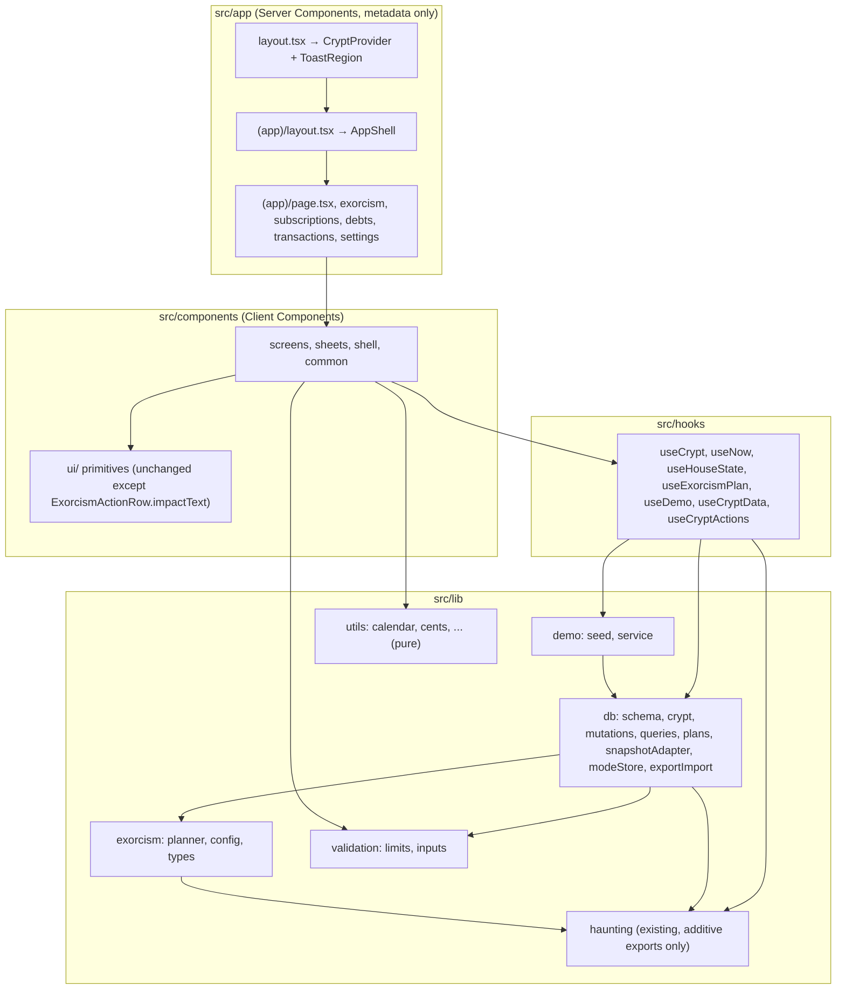
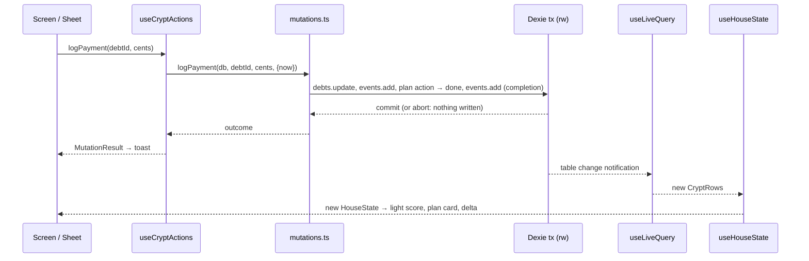

# Design Document — App Screens

## Overview

This feature connects the finished haunting engine (`src/lib/haunting/`) and the finished chrome primitives (`src/components/ui/`) into a working, local-first app. It adds five things, in priority order:

1. **Data layer** (`src/lib/db/`, `src/hooks/`): a versioned Dexie schema, one atomic mutation per user action, and a pure adapter from stored rows to the engine's `FinancialSnapshot`.
2. **Exorcism planner** (`src/lib/exorcism/`): a pure `generateExorcismPlan(houseState, snapshot)` that returns exactly three distinct actions, always including the extra-payment action when one exists. The plan is stored once per Monday-based week.
3. **Demo Crypt** (`src/lib/demo/`): a second Dexie database (`cashcrypt-demo`) with five seed scenarios, a switcher, reset, and a demo-only "Skip to next week".
4. **Screens**: Landing, Dashboard, `/exorcism`, `/subscriptions`, `/debts`, `/transactions`, `/settings`, a navigation shell, and four shared sheets.
5. **Tests**: `fake-indexeddb` data-layer tests, fast-check properties for the pure cores, one component test file per screen, and an axe check on every screen.

The house SVG, GSAP moments, sound and CSV/JSON portability beyond the optional Requirements 32 and 33 are out of scope. The Dashboard shows a labelled placeholder where the scene will go.

### Key design decisions

| # | Decision | Rationale |
|---|---|---|
| D1 | The engine, planner, adapter and validators are pure and take "now" as an argument. Only `getLocalDate()` and the hooks touch the real clock. | Tests control time. The demo moves time forward by changing one stored date. |
| D2 | Every user action is one function in `src/lib/db/mutations.ts` that runs in exactly one `db.transaction("rw", ...)`. Auto-completion of a plan action runs inside the same transaction. | `product.md` data-layer rule: snapshot rows and momentum events must change together or not at all. |
| D3 | Domain row types live in `src/types/finance.ts`; `src/lib/db/schema.ts` only adds the Dexie table typing. Pure validators live in `src/lib/validation/`. | Components may not import `@/lib/db/` (Requirement 1.4, 1.6), yet forms need the same types and rules as the mutations. |
| D4 | Hooks return `MutationResult` values instead of throwing. Typed errors (`validation`, `not-found`, `unknown`) are mapped inside `src/hooks/`. | Components never see Dexie error types and can show field errors without `try/catch`. |
| D5 | The Active_Crypt is chosen by a `localStorage` Mode_Store read through `useSyncExternalStore`. The server snapshot is `"unknown"`, so SSR and the first client render match. | The app is fully client-side data; Next.js `proxy.ts`, `redirect()` on the server and route handlers cannot see `localStorage`. |
| D6 | One live query per Crypt returns all rows (`CryptRows`). `useHouseState` builds the snapshot and calls `computeHouseState` once. No screen computes its own state. | The data volume is small and the House_State needs every table. One query keeps all screens consistent (Requirement 10.8). |
| D7 | The planner forces the `extra_payment` candidate into the output and then re-sorts (Requirement 12.15 to 12.17). A reference-model property checks the selection rule. | Debt must always be addressed; ranking by interest saved alone would starve it. |
| D8 | `ExorcismActionRow` gets an optional `impactText` and ids are namespaced per week. This is an additive change to an existing primitive, not a new primitive. | Zero-amount actions (fallbacks) must not render "+$0.00/mo". The existing tests keep passing because the prop is only relaxed. |
| D9 | Only one `<nav>` is rendered at a time, chosen with `matchMedia("(min-width: 1024px)")`. | Two landmarks with the same role would trip axe `landmark-unique`, and tests can switch layouts with `setViewportWidth`. |

### Research findings

Sources are the Next.js docs shipped in `node_modules/next/dist/docs/01-app/` (this is Next.js 16.4.6, which `AGENTS.md` says differs from older versions).

- **Route groups** (`03-file-conventions/route-groups.md`): `(folder)` names are omitted from the URL. Pages inside one group share its `layout.tsx` without sharing it with `/styleguide`. Navigating between different *root* layouts forces a full reload, so the group uses a nested layout, not a second root layout.
- **Layouts** (`03-file-conventions/layout.md`): layouts do not re-render on navigation, so the current pathname must be read in a Client Component with `usePathname()`. `LayoutProps<"/">` is a global typed helper (the existing root layout already uses it).
- **Redirects** (`04-functions/redirect.md`): `redirect()` works in Client Components only during render, not in event handlers, and `proxy.ts` runs before render on the server. Neither can read `localStorage`. The shell therefore calls `router.replace("/")` from `useRouter()` in an effect (`04-functions/use-router.md`).
- **Cache Components**: `next.config.ts` sets `cacheComponents: true`. Every clock read, `localStorage` read and `indexedDB` open in this design happens in a Client Component after mount (effects, `useSyncExternalStore` client snapshots, event handlers), never while a Server Component renders.
- **Dexie** (dexie.org): `new Dexie(name, { indexedDB, IDBKeyRange })` accepts injected implementations, which is how tests use `fake-indexeddb` without globals. A `&index` makes a unique secondary index, rows where the property is `undefined` are not indexed (so many `debt_payment` events can have no `refKey`), and a primary key is always unique. A `ConstraintError` from a duplicate unique key aborts a read-write transaction. `useLiveQuery(querier, deps, default)` from `dexie-react-hooks` returns `undefined` until the first result.

## Architecture

### Layers and module boundaries



Boundary rules (all enforced by a source-scan test, Requirement 31.10):

- Only files under `src/lib/db/` import `dexie`. `src/lib/demo/service.ts` receives a `CryptDb` and imports it as a type from `@/lib/db`.
- Only files under `src/hooks/` import `dexie-react-hooks`.
- No file under `src/components/` imports from `@/lib/db/` or `@/lib/demo/`. Types they need come from `@/types/finance`; behaviour comes from hooks.
- `src/lib/exorcism/`, `src/lib/validation/`, `src/lib/db/snapshotAdapter.ts` and `src/lib/utils/calendar.ts` import no React, Dexie or Next.js module.
- No GSAP import anywhere in this feature. Framer Motion stays inside `src/components/ui/`; feature components use primitives only.

### Routing and layout

```
src/app/
├── layout.tsx                  # root: fonts, <CryptProvider><ToastRegion>{children}</ToastRegion></CryptProvider>
├── globals.css
├── styleguide/page.tsx         # unchanged, outside the (app) group, no shell
└── (app)/
    ├── layout.tsx              # <AppShell>{children}</AppShell>
    ├── page.tsx                # "/"  → <HomeScreen/> (Landing or Dashboard)
    ├── exorcism/page.tsx       # → <ExorcismScreen/>
    ├── subscriptions/page.tsx  # → <SubscriptionsScreen/>
    ├── debts/page.tsx          # → <DebtsScreen/>
    ├── transactions/page.tsx   # → <TransactionsScreen/>
    └── settings/page.tsx       # → <SettingsScreen/>
```

- The current `src/app/page.tsx` moves to `src/app/(app)/page.tsx` and is replaced. The placeholder `tests/ui/home.page.test.tsx` is replaced by Landing and Dashboard tests (Requirement 29.9).
- Each `page.tsx` is a Server Component that exports `metadata` (a title) and renders one Client Component. Each Screen file starts with `"use client"` because it uses hooks.
- `/` has two faces. `HomeScreen` reads `useCrypt()`: while `status === "loading"` it renders a skeleton, with no Active_Crypt it renders `Landing`, otherwise `Dashboard`.
- `AppShell` has three states:

| `useCrypt().status` | Pathname `/` | Any other pathname |
|---|---|---|
| `loading` (mode unknown, first render) | skeleton, no chrome | skeleton, no chrome |
| `none` | children (Landing), no chrome | `router.replace("/")` in an effect, render the skeleton |
| `demo` or `real` | chrome + children (Dashboard) | chrome + children |

- Chrome: below 1024px a header (wordmark, optional "Demo mode" Chip, Settings link) and a fixed bottom Tab_Bar; from 1024px a Sidebar with all six links. The main column is `max-w-content` (560px) below 1024px and a two-column card grid from 1024px. The content wrapper adds bottom padding equal to the Tab_Bar height plus the safe area (Requirement 19.8).
- Active link: `usePathname()`; `/` matches exactly, other links match by prefix. The active link gets `aria-current="page"`.

### Data flow



### Mode store and Crypt selection

- `src/lib/db/modeStore.ts` exposes `readMode(storage)`, `writeMode(storage, mode)`, `clearMode(storage)` and `subscribeMode(listener)`. Key: `cashcrypt:mode`. Any value other than `"demo"` or `"real"` reads as `null` (Requirement 16.7). It holds no financial data. `subscribeMode` listens to the `storage` event and to a module-level in-tab listener set, so `useSyncExternalStore` sees changes made in the same tab.
- `CryptProvider` (in `src/hooks/useCrypt.tsx`) owns the mode snapshot and the two lazily opened databases. In the browser `getCryptDb(name)` opens a singleton per name. In tests the provider receives `{ openDb, storage, getClock }` props, so no global is replaced.
- If `db.open()` rejects, the provider reports `status: "unavailable"` and screens render the storage-blocked Card (Requirement 10.7).
- `mode === "real"` with no Profile row (for example after a failed clear) is treated as `none`.

### Plan lifecycle

`ensureWeeklyPlan(db, now)` (in `src/lib/db/plans.ts`) is the only place that generates a plan. It runs one `rw` transaction over all tables: read `weeklyPlans.get(weekKey)`; if present return it; otherwise adapt the rows, call `computeHouseState`, call `generateExorcismPlan`, and `add` the row with `startLightScore`. A concurrent second call either waits on the transaction lock and finds the row, or hits the primary-key `ConstraintError`, which the function catches and answers with a fresh `get`. `useExorcismPlan` calls it from an effect when the live query reports no plan for the current week. Mutations never call it (Requirement 8.10); `loadScenario` calls it inside its own transaction (Requirement 17.7).

## Components and Interfaces

### Existing APIs this design relies on

| Existing API | Used for |
|---|---|
| `computeHouseState(snapshot)` and `FinancialSnapshot`, `HouseState`, `Zombie`, `Poltergeist` from `@/lib/haunting` | Light score, zombies, ghosts, Poltergeist |
| `isInWindow(date, now)` from `src/lib/haunting/dates.ts`, `isSmallExpense`, `SMALL_EXPENSE_THRESHOLD_CENTS`, `POLTERGEIST_RATIO`, `WINDOW_DAYS`, `MIN_INCOME_CENTS` | Window query, Ghost chips, thresholds |
| `BalanceHero({label, value, format, showMax, delta})`, `LightScoreBar({score, base, momentum, ...})`, `formatBreakdown`, `formatScoreText` | Dashboard hero and breakdown |
| `BottomSheet({open, onClose, title, children})` | All sheets. Traps focus, closes on Escape, returns focus to the opener if it is still connected |
| `useToast().show({tone, message})`, tones `success | info | warning | danger` (success/info polite, warning/danger assertive) | Every mutation result |
| `SegmentedControl({options, value, onChange, aria-label})`, `Input({label, variant: "text" \| "money", error, hint, fill})`, `Chip({tone, icon})`, `Card({title, action, headingLevel})`, `ListRow({icon, tone, title, subtitle, amount, amountDirection, onClick, divider})`, `QuickAction`, `Button({variant, size, leadingIcon, loading, disabled})`, `ExorcismActionRow({id, title, subtitle, impactText, done, onToggle, disabled})` | All screens |
| `commitMoneyInput(raw)`, `formatCurrencyParts(dollars)` from `src/lib/utils/money.ts` | Money Input text and currency display |
| `animate-shimmer` utility from `globals.css` | Skeletons |
| `tests/ui/helpers/axe.ts` (`expectNoAxeViolations`), `viewport.ts` (`setViewportWidth`), `motion.ts` | UI tests |

### Additive changes to existing code

| File | Change | Why |
|---|---|---|
| `src/lib/haunting/index.ts` | Also export `normalizeSubscription`, `dollarsToCents` and the `SubscriptionInCents` type. No computed output changes; no numeric literal is added. | Requirement 7.2 (cancellation event amount uses the engine's cadence normalization) and the planner's money conversion. `tests/haunting/staticChecks.test.ts` must keep passing. |
| `src/components/ui/ExorcismActionRow.tsx` | `impactText` becomes optional. When omitted, the impact span is not rendered. Add a test in `tests/ui/ExorcismActionRow.test.tsx`. | D8 |
| `src/app/page.tsx` → `src/app/(app)/page.tsx`, `src/app/layout.tsx` | Move and wrap with `CryptProvider`. | Routing |
| `.kiro/steering/structure.md` | Add `src/components/{shell,common,landing,dashboard,sheets,settings,screens}/`, `src/lib/validation/`, `src/hooks/useCrypt.tsx`, `tests/db/`, `tests/demo/`. | Keep the steering layout true. |
| `package.json` | Add `dexie`, `dexie-react-hooks` (dependencies) and `fake-indexeddb` (devDependency). Versions: Dexie 4 line, current `dexie-react-hooks` and `fake-indexeddb` majors at install time. | Requirement 1.1 |

### `src/lib/utils/calendar.ts` (pure)

```ts
export type LocalDate = string; // "YYYY-MM-DD"
export type Clock = () => LocalDate;
export function getLocalDate(date?: Date): LocalDate;       // local Y/M/D of `date` (default: new Date())
export function addDays(date: LocalDate, days: number): LocalDate;      // throws RangeError on bad input
export function getPlanWeekStart(date: LocalDate): LocalDate;           // the Monday on or before `date`
export function getWeekEnd(weekKey: LocalDate): LocalDate;              // weekKey + 6
export function formatWeekRange(weekKey: LocalDate): string;            // "Jun 2 – Jun 8"
```

Implementation: validate with a strict regex plus a real-calendar check, convert with `Date.UTC(y, m - 1, d)`, add `days * MS_PER_DAY`, read back with `getUTCFullYear/Month/Date`. UTC arithmetic avoids daylight-saving shifts. Invalid input throws `RangeError(\`Invalid local date: ${value}\`)`. Day-of-week constants (`MONDAY_INDEX`, `DAYS_PER_WEEK`) are named constants. `getLocalDate` is the only function that reads `Date` fields in local time; `Date` is injectable.

### `src/lib/utils/cents.ts` (pure)

```ts
export function formatCents(cents: number): string;          // 12000 → "$120.00" (en-US grouping, integer math)
export function formatCentsPerMonth(cents: number): string;  // "$120.00/mo"
export function parseMoneyToCents(text: string): number | null; // "300.00" → 30000; "" or invalid → null; no float math
export function centsToMoneyText(cents: number): string;     // 30000 → "300.00" (for Input prefill)
export function aprPercentToFraction(percent: number): number;  // 22 → 0.22
export function aprFractionToPercent(fraction: number): number; // 0.22 → 22 (rounded to 2 decimals)
```

`parseMoneyToCents` takes the committed text from `commitMoneyInput` (`^\d*(\.\d{0,2})?$`) and builds cents from the integer and fraction digit strings, so there is no floating-point rounding.

### `src/lib/validation/` (pure, no imports from db)

```ts
// limits.ts
export const MAX_MONEY_CENTS = 100_000_000;       // $1,000,000, re-exported from src/lib/db/schema.ts
export const MIN_INCOME_CENTS_INPUT = 100;        // equals the engine's MIN_INCOME_CENTS
export const MAX_NAME_LENGTH = 60;

// inputs.ts
export type FieldError = { field: string; message: string };
export type ValidationResult<T> = { ok: true; value: T } | { ok: false; errors: FieldError[] };
export function validateIncome(cents: unknown): ValidationResult<number>;
export function validateDebtInput(input: unknown): ValidationResult<DebtInput>;
export function validateSubscriptionInput(input: unknown): ValidationResult<SubscriptionInput>;
export function validateTransactionInput(input: unknown, now: LocalDate): ValidationResult<TransactionInput>;
export function validatePaymentAmount(cents: unknown, debt: { balanceCents: number }): ValidationResult<number>;
```

Rules: money is a finite integer in `[1, MAX_MONEY_CENTS]` (income: from 100; debt balance and minimum payment may be 0 only where Requirement 24.8 allows it: balance ≥ 0, minimum payment ≥ 0 and present); names are trimmed, non-empty, at most 60 characters; APR is a finite number in `[0, 1]`; a transaction date must be a real date not later than `now`; a payment must be ≤ the balance and the message states the balance ("The balance is $1,800.00."). The same validators back the form fields and the mutations, so a form and a mutation can never disagree.

### `src/lib/db/` (Data_Layer)

| File | Contents |
|---|---|
| `schema.ts` | `CRYPT_DB_NAME`, `DEMO_DB_NAME`, Dexie store definitions, `CryptDb` class type, re-export of `MAX_MONEY_CENTS` |
| `crypt.ts` | `openCrypt(name, opts?: { indexedDB; IDBKeyRange })`, `getCryptDb(name)` (lazy singleton, browser only), `assertDemoDb(db)`, `assertRealDb(db)` |
| `errors.ts` | `DbValidationError`, `DbNotFoundError` (both carry `FieldError[]` / the missing id) |
| `modeStore.ts` | Mode_Store helpers (see Architecture) |
| `snapshotAdapter.ts` | `toFinancialSnapshot(rows: CryptRows, now): FinancialSnapshot` (pure) |
| `queries.ts` | `readAllRows(db)` (a missing profile gives `profile: null`, never a throw), `getTransactionsInWindow(db, now)`, `getPlan(db, weekKey)` |
| `mutations.ts` | All mutations (below) |
| `plans.ts` | `ensureWeeklyPlan(db, now, newId?)` |
| `exportImport.ts` | Optional (Requirement 33): `serializeExport`, `parseExport`, `exportRows`, `replaceAllRows` |
| `csv.ts` | Optional (Requirement 32): `parseTransactionsCsv`, `serializeTransactionsCsv`, `importTransactions` |

```ts
export type MutationContext = { now: LocalDate; newId?: () => string }; // default newId: crypto.randomUUID

export function setMonthlyIncome(db: CryptDb, cents: number): Promise<void>; // no ctx: writes no Event and creates no id
export function addDebt(db: CryptDb, input: DebtInput, ctx: MutationContext): Promise<DebtRow>;
export function editDebt(db: CryptDb, id: string, input: DebtInput): Promise<DebtRow>;
export function addSubscription(db: CryptDb, input: SubscriptionInput, ctx: MutationContext): Promise<SubscriptionRow>;
export function editSubscription(db: CryptDb, id: string, input: SubscriptionInput): Promise<SubscriptionRow>;
export function addTransaction(db: CryptDb, input: TransactionInput, ctx: MutationContext): Promise<TransactionRow>;
export function logPayment(db: CryptDb, debtId: string, amountCents: number, ctx: MutationContext): Promise<LogPaymentOutcome>;
export function cancelSubscription(db: CryptDb, id: string, ctx: MutationContext): Promise<CancelOutcome>;
export function reactivateSubscription(db: CryptDb, id: string): Promise<SubscriptionRow>;
export function completePlanAction(db: CryptDb, weekKey: LocalDate, actionId: string, ctx: MutationContext): Promise<void>;
export function uncompletePlanAction(db: CryptDb, weekKey: LocalDate, actionId: string): Promise<void>;
export function clearAllData(db: CryptDb): Promise<void>; // real db only

export type LogPaymentOutcome = { debt: DebtRow; extraPrincipalCents: number; completedActionId: string | null };
export type CancelOutcome =
  | { changed: false }
  | { changed: true; monthlySavedCents: number; completedActionId: string | null };
```

Common shape of each mutation: validate with `src/lib/validation` first (no transaction opened on invalid input), then `db.transaction("rw", [...tables], async () => { ... })`. The table list always includes `events` and, for `logPayment`, `cancelSubscription` and `completePlanAction`, `weeklyPlans` (Requirement 5.1).

- **`logPayment`**: `debts.get` (not-found if missing); reject when balance is 0 or `amountCents > balance`; `debts.update(balanceCents - amount)`; `extra = max(0, amount - minimumPaymentCents)`; `events.add({ type: "debt_payment", date: now, extraPrincipalCents: extra })`; if `extra > 0` call `autoCompletePlanAction(db, "extra_payment", debtId, ctx)`.
- **`cancelSubscription`**: `subscriptions.get`; if `!active` return `{ changed: false }` without writing; `monthly = normalizeSubscription({...}).monthlyCostCents`; `update({ active: false, canceledOn: now })`; `events.add` with `refKey: "cancel:" + id` only when no event with that key exists (checked with `events.where("refKey").equals(key).first()`, backed by the unique index); then `autoCompletePlanAction(db, "cancel_subscription", id, ctx)`.
- **`completePlanAction`**: read the plan row for `weekKey`, find the action (not-found otherwise); set `done: true` and `completedOn: now` unless already done; `events.add({ type: "exorcism_action_completed", date: now, refKey: "plan:" + weekKey + ":" + actionId })` only when no such event exists. Changes no debt, subscription or transaction row (Requirement 8.5).
- **`uncompletePlanAction`**: sets `done: false`, keeps `completedOn` and the event.
- **`autoCompletePlanAction(db, kind, targetId, ctx)`** (internal, same transaction): takes the caller's `MutationContext`, not just `now`, because the completion Event needs `ctx.newId`. `plan = weeklyPlans.get(getPlanWeekStart(ctx.now))`; if no plan, or no action with that `kind` and `targetId`, return `null` and write nothing; otherwise run the same body as `completePlanAction`. It never generates a plan (Requirement 8.10). Any throw propagates and aborts the whole transaction (Requirement 8.11).
- **`clearAllData`**: `assertRealDb(db)`, then `db.transaction("rw", allTables, () => Promise.all(tables.map(t => t.clear())))`.

### `src/lib/exorcism/` (Planner, pure)

```ts
// types.ts
export type ExorcismActionKind = "cancel_subscription" | "extra_payment" | "reduce_small_expenses" | "fallback";
export type ExorcismAction = {
  id: string;                       // cancel:<subId> | pay:<debtId> | reduce:<category> | fallback:<key>
  kind: ExorcismActionKind;
  title: string;
  subtitle: string;
  targetId?: string;                // subscription id, debt id or category name
  suggestedAmountCents?: number;    // extra_payment only
  monthlyAmountCents: number;
  priorityCents: number;
  done: boolean;
};
// index.ts
export function generateExorcismPlan(houseState: HouseState, snapshot: FinancialSnapshot): ExorcismAction[];
```

```ts
// config.ts (every number and fallback key lives here)
export const PLAN_SIZE = 3;
export const USAGE_WEIGHTS = { never: 1.0, rarely: 0.6, often: 0.2 } as const;
export const EXTRA_PAYMENT_INCOME_BASIS_POINTS = 1000;   // 10%
export const EMERGENCY_FUND_INCOME_BASIS_POINTS = 500;   // 5%
export const BASIS_POINTS_DENOMINATOR = 10000;
export const MONTHS_PER_YEAR_FOR_INTEREST = 12;
export const FLOAT_NOISE_EPSILON = 1e-9;
export const FALLBACK_KEYS = ["emergency-fund", "review-small-expenses", "review-subscriptions"] as const;
```

Algorithm (all money in integer cents; the snapshot's dollar fields go through the exported `dollarsToCents`; zombies already carry cents):

1. **Sanitize**: any non-finite or negative number becomes 0; non-array fields become `[]`; this makes Requirement 11.8 hold by construction.
2. **Cancellation candidates**: one per `houseState.zombies` entry (the engine already limits zombies to valid, active subscriptions). `priorityCents = Math.round(monthlyCost * USAGE_WEIGHTS[usage])`, `monthlyAmountCents = monthlyCost`, `id = "cancel:" + subscriptionId`, title `Cancel ${name} — saves ${formatCents(monthlyCost)}/mo`, subtitle "Open Subscriptions to cancel it".
3. **Extra-payment candidate**: among snapshot debts with balance > 0 pick the highest `apr`, ties by larger balance, then `debtId` ascending. `suggested = min(balanceCents, floor(incomeCents * 1000 / (10000 * 100)) * 100)`. The floor uses an exact integer product, so `$3,000` gives exactly `$300.00`. If `suggested === 0` there is no candidate. `priorityCents = monthlyAmountCents = Math.round(suggested * apr / 12)` (`30000 × 0.22 / 12 = 550`). Title `Pay ${formatCents(suggested)} extra on ${name} — saves ${formatCents(interest)}/mo in interest`; `id = "pay:" + debtId`, subtitle "Open Debts to log the payment".
4. **Poltergeist candidate**: only when `houseState.poltergeist` exists. Pick the category with the largest finite positive value in `byCategory` (ties by code-point-smallest name). `excessCents = ceil((totalAmount - POLTERGEIST_RATIO * incomeCents) / 100 - FLOAT_NOISE_EPSILON) * 100`; the epsilon keeps `0.1 × 300000` float noise from adding a whole dollar. No candidate when there is no valid category or `excessCents <= 0`. `id = "reduce:" + category`, title `Cut ${category} by $${excessCents / 100} this month to dispel the Poltergeist`, subtitle "Open Transactions to review it. Tick it when you are done.", `priorityCents = monthlyAmountCents = excessCents`.
5. **Fallbacks**: three, in `FALLBACK_KEYS` order, ids `fallback:<key>`, `priorityCents = monthlyAmountCents = 0`. Exact texts:

   | Id | Title | Subtitle |
   |---|---|---|
   | `fallback:emergency-fund` | `Set aside ${amount} for an emergency fund`, where `amount` is 5% of income floored to whole dollars, formatted with `formatCents` and the cents dropped (`$3,000` income → "Set aside $150 for an emergency fund"). When that amount is 0: "Set aside a small amount for an emergency fund" | "Move it to savings, then mark it done" (there is no savings screen, so it points to no screen) |
   | `fallback:review-small-expenses` | "Review last week's small expenses" | "Open Transactions to review it" |
   | `fallback:review-subscriptions` | "Review your subscription list" | "Open Subscriptions to review it" |

   Their ids happen to sort in the fixed order (`emergency-fund` < `review-small-expenses` < `review-subscriptions`), and a unit test pins this.
6. **Ranking comparator**: `priorityCents` descending; then real candidates before fallbacks; then `id` ascending by Unicode code point (not `localeCompare`, and not the UTF-16 order of `a < b`, which puts an astral character such as "😀" before "～"). The same comparison breaks Poltergeist category ties and debt ties.
7. **Selection** over `ranking = sort(candidates ∪ fallbacks)`: if no `extra_payment` exists, `ranking.slice(0, 3)`. If it exists and is within the first three of `ranking`, return those three. Otherwise return `[first two non-extra items of ranking, extra]` with no re-sort: since `extra` is outside the first three, those two items are `ranking[0]` and `ranking[1]`, already in order and both ranked above `extra`. Because three fallbacks always exist, `ranking` always has at least three non-extra items, so the output always has exactly three.

The planner imports only `@/lib/haunting` (types, `dollarsToCents`, `POLTERGEIST_RATIO`) and `@/lib/utils/cents` for text. It never reads the clock and never mutates its inputs (it builds new objects).

### Pure view-model helpers (`src/lib/utils/`)

Small pure functions keep screens thin and give the property tests something to hold on to.

| File | Exports |
|---|---|
| `planView.ts` | `summarizePlan(actions): { doneCount; total; freedCents; possibleCents; allDone }`, `getDoItTarget(action, rows): DoItTarget \| null`, `getPaymentPrefill(debt, action?): number`, `getExtraAboveMinimum(amountCents, minimumCents): number`, `getActionImpactText(action): string \| undefined`, `getToastForCompletion(action): string` |
| `scoreView.ts` | `getScoreDelta(currentScore, startScore): { direction; intent; text } \| null` (null when the floored values are equal), `getLevelLabel(level): string` ("Level 4 — Crumbling"), `getLevelAnnouncement(level, score): string` |
| `listViews.ts` | `sortSubscriptionsByMonthlyCost`, `sortDebtsByBalance`, `toTransactionRows(rows, now, income)` (window filter, newest first, ghost flag using `isSmallExpense`), `getSmallExpenseSummary(...)` |

`DoItTarget` is `{ kind: "cancel"; subscriptionId } | { kind: "pay"; debtId; prefillCents }`. `getDoItTarget` returns `null` for `fallback` and `reduce_small_expenses` actions, for done actions, and for targets that no longer qualify (inactive subscription, balance 0).

### Hooks (`src/hooks/`, all `"use client"`)

| Hook | Returns | Notes |
|---|---|---|
| `useCrypt()` (in `useCrypt.tsx`, with `CryptProvider`) | `{ status: "loading" \| "none" \| "demo" \| "real" \| "unavailable"; db: CryptDb \| null; hasRealProfile: boolean \| null; setMode(mode): void; clearMode(): void }` | `hasRealProfile` comes from a read-only live query on the Real_Crypt (used by Landing and Settings). |
| `useNow()` | `LocalDate \| null` | Demo: the Profile's `demoNow`. Real: `getLocalDate()`, refreshed on `visibilitychange` and `focus`. `null` until known. |
| `useCryptData()` | `{ status: "loading" \| "ready"; rows: CryptRows \| null }` | One `useLiveQuery` over every table: `{ profile, debts, subscriptions, transactions, events, plans }`. |
| `useHouseState()` | `{ status; houseState: HouseState \| null; snapshot: FinancialSnapshot \| null; rows; now }` | `useMemo` over `toFinancialSnapshot` and `computeHouseState`. Only source of a House_State for screens. |
| `useExorcismPlan()` | `{ status; plan: StoredWeeklyPlan \| null; weekKey; toggleAction(actionId, next): Promise<MutationResult<void>> }` | Calls `ensureWeeklyPlan` from an effect when no plan exists for the week. |
| `useCryptActions()` | Bound, result-returning actions: `setIncome`, `addDebt`, `editDebt`, `addSubscription`, `editSubscription`, `addTransaction`, `logPayment`, `cancelSubscription`, `reactivateSubscription`, `clearAll`, plus optional `importCsv`, `exportData`, `importData` | Each wraps the mutation with the current `db` and `now`, and maps thrown errors to `MutationResult`. |
| `useDemo()` | `{ scenarioId; demoNow; loadScenario(id); reset(); skipWeek(); enterDemo(): Promise<void> }` | `enterDemo` sets the mode, seeds `level-4` if the Demo_Crypt has no Profile, then the caller navigates to `/`. |

```ts
export type MutationError =
  | { kind: "validation"; errors: { field: string; message: string }[] }
  | { kind: "not-found"; message: string }
  | { kind: "unknown"; message: string };
export type MutationResult<T> = { ok: true; value: T } | { ok: false; error: MutationError };
```

### Demo service (`src/lib/demo/`)

```ts
export type ScenarioId = "level-1" | "level-2" | "level-3" | "level-4" | "level-5";
export type SeedData = Omit<CryptRows, "plans"> & { profile: ProfileRow };
export function buildScenario(id: ScenarioId, demoNow: LocalDate): SeedData; // pure, deterministic ids

export function loadScenario(db: CryptDb, id: ScenarioId, demoNow: LocalDate): Promise<void>;
export function skipWeek(db: CryptDb): Promise<LocalDate>;     // demoNow + 7
export function resetDemo(db: CryptDb, today: LocalDate): Promise<void>; // reload current scenario
```

- Every function starts with `assertDemoDb(db)`; passing the Real_Crypt rejects before any write (Requirement 18.8).
- `loadScenario` runs one `rw` transaction: clear every table, bulk-add the seed, store `{ demoNow, scenarioId }` in the Profile, then run the `ensureWeeklyPlan` body (generated with `now = demoNow`).
- Seed ids are deterministic (`demo:<scenario>:debt:<slug>`, `demo:<scenario>:tx:<index>`). Transaction dates are `addDays(demoNow, -offset)`.
- Persona numbers come from the haunting-engine Calibration Table: income and debts as in the table, so empty-event scores are 87.22, 62.74, 42.74, 32.74 and 17.07. `level-4` is fixed by Requirement 17.3 and 17.4.
- Small expenses per scenario (all amounts below `SMALL_EXPENSE_THRESHOLD_CENTS`, so each is a Ghost):

| Scenario | Transactions | Poltergeist? |
|---|---|---|
| `level-1` | 3: Coffee $4.50, Snack $6.00, Bus fare $3.25 (categories Coffee, Food, Transport) | No (total $13.75 < $500) |
| `level-2` | 4: Coffee $4.50 ×2, Snack $6.00, Bus fare $3.25 | No (< $400) |
| `level-3` | 5 mixed Coffee, Snack, Bus fare, each ≤ $9 | No (< $350) |
| `level-4` | 30 × Coffee $12.00, `addDays(demoNow, -(i % 23))` | Yes ($360 > $300), still active after Skip_Week |
| `level-5` | 30 rows: Coffee, Snack, Bus fare, Lunch, Vending machine, 6 × $10.00 each | Yes ($300 > $250) |

### Screens and shared components

All files are Client Components unless noted. Folders follow `structure.md` and add `shell/`, `common/`, `landing/`, `dashboard/`, `sheets/`, `settings/`, `screens/`.

| Component | Built from | Behaviour |
|---|---|---|
| `shell/AppShell` | `NavLink`, `TabBar`, `Sidebar`, `DemoChip` | States in the routing table. One `<nav aria-label="Main">`. Links ≥ 44×44px, Lucide icons 20px stroke 2 with text labels. |
| `common/PageHeader` | native `h1` (display scale), optional actions | Exactly one `h1` per screen. |
| `common/Skeleton` | native div with `animate-shimmer` | Wrapped in a region with `aria-busy="true"`. Not a primitive; lives outside `ui/`. |
| `common/EmptyState` | native text + optional `Button` | One line, one next action. |
| `common/StorageBlockedCard` | `Card`, link | Text from Requirement 10.7. |
| `landing/Landing` | native `main`, `h1` (wordmark font), `Button` ×2, `OnboardingSheet`, link `/styleguide` | One primary Button ("Enter the demo crypt"). "Continue to my crypt" replaces "Start my own crypt" semantics when `hasRealProfile` is true (the latter stays as secondary). |
| `sheets/OnboardingSheet` | `BottomSheet`, money `Input`, primary `Button` | Validates with `validateIncome`; keeps the sheet open and sets `Input.error` on failure. Also used by Settings. |
| `dashboard/Dashboard` | `BalanceHero`, `LightScoreBar`, `QuickAction`×4, `ExorcismPlan` (card variant), `PoltergeistBanner`, `ScenePlaceholder`, `DemoControls`, visually hidden live region | Delta from `getScoreDelta(lightScore, plan.startLightScore)`. |
| `dashboard/PoltergeistBanner` | `Card`, `Chip` (icon + text) | "A Poltergeist is haunting you: $X in small expenses in 30 days". |
| `dashboard/ScenePlaceholder` | native region | Visible text "House scene arrives in the next update" and `getLevelLabel(level)`. |
| `exorcism/ExorcismPlan` | `ExorcismPlanAction`, `LogPaymentSheet`, `CancelSubscriptionSheet`, skeleton | `variant="card"` (Dashboard) or `"page"`. Owns the Do it sheets so both screens behave the same. After a Do it sheet closes and the Do it button is gone, focus moves to that row's checkbox. |
| `exorcism/ExorcismPlanAction` | `ExorcismActionRow`, secondary `Button` | Row id `plan-<weekKey>-<actionId>`. Do it button name `Do it: <title>`, placed under the row. `disabled` while its mutation runs. |
| `screens/ExorcismScreen` | `PageHeader`, `ExorcismPlan`, progress and "Money freed" text, completion message | Uses `summarizePlan`. |
| `screens/SubscriptionsScreen` | `ListRow`, `Chip`, `Card`, `SegmentedControl`, `Input`, `BottomSheet`, `Button` | Add sheet, details sheet, `CancelSubscriptionSheet`, Graveyard Card with "Bring it back". |
| `screens/DebtsScreen` | `ListRow`, `Chip`, `Card`, `Input`, `BottomSheet`, `Button` | Add/Edit debt form (APR as percent via `aprPercentToFraction`), "Log payment" opens `LogPaymentSheet`. |
| `screens/TransactionsScreen` | `ListRow`, `Chip` ("Ghost" with icon), `Card`, `AddExpenseSheet` | Summary Card, empty state. |
| `screens/SettingsScreen` | `Input`, `Button`, `SegmentedControl`, `BottomSheet`, `DemoControls` | Income, Crypt switcher, optional export/import, Clear all data (real only). |
| `demo/DemoControls` | `Card`, `SegmentedControl` (Level 1–5), `Button` ×2, polite live region | Rendered only while the Demo_Crypt is active. |
| `sheets/LogPaymentSheet` | `BottomSheet`, `ListRow` picker, money `Input`, primary `Button` | Props: `debts`, `initialDebtId?`, `prefillCents?`. Skips the picker when a debt is given. |
| `sheets/CancelSubscriptionSheet` | `BottomSheet`, "Keep it" and danger buttons | States "Cancel Wraithcast — saves $120.00/mo". |
| `sheets/AddExpenseSheet` | `BottomSheet`, money `Input`, text `Input`, category `SegmentedControl` | Dates with `now`; toast "Ghost added: $X" below the threshold. |

Each Screen renders exactly one `h1` and sits inside the shell's `<main>`. Landing renders its own `<main>` because it has no shell. Each Screen keeps at most one primary Button and at most one `hero`-scale number. Mutation toasts use `success` for savings and payments and `danger` for failures.

Classes passed to primitives are layout-only (`ml-14`, `w-full`, `mt-4`, `lg:col-span-2`) so the existing className scan passes. Visual styling of native elements uses design-token utilities only; there are no color literals.

## Data Models

### Row types (`src/types/finance.ts`)

**Profile key rule:** every profile write must use `id: PROFILE_ID` from `src/lib/db/schema.ts` (type `ProfileRecord`), the single-row key of the `profile` table.

```ts
export type LocalDate = string;                // "YYYY-MM-DD"
export type Cadence = "weekly" | "monthly" | "yearly";
export type Usage = "often" | "rarely" | "never";

export type ProfileRow = {
  monthlyIncomeCents: number;
  demoNow?: LocalDate;                         // Demo_Crypt only
  scenarioId?: ScenarioId;                     // Demo_Crypt only
};
// Stored in the `profile` table as ProfileRecord = ProfileRow & { id: typeof PROFILE_ID } (src/lib/db/schema.ts); single row.
export type DebtRow = {
  id: string; name: string;
  balanceCents: number;                        // ≥ 0
  apr: number;                                 // fraction 0..1
  minimumPaymentCents: number;
};
export type SubscriptionRow = {
  id: string; name: string;
  amountCents: number;                         // per cadence period
  cadence: Cadence; usage: Usage;
  active: boolean;
  canceledOn?: LocalDate;
};
export type TransactionRow = {
  id: string; amountCents: number;
  description: string; category: string; date: LocalDate;
};
export type EventRow = {
  id: string;
  type: "debt_payment" | "subscription_canceled" | "exorcism_action_completed";
  date: LocalDate;
  amountCents?: number;                        // subscription_canceled: normalized monthly cost
  extraPrincipalCents?: number;                // debt_payment
  refKey?: string;                             // "cancel:<subId>" | "plan:<weekKey>:<actionId>"
};
export type StoredPlanAction = ExorcismAction & { completedOn?: LocalDate };
export type WeeklyPlanRow = {
  weekKey: LocalDate;                          // primary key, a Monday
  actions: StoredPlanAction[];                 // exactly 3, stored order
  startLightScore: number;
  generatedOn: LocalDate;
};
export type CryptRows = {
  profile: ProfileRow | null; // null when no profile row exists; the adapter maps it to income 0 (Requirement 4.8)
  debts: DebtRow[]; subscriptions: SubscriptionRow[]; transactions: TransactionRow[];
  events: EventRow[]; plans: WeeklyPlanRow[];
};
export type DebtInput = { name: string; balanceCents: number; apr: number; minimumPaymentCents: number };
export type SubscriptionInput = { name: string; amountCents: number; cadence: Cadence; usage: Usage };
export type TransactionInput = { amountCents: number; description: string; category: string; date?: LocalDate };
```

`SubscriptionInput` has no `active`: `addSubscription` stores `active: true` and `editSubscription` never changes it, so a cancellation always goes through `cancelSubscription` and creates its event.

### Dexie schema (version 1)

```ts
db.version(1).stores({
  profile: "id",
  debts: "id, name",
  subscriptions: "id, active",
  transactions: "id, date",
  events: "id, date, &refKey, type",
  weeklyPlans: "weekKey",
});
```

- Tables are plural camelCase: `profile` is the single exception because it holds exactly one row, as written in Requirement 2.1.
- `weeklyPlans` uses `weekKey` as its primary key, which is unique: at most one plan per Plan_Week (Requirement 2.3).
- `events.refKey` is a unique index. Rows without `refKey` (`debt_payment`) are not indexed, so many are allowed; two `plan:<weekKey>:<actionId>` events or two `cancel:<subId>` events cannot be stored (Requirement 2.4).
- All money fields are integer cents and all date fields are `YYYY-MM-DD` strings.

### Snapshot adapter

`toFinancialSnapshot(rows, now)` maps rows to the engine input without mutation: `monthlyIncome = (profile?.monthlyIncomeCents ?? 0) / 100`; each debt to `{ debtId, name, balance: cents / 100, minimumMonthlyPayment: cents / 100, apr }`; each subscription to `{ subscriptionId, name, amount: cents / 100, cadence, usage, active }` (inactive included); each transaction to `{ transactionId, amount: cents / 100, description, category, date }`; events pass through as `{ type, date, amountCents, extraPrincipalCents }`; `now` is copied. Dividing an integer up to `MAX_MONEY_CENTS` by 100 and applying the engine's `Math.round(x * 100)` recovers the same integer, which Property 4 checks.

### Stored plan and week model

The plan is stored once, so ticking does not reshuffle the list. `startLightScore` is the light score when the plan was generated; the Dashboard delta compares the current floored score with the floored `startLightScore`. A new Monday gives a new `weekKey`; older rows stay.

### Demo Crypt isolation

The two databases share no connection. Every hook receives the `db` of the Active_Crypt only. The service functions assert the database name. Opening the Real_Crypt for `hasRealProfile` is read-only and does not write rows.

### Optional formats

- **CSV** (Requirement 32): header `date,description,category,amount`; `amount` is dollars with two decimals; fields containing `,`, `"` or a newline are quoted and `"` is doubled. `CsvTransaction = { date; description; category; amountCents }`. `parseTransactionsCsv` returns `{ ok: true; rows } | { ok: false; errors: { line; message }[] }` and imports nothing if any row fails. Ids are generated on import; the round trip is over `CsvTransaction`, which has no id.
- **Export file** (Requirement 33): `{ app: "cashcrypt", version: 1, exportedAt, profile, debts, subscriptions, transactions, events, weeklyPlans }`. `parseExport` validates the envelope, every row's fields, integer non-negative cents, real dates and unique ids per table, and returns the first problem as a message. Import replaces all Real_Crypt rows in one transaction after confirmation.


## Correctness Properties

*A property is a characteristic or behavior that should hold true across all valid executions of a system-essentially, a formal statement about what the system should do. Properties serve as the bridge between human-readable specifications and machine-verifiable correctness guarantees.*

Properties 1 to 3 cover the calendar, 4 and 5 the snapshot adapter, 6 to 14 the mutations and plan service, 15 to 22 the planner, 23 to 28 the pure view helpers, 29 to 32 the Demo Crypt and mode store, and 33 and 34 the optional CSV and export features. Data-layer properties run against `fake-indexeddb` with a unique database name per run; each uses `{ numRuns: 100 }` or more (database-backed properties use 100 and keep the generated row counts small). Generators are built inline in the test files, reusing the component arbitraries of `src/lib/haunting/testArbitraries.ts` for debts, subscriptions and events where they fit.

### Property 1: Day arithmetic round trip

*For any* valid Local_Date `d` and any integer offset `n` within ±100,000 days, `addDays(addDays(d, n), -n)` equals `d`, and `addDays(d, n)` is again a valid Local_Date.

**Validates: Requirements 3.3, 3.4**

### Property 2: Plan week start is the Monday on or before the date

*For any* valid Local_Date `d`, `getPlanWeekStart(d)` is a Monday, is not later than `d`, is at most 6 days before `d`, and `getPlanWeekStart(getPlanWeekStart(d))` equals `getPlanWeekStart(d)`.

**Validates: Requirements 3.3, 3.5**

### Property 3: Invalid dates are rejected with the offending value

*For any* string that is not a real `YYYY-MM-DD` calendar date (wrong shape, month 13, February 30, non-leap February 29, empty), `addDays` and `getPlanWeekStart` throw a `RangeError` whose message contains that string.

**Validates: Requirements 3.6**

### Property 4: Cents survive the dollars boundary

*For any* Crypt rows with every money value an integer in `[0, MAX_MONEY_CENTS]`, `Math.round(adapted.amount * 100)` equals the stored Cents for each debt balance, minimum payment, subscription amount, transaction amount and the monthly income.

**Validates: Requirements 4.2, 4.7**

### Property 5: The snapshot adapter preserves structure and purity

*For any* Crypt rows (including an absent Profile, inactive subscriptions and debts with balance 0) and any Local_Date `now`, `toFinancialSnapshot(rows, now)` has `snapshot.now === now`, the same number of debts, subscriptions, transactions and events in the same order, keeps inactive subscriptions with `active: false` and zero-balance debts with `balance: 0`, passes each event's `type`, `date`, `amountCents` and `extraPrincipalCents` through unchanged, uses income 0 when the Profile is absent, returns a new object, and leaves a deep clone of the input equal to the input.

**Validates: Requirements 4.1, 4.3, 4.4, 4.5, 4.6, 4.8**

### Property 6: Invalid mutation input is rejected and writes nothing

*For any* Crypt and any mutation call whose input is invalid (a money amount that is not a finite integer in range, an income below 100 Cents, a name empty after trimming or longer than 60 characters, an APR outside `[0, 1]`, a transaction dated after `now`, a payment above the balance or on a paid-off debt, or an id that does not exist), the mutation rejects with a validation or not-found error and every table is deeply equal to its state before the call.

**Validates: Requirements 4.9, 5.3, 5.4, 5.7, 5.8, 6.4, 6.5, 8.4, 9.1, 9.2, 9.5, 9.6**

### Property 7: Logging a payment moves exactly the right rows

*For any* Crypt, any Debt with balance above 0 and any payment `p` with `1 ≤ p ≤ balance`, `logPayment` leaves `balanceAfter + p = balanceBefore`, creates exactly one `debt_payment` Event dated `now` whose `extraPrincipalCents` equals `max(0, p - minimumPayment)`, and changes no other Debt, Subscription or Transaction row.

**Validates: Requirements 6.1, 6.2, 6.3, 6.7**

### Property 8: A payment never lowers the light score

*For any* valid Crypt, Debt and payment amount, the light score from `computeHouseState(toFinancialSnapshot(rows, now))` after `logPayment` is greater than or equal to the score before it.

**Validates: Requirements 6.6**

### Property 9: Canceling a subscription changes only that subscription and records one event

*For any* Crypt and any active valid Subscription, `cancelSubscription` sets `active` to `false` and `canceledOn` to `now`, keeps every other field of that row, creates exactly one `subscription_canceled` Event with `refKey` `cancel:<id>` and `amountCents` equal to the engine's normalized monthly cost, and leaves every other row unchanged apart from the matching plan action and its completion event (Property 13).

**Validates: Requirements 7.1, 7.2, 7.3, 7.7**

### Property 10: Cancel and reactivate sequences never farm momentum

*For any* Subscription and any non-empty sequence of `cancelSubscription` and `reactivateSubscription` calls, the number of `subscription_canceled` Events for that Subscription is 0 if it was never canceled and 1 otherwise; canceling an already inactive Subscription writes nothing; reactivation sets `active` to `true`, clears `canceledOn` and creates no Event.

**Validates: Requirements 7.4, 7.5, 7.6, 7.7**

### Property 11: Canceling a subscription strictly raises the score

*For any* valid Crypt with monthly income above 0 and a light score strictly between 0 and 100, canceling an active valid Subscription gives a strictly higher light score.

**Validates: Requirements 7.8**

### Property 12: Plan actions complete at most once

*For any* stored Weekly_Plan and any sequence of `completePlanAction`, `uncompletePlanAction`, `logPayment` and `cancelSubscription` calls within that Plan_Week, each Plan_Action has 0 `exorcism_action_completed` Events if it was never completed (by ticking or by Auto_Completion) and exactly 1 otherwise, all with reference key `plan:<weekKey>:<actionId>`; ticking alone changes no Debt, Subscription or Transaction row; unticking sets `done` to `false` and keeps the Event.

**Validates: Requirements 8.1, 8.2, 8.3, 8.5, 8.6, 8.7, 8.13**

### Property 13: Auto-completion happens together with the change, or not at all

*For any* Crypt, any week plan state and any `logPayment` or `cancelSubscription` call: when the plan row for `getPlanWeekStart(now)` exists and holds a not-yet-completed action of the matching kind with that target, and the call creates extra principal above 0 (payment) or changes an active Subscription (cancel), then the action is `done` with `completedOn` equal to `now` and one completion Event exists, all in the same transaction. In every other case (no plan for the week, a plan of another week, no matching action, extra principal 0, an already inactive Subscription) `weeklyPlans` is unchanged, no plan is generated, and an already done action keeps its `completedOn` and gets no second Event. When the completion write fails, the debt or subscription change and its Event are rolled back too.

**Validates: Requirements 6.8, 7.9, 8.8, 8.9, 8.10, 8.11, 8.12**

### Property 14: The 30-day transaction query matches the engine window

*For any* set of transactions and any `now`, `getTransactionsInWindow(db, now)` returns exactly the transactions for which `isInWindow(date, now)` is true, sorted by date descending and then by id ascending.

**Validates: Requirements 9.7**

### Property 15: The plan always has three distinct, sorted, pending actions

*For any* valid House_State and snapshot, `generateExorcismPlan` returns exactly three Plan_Actions with pairwise distinct ids, `done` equal to `false`, ordered by `priorityCents` non-increasing, ties broken by real candidates before fallbacks and then by `id` ascending in code-point order, including when the `extra_payment` action was forced in below the top three by priority.

**Validates: Requirements 11.1, 11.2, 11.3, 11.6, 13.5, 13.7, 15.2, 15.3, 15.5, 15.12**

### Property 16: The planner is deterministic and pure

*For any* valid House_State and snapshot, two calls return deeply equal output, and a deep clone of each input is still deeply equal to the input afterwards.

**Validates: Requirements 11.4, 11.5, 15.4, 15.7**

### Property 17: The planner tolerates hostile input

*For any* House_State and snapshot containing `NaN`, `Infinity`, negative numbers, empty arrays or missing optional values, `generateExorcismPlan` does not throw and returns exactly three Plan_Actions whose numeric fields are finite, non-negative integers.

**Validates: Requirements 11.8, 15.7**

### Property 18: Cancellation and debt targets are real and scored by the formula

*For any* valid House_State and snapshot, every `cancel_subscription` action targets a subscription that is in `houseState.zombies` (so valid and active) with `priorityCents` equal to `Math.round(monthlyCost × usageWeight)` and `monthlyAmountCents` equal to `monthlyCost`; no action targets an inactive subscription; no `extra_payment` action targets a Debt with balance 0; and every `extra_payment` has `priorityCents` and `monthlyAmountCents` equal to `Math.round(suggestedAmountCents × apr / 12)`.

**Validates: Requirements 12.1, 12.2, 12.3, 12.6, 12.7, 15.6**

### Property 19: Debt is always addressed with the right payment

*For any* valid House_State and snapshot, the output contains exactly one `extra_payment` action when some Debt has balance above 0 and the suggested amount is above 0 Cents, and none otherwise. When present, it targets the Debt with the highest APR among those with balance above 0 (ties: larger balance, then `debtId` ascending), and `suggestedAmountCents` equals `min(balance, floor(10% of monthly income to whole dollars))`.

**Validates: Requirements 12.4, 12.5, 12.15, 15.11**

### Property 20: The Poltergeist action is precise and optional

*For any* valid House_State and snapshot, the output contains no `reduce_small_expenses` action when the House_State has no Poltergeist, when `byCategory` has no finite value above 0, or when the Poltergeist_Excess is 0; otherwise it contains at most one, with `id` `reduce:<category>` for the category with the largest `byCategory` value (ties: smallest name in code-point order), and with `priorityCents` equal to `monthlyAmountCents` equal to the Poltergeist_Excess, a multiple of 100.

**Validates: Requirements 12.10, 12.11, 12.12, 12.13, 15.8**

### Property 21: Selection matches the reference rule

*For any* valid House_State and snapshot, the planner output equals a reference implementation written directly from Requirement 12 criteria 16 and 17: rank all candidates and fallbacks; with no extra payment take the first three; with an extra payment inside the first three keep those three; otherwise take the first two non-extra items plus the extra payment and re-sort. As a consequence no real candidate is dropped when the extra payment already ranks within the top three.

**Validates: Requirements 12.16, 12.17, 13.1, 13.6, 13.9, 15.10**

### Property 22: Fallbacks fill only what is missing

*For any* valid House_State and snapshot, every `fallback` action has `priorityCents` and `monthlyAmountCents` equal to 0 and an id from the fixed key list; fallbacks appear in the fixed order; the count of fallbacks equals `3 − (number of real candidates selected)`, so none appear when three or more real candidates exist (counting the forced extra payment and two best non-extra items); and the emergency-fund title uses 5% of income floored to whole dollars, or the generic title when that is 0.

**Validates: Requirements 13.1, 13.2, 13.3, 13.4, 13.6, 13.9**

### Property 23: One plan per week, unchanged once stored

*For any* sequence of `now` dates and any number of concurrent `ensureWeeklyPlan` calls per date, the number of stored plans equals the number of distinct plan-week keys visited; each plan has three actions and `startLightScore` equal to the light score at first generation; later reads return a deeply equal row; completing or unchecking an action changes only that action's `done` and `completedOn`, never the list or its order; earlier weeks' plans stay stored.

**Validates: Requirements 14.1, 14.2, 14.3, 14.4, 14.5, 18.9**

### Property 24: Do it is offered only where it can work, with a safe pre-fill

*For any* Plan_Action and Crypt rows, `getDoItTarget` returns `null` for `fallback` and `reduce_small_expenses` actions, for done actions, and for targets that no longer qualify (inactive subscription, Debt balance 0); it returns a target otherwise. For `extra_payment` the pre-fill equals `min(minimumPayment + suggestedAmountCents, balance)`, is at least 1 Cent and at most the balance, and `getExtraAboveMinimum(amount, minimum)` equals `max(0, amount − minimum)`.

**Validates: Requirements 13.8, 14.6, 22.9, 22.10, 25.3, 25.4, 25.8, 25.9**

### Property 25: The plan summary adds up

*For any* three Plan_Actions with any `done` flags, `summarizePlan` returns `doneCount` equal to the number of done actions, `freedCents` equal to the sum of `monthlyAmountCents` over done actions, `possibleCents` equal to the sum over all three, `freedCents ≤ possibleCents`, and `allDone` true exactly when `doneCount` is 3.

**Validates: Requirements 22.1, 22.4, 22.5**

### Property 26: The weekly delta appears only when the displayed score changed

*For any* two light scores in `[0, 100]`, `getScoreDelta(current, start)` returns `null` when `Math.floor(current) === Math.floor(start)`; otherwise it returns direction `up` and intent `good` when the floored current score is higher, `down` and `bad` when it is lower, and a text whose number is the absolute difference of the floored scores followed by "this week".

**Validates: Requirements 21.2, 21.3**

### Property 27: Money and APR text round trip

*For any* integer Cents value in `[0, MAX_MONEY_CENTS]`, `parseMoneyToCents(centsToMoneyText(cents))` equals `cents` and `formatCents(cents)` has the form `$<grouped integer>.<two digits>` whose digits read back to `cents`; *for any* APR percent with at most two decimals in `[0, 100]`, `aprFractionToPercent(aprPercentToFraction(p))` equals `p`.

**Validates: Requirements 24.4, 28.4**

### Property 28: List views are permutations in the right order, with ghosts marked correctly

*For any* subscriptions, debts and transactions, `sortSubscriptionsByMonthlyCost` and `sortDebtsByBalance` return a permutation of their input in non-increasing order of monthly cost and balance; `toTransactionRows` returns only in-window transactions, newest first, and marks a row as a Ghost exactly when its amount is above 0 and below `SMALL_EXPENSE_THRESHOLD_CENTS`.

**Validates: Requirements 23.1, 24.1, 26.1, 26.2**

### Property 29: Demo operations never touch the real crypt

*For any* sequence of `loadScenario`, `resetDemo` and `skipWeek` calls on the Demo_Crypt, a snapshot of every Real_Crypt table taken before and after is identical; and *for any* sequence of Real_Crypt mutations, every Demo_Crypt table is identical before and after.

**Validates: Requirements 16.1, 16.3, 16.4, 16.5, 16.6**

### Property 30: Scenarios are deterministic and date-independent

*For any* scenario id and any valid `demoNow`, `buildScenario(id, demoNow)` called twice gives deeply equal data with unique ids, no transaction dated after `demoNow`, and, through `computeHouseState` with empty events, the light score and decay level of the Calibration Table (87.22 / 1, 62.74 / 2, 42.74 / 3, 32.74 / 4, 17.07 / 5, two-decimal rounding); `level-1` to `level-3` have at least three Ghosts and no Poltergeist, and `level-4` and `level-5` have a Poltergeist, which for `level-4` is still active at `addDays(demoNow, 7)`.

**Validates: Requirements 17.1, 17.2, 17.4, 17.5, 17.6**

### Property 31: Skipping a week only moves the date

*For any* Demo_Crypt contents, `skipWeek` sets `demoNow` to exactly seven days later and leaves every Debt, Subscription, Transaction, Event and the scenario id unchanged; *for any* call with the Real_Crypt it rejects and changes nothing.

**Validates: Requirements 18.6, 18.8, 18.10**

### Property 32: Unknown mode values read as empty

*For any* string stored under `cashcrypt:mode` other than `demo` and `real` (including the empty string and strings with different case), `readMode` returns `null`; `writeMode` followed by `readMode` returns the written value for `demo` and `real`.

**Validates: Requirements 16.7**

### Property 33: CSV round trip (optional, Requirement 32)

*For any* list of valid CSV transactions (descriptions and categories containing commas, quotes, newlines and non-ASCII text; amounts in `[1, MAX_MONEY_CENTS]`; real dates), `parseTransactionsCsv(serializeTransactionsCsv(list))` returns a list deeply equal to `list`; *for any* text with an invalid row the result is an error list with the line number and no row is imported.

**Validates: Requirements 32.1, 32.2, 32.3, 32.5**

### Property 34: Export round trip and safe import (optional, Requirement 33)

*For any* valid row set, `parseExport(serializeExport(rows))` returns rows deeply equal to the input (excluding `exportedAt`); *for any* file that is not JSON, has a different `app`, an unsupported `version`, a missing field, a non-integer or negative Cents value, an invalid date or a duplicate id, `parseExport` returns errors and the import writes nothing.

**Validates: Requirements 33.1, 33.2, 33.3, 33.5, 33.6**

### Criteria not covered by a property

Structural and UI criteria (Requirements 1, 2, 10, 15.9 to 15.13 in part, 17.3, 17.7 to 17.12, 18.1 to 18.5, 19 to 22 except as listed, 23 to 27 except as listed, 28 to 30, 31) are verified by smoke tests, source scans, example-based unit tests and component tests, listed in the Testing Strategy.

## Error Handling

| Situation | Behaviour |
|---|---|
| Invalid mutation input (amount, name, APR, date, income) | Validators run before a transaction opens. The mutation throws `DbValidationError` with `{ field, message }[]`. The hook returns `{ ok: false, error: { kind: "validation", errors } }`; sheets and forms put the message on the matching `Input.error`. Nothing is written. |
| Payment above the balance, or on a paid-off debt | Same path; the message names the balance ("The balance is $1,800.00."). The Log payment sheet stays open. |
| Missing row id (debt, subscription, plan, action) | `DbNotFoundError`. Hook result `not-found`. The screen shows a `danger` toast "That item no longer exists." and the live query refreshes the list. |
| Any step of a mutation throws, including the Auto_Completion step | The Dexie transaction aborts, so every table is unchanged. The original error reaches the hook, which returns `kind: "unknown"`. The screen shows a `danger` toast. The Exorcism Screen uses "Could not save that action. Try again." and leaves the row state as stored. |
| Duplicate completion or cancellation events | The unique `refKey` index and the explicit existence check prevent a second row. A `ConstraintError` in a concurrent race is caught inside `ensureWeeklyPlan` (re-read) and treated as a bug elsewhere. |
| Two reads race to create the week's plan | `ensureWeeklyPlan` does check-then-add in one transaction; a `ConstraintError` on the primary key is caught and answered with `get`. Exactly one row exists. |
| Cancel on an inactive subscription | Resolves `{ changed: false }`, writes nothing. No toast for a second cancel. |
| Plan action whose target no longer qualifies | The action stays listed, its checkbox stays usable, and no Do it button is shown. |
| No Weekly_Plan when a mutation runs | No auto-completion, no plan generation, no error. |
| `db.open()` rejects (private mode, blocked storage, quota) | `useCrypt().status` is `unavailable`. Screens show the blocked-storage Card with a link to `/`. Landing still renders so the user is not stranded. |
| Mode store holds an unknown value, or `real` without a Profile | Treated as empty: Landing is shown; other routes redirect to `/`. |
| Active_Crypt is `none` on a protected route | The shell renders the skeleton and calls `router.replace("/")` from an effect. |
| `skipWeek`, `loadScenario` or `resetDemo` called with the Real_Crypt | `assertDemoDb` throws before any write. |
| `clearAllData` called with the Demo_Crypt | `assertRealDb` throws. The Settings control is also disabled with the hint "Switch to your own crypt to use this." |
| Invalid calendar string reaching a calendar function | `RangeError` naming the value. Callers inside the data layer pass only values they produced or validated. |
| Optional import with an invalid CSV or export file | Nothing is written (single transaction, validation first). The sheet or Settings shows the line number or the first problem. If the import transaction itself fails, Dexie rolls back and the previous Real_Crypt data stays. |
| Planner given hostile numbers | Sanitized to 0; still returns three actions (Property 17). |

Error text is plain and exact, never jokes about debt and never uses fear (Requirement 28.3). Failures use `danger` toasts, which the `ToastRegion` announces in its assertive region; successes use `success` toasts in the polite region.

## Testing Strategy

### Approach

Pure cores (calendar, cents helpers, validators, adapter, planner, view helpers, mode store, scenario builder, optional CSV and export codecs) get fast-check properties plus a few exact examples. The data layer gets `fake-indexeddb` tests, because the guarantees (atomicity, uniqueness, auto-completion) belong to the database transaction, not to a pure function. Screens get Testing Library tests against a real `fake-indexeddb` Crypt, because they are UI wiring (no property tests for rendering).

### Property-based testing

- Library: `fast-check` (already installed). No property-testing code is written from scratch.
- Each property is one test, runs at least 100 iterations (`{ numRuns: 100 }`), and carries the tag `// Feature: app-screens, Property N: <property text>` using the numbers above.
- Database-backed properties (6 to 14, 23, 29, 31) open a fresh `openCrypt("test-" + counter, { indexedDB, IDBKeyRange })` per iteration from `fake-indexeddb` and close and delete it afterwards. They keep generated arrays small (at most 6 debts, 8 subscriptions, 12 transactions) to keep the run under a few seconds.
- Property 13's rollback clause and the atomicity examples force a failure by `vi.spyOn(db.events, "add").mockRejectedValueOnce(...)` or by stubbing the plan update, then assert every table equals its pre-call snapshot.
- Bug-fix rule from `conventions.md`: a test added for a fix must be shown to fail when the fix is temporarily reverted; the task summary records the counterexample.

### Unit and example tests (by file)

| File | Project | Covers |
|---|---|---|
| `tests/utils/calendar.test.ts`, `tests/utils/cents.test.ts` | node | Properties 1 to 3 and 27; leap years, year boundaries, `getLocalDate` local fields |
| `tests/validation/inputs.test.ts` | node | Validator messages and limits (supports Property 6) |
| `tests/db/snapshotAdapter.test.ts` | node | Properties 4 and 5 |
| `tests/db/schema.test.ts` | node | Tables, indexes, duplicate `weekKey` and `refKey` rejected, `debt_payment` rows without `refKey` allowed |
| `tests/db/mutations.test.ts` | node | Exact rows after each mutation and each rejection, injected id generator, Properties 6 to 11 |
| `tests/db/autoCompletion.test.ts` | node | Requirement 31.7 cases: cancel, payment with extra, extra 0, ticked first, no plan, other-week plan, forced-failure rollback; Properties 12 and 13 |
| `tests/db/queries.test.ts`, `tests/db/plans.test.ts` | node | Properties 14 and 23 |
| `tests/db/modeStore.test.ts` | node | Property 32 with an in-memory `Storage` |
| `tests/db/moduleBoundaries.test.ts` | node | Source scan: only `src/lib/db/` imports `dexie`; only `src/hooks/` imports `dexie-react-hooks`; no `@/lib/db/` or `@/lib/demo/` import under `src/components/`; no `computeHouseState` call under `src/components/`; no `Date.now`, `new Date(` or `Math.random` under `src/lib/exorcism/` and the pure db files; no React import in `src/lib/exorcism/`, `src/lib/validation/` and the adapter |
| `tests/exorcism/planner.test.ts` | node | Properties 15 to 22; L4 persona exact output of Requirement 15.9; top-three case of 15.10; empty snapshot of 15.13 |
| `tests/exorcism/staticChecks.test.ts` | node | No numeric literals outside `config.ts` except 0, 1, -1 (Requirement 11.7); fallback id order matches the fixed key order |
| `tests/utils/planView.test.ts`, `scoreView.test.ts`, `listViews.test.ts` | node | Properties 24 to 26 and 28 |
| `tests/demo/seed.test.ts` | node | Property 30; level-4 content; brand scan with `FORBIDDEN_BRAND_NAMES` defined in this file |
| `tests/demo/service.test.ts` | node | Properties 29 and 31; five scenario scores after `loadScenario`; plan generated at load |
| `tests/demo/calibration.test.ts` | node | Calibration_Path through the real mutations on `level-4` (start 2025-06-02): reads each week's stored plan, does what it says in order, calls `skipWeek` after week 1, asserts all three actions done and three completion events per week, prints start, after week 1 and after week 2 (expected 32.74/32.74/0.00/L4, 43.49/33.49/10.00/L3, 49.16/34.16/15.00/L3), asserts the decay level number after week 2 is lower than at the start |
| `tests/db/csv.test.ts`, `tests/db/exportImport.test.ts` | node | Optional: Properties 33 and 34, file name `cashcrypt-export-YYYY-MM-DD.json`, replace-all in one transaction |
| `tests/ui/helpers/crypt.tsx` | ui | `renderWithCrypt({ mode, seed, now, width })`: wraps the tree in `CryptProvider` with a `fake-indexeddb` factory, an in-memory `Storage` and a fixed clock, inside `ToastRegion`; helper `seedReal(...)`; `useRouter`/`usePathname` mocked through `vi.mock("next/navigation")` |
| `tests/ui/shell.test.tsx` | ui | Requirement 31.9: Tab_Bar below 1024px and Sidebar from 1024px (`setViewportWidth`), one `<nav>`, `aria-current`, 44px targets, redirect to `/` with no Active_Crypt, "Demo mode" Chip |
| `tests/ui/landing.test.tsx`, `dashboard.test.tsx`, `exorcism.screen.test.tsx`, `subscriptions.test.tsx`, `debts.test.tsx`, `transactions.test.tsx`, `settings.test.tsx` | ui | One file per Screen: render, empty state, a successful action with its toast, an invalid input. Dashboard and Exorcism add the Do it flows (cancellation and extra payment: sheet pre-filled, action done afterwards, no second toast) and the absence of Do it on fallback and `reduce_small_expenses` actions |
| `tests/ui/screens.axe.test.tsx` | ui | Requirement 30.7: `expectNoAxeViolations` for every Screen in "empty real crypt", "populated real crypt", "demo level 4" and "loading" |
| `tests/ui/ExorcismActionRow.test.tsx` (extend) | ui | Omitted `impactText` renders no impact span; existing cases unchanged |
| `tests/ui/home.page.test.tsx` | ui | Deleted, replaced by `landing.test.tsx` and `dashboard.test.tsx` (Requirement 29.9) |

Existing suites (design-system scans, haunting tests, primitive tests, styleguide tests) must keep passing; `npm test`, `npm run lint` and `npm run typecheck` stay green (Requirement 31.12).

### Notes on property-based testing coverage

- Rendering, layout, focus handling and copy are not property-tested; they use example tests and axe, as the testing guidance for UI requires.
- Database behaviour is tested with properties over small generated Crypts because the cost per run is low (in-memory IndexedDB) and the input space (sequences of operations, row combinations, dates) is where bugs hide.
- The reference-model property for planner selection (Property 21) is deliberately a second, simple implementation of Requirement 12 criteria 16 and 17, so the optimized planner and the model can disagree and expose a bug.
