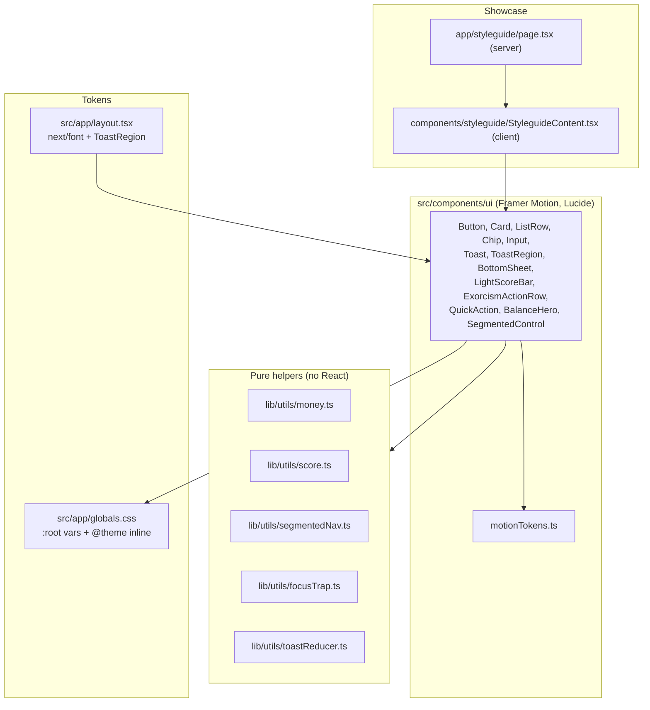

# Design Document — Design System Foundation

## Overview

This feature implements `.kiro/steering/design-system.md` ("Crypt UI") as code: the design tokens in `src/app/globals.css`, the four fonts in `src/app/layout.tsx`, thirteen chrome primitives in `src/components/ui/`, and a `/styleguide` route that renders every primitive in every variant and state. It covers the chrome register only. The scene, GSAP moments, Dexie, the haunting engine and the app screens are out of scope.

Three principles drive the design:

1. **Logic lives in small pure functions, rendering lives in thin components.** Everything that has a "for any input" property (money sanitizing, score clamping, currency parts, keyboard navigation, focus wrap, toast state, contrast) is a pure function in `src/lib/utils/` or in a test helper. Components call those functions. This is what makes property-based testing possible without a DOM.
2. **No new runtime dependencies beyond `framer-motion` and `lucide-react`** (Requirement 25.6). Portal, focus trap, inert background and scroll lock are hand-written (Decision 4).
3. **The token sheet is the only file with color literals.** Components use Tailwind utilities generated from `@theme` and never carry a hex value (Requirement 3).

### Research summary (verified against the installed packages)

| Topic | Finding | Source |
|---|---|---|
| Installed versions | `next` 16.4.6, `react` 19.3.0, `tailwindcss` 4.3.3, `vitest` 5.1.0 (with `vite` 8.3.8), `fast-check` 4.10.2, `eslint-config-next` 16.4.6. Not installed yet: `framer-motion`, `lucide-react`, `jsdom`, Testing Library, `@testing-library/jest-dom`. | `package.json`, `node_modules/*/package.json` |
| Tailwind integration | The project uses the Turbopack loader rule in `next.config.ts` (`@tailwindcss/turbopack` on `*.css`), not `postcss.config.mjs`. No `tailwind.config.ts` exists. `globals.css` currently has `@import "tailwindcss"` plus a `@theme inline` block. | `next.config.ts`, `src/app/globals.css` |
| Next.js specifics | `cacheComponents: true` and `partialPrefetching: true` are enabled. `layout.tsx` uses the generated `LayoutProps<"/">` type. `next/font/google` takes `weight`, `display`, `variable` options. A non-variable Google font needs explicit `weight`. | `next.config.ts`, `src/app/layout.tsx`, `node_modules/next/dist/docs/01-app/03-api-reference/02-components/font.md` |
| Vitest 5.1.0 | `test.projects` exists, with per-project `extends` (`string \| boolean`). `environmentMatchGlobs` and `poolMatchGlobs` no longer appear anywhere in the installed types or dist. The `@vitest-environment` docblock is still read (`getSpecificationDocblock`). `jsdom` and `happy-dom` are optional peers, so `jsdom` must be installed. | `node_modules/vitest/dist/chunks/plugin.d.LRFSN46m.d.ts` (lines 3821, 4687–4701), `node_modules/vitest/dist/chunks/cli-api.COfZo8lK.js`, `node_modules/vitest/package.json` |
| Package name | The animation package was renamed to `motion` (import from `motion/react`). `framer-motion` 14.14.0 is still published with the same version and the same API. Requirement 5.6 and `conventions.md` say `framer-motion`, so the design keeps that import path. | [Motion docs](https://motion.dev/docs/react-accessibility), npm registry |
| Axe | `axe-core` 4.14.1 is already in `node_modules` as a transitive dependency of `eslint-plugin-jsx-a11y`, and ships `axe.d.ts`. `vitest-axe` is at 0.1.0 on npm and extends `expect`. | `node_modules/axe-core/package.json`, npm registry |
| Testing Library peers | `@testing-library/react` 16.3.3 requires `@testing-library/dom` ^10 as a peer. `@testing-library/jest-dom` 7.0.1 requires `vitest >= 0.32` and `@testing-library/dom` >=10 <11. `jsdom` 31.0.1 requires Node `^22.22.2 \|\| ^24.15.0 \|\| >=26`. | npm registry |
| `inert` | `inert` is a global HTML attribute that removes a subtree from the tab order, blocks pointer events and hides it from the accessibility tree. See [MDN](https://developer.mozilla.org/en-US/docs/Web/HTML/Reference/Global_attributes/inert). I could not confirm from installed docs whether jsdom implements any `inert` behavior, so the tests only assert the attribute (Decision 4). | MDN |

*Content from the web sources was paraphrased for compliance with licensing restrictions.*

---

## Architecture

### Layers



### File layout

```
src/
├── app/
│   ├── globals.css                    # tokens (:root), @theme inline, base styles, shimmer keyframes
│   ├── layout.tsx                     # 4 fonts, metadata, <ToastRegion> around children
│   └── styleguide/page.tsx            # thin server wrapper, noindex metadata
├── components/
│   ├── styleguide/StyleguideContent.tsx   # "use client", all sections and demo state
│   └── ui/
│       ├── Button.tsx  QuickAction.tsx  BalanceHero.tsx  Card.tsx  ListRow.tsx  Chip.tsx
│       ├── SegmentedControl.tsx  Input.tsx  BottomSheet.tsx  Toast.tsx  ToastRegion.tsx
│       ├── LightScoreBar.tsx  ExorcismActionRow.tsx
│       └── motionTokens.ts            # duration/scale/offset constants mirrored from the token sheet
└── lib/utils/
    ├── money.ts                       # sanitizeMoneyInput, formatMoneyOnBlur, formatCurrencyParts
    ├── score.ts                       # clampScore, getFillPercent, formatScoreText, formatBreakdown
    ├── delta.ts                       # getDeltaPresentation
    ├── segmentedNav.ts                # getNextEnabledIndex
    ├── focusTrap.ts                   # FOCUSABLE_SELECTOR, getNextFocusIndex, shouldSkipInert
    └── toastReducer.ts                # toastReducer, Toast state types
tests/
├── ui/                                # jsdom project: one <Primitive>.test.tsx per primitive + styleguide tests
│   ├── setup.ts                       # jest-dom, cleanup, matchMedia stub, framer-motion partial mock
│   └── helpers/ motion.ts  axe.ts  viewport.ts
├── utils/                             # node project: property tests for lib/utils/*
└── design-system/                     # node project: tokens.test.ts, contrast.test.ts, sourceScan.test.ts
    └── helpers/contrast.ts            # parseHex, relativeLuminance, contrastRatio (test-only)
```

Module boundaries that this feature adds to `structure.md`:

- `src/components/ui/` may import `framer-motion`, `lucide-react`, `react`, `react-dom` and `@/lib/utils/*`. It never imports GSAP, `@/lib/db/`, `@/hooks/` or `@/lib/haunting/` (Requirements 5.6, 16.8, 17.9, 22.11; enforced by a source scan).
- A hook that is part of a primitive's contract (`useToast`) lives in that primitive's file. `src/hooks/` stays reserved for hooks that bridge Dexie and the haunting engine (Requirement 24.3).
- `className` is for layout only (Decision 5).

---

## Decision 1 — Vitest runs `tests/ui` in jsdom and everything else in node

**Mechanism: `test.projects` with `extends: true`.** Verified in Vitest 5.1.0: `projects?: TestProjectConfiguration[]` is on the root config and each inline project accepts `extends?: string | boolean` (`plugin.d.ts` lines 3821 and 4701). `environmentMatchGlobs` and `poolMatchGlobs` are gone from the installed types and dist, and there is no separate workspace file to maintain. The `// @vitest-environment jsdom` docblock still works, but it is rejected as the primary mechanism because it needs a comment in every file and a forgotten comment silently runs a DOM test in node.

**Inheritance rule.** Each project sets `extends: true` so that it inherits the root `resolve.alias` (`@` → `src`). The `node` project keeps the exact include glob the repository uses today (`tests/**/*.test.{ts,tsx}`) and only excludes `tests/ui/**`. Any new test directory (for example `tests/exorcism/`) therefore defaults to node and can never be silently skipped. `tests/haunting/` is not touched and runs under the same `node` environment as before.

```ts
// vitest.config.ts
import { fileURLToPath } from "node:url";
import { configDefaults, defineConfig } from "vitest/config";

export default defineConfig({
  resolve: {
    alias: { "@": fileURLToPath(new URL("./src", import.meta.url)) },
  },
  test: {
    passWithNoTests: true,
    coverage: { provider: "v8", include: ["src/lib/**/*.ts"] },
    projects: [
      {
        extends: true,
        test: {
          name: "node",
          environment: "node",
          include: ["tests/**/*.test.{ts,tsx}"],
          exclude: [...configDefaults.exclude, "tests/ui/**"],
        },
      },
      {
        extends: true,
        test: {
          name: "ui",
          environment: "jsdom",
          include: ["tests/ui/**/*.test.{ts,tsx}"],
          setupFiles: ["./tests/ui/setup.ts"],
        },
      },
    ],
  },
});
```

`coverage` is a root-only option and stays at the root. `npm test` (`vitest --run`) runs both projects; `vitest --run --project ui` runs only the component tests (Requirement 22.10).

**Setup file (`tests/ui/setup.ts`)**, loaded only by the `ui` project:

```ts
import "@testing-library/jest-dom/vitest";
import { cleanup } from "@testing-library/react";
import { afterEach, vi } from "vitest";
import { isReducedMotion, setReducedMotion } from "./helpers/motion";
import { installMatchMediaStub, resetViewport } from "./helpers/viewport";

installMatchMediaStub(); // jsdom has no matchMedia

vi.mock("framer-motion", async (importOriginal) => {
  const actual = await importOriginal<typeof import("framer-motion")>();
  return { ...actual, useReducedMotion: () => isReducedMotion() };
});

afterEach(() => {
  cleanup();             // required: globals are off, so Testing Library does not auto-register it
  setReducedMotion(false);
  resetViewport();
});
```

Vitest runs with `globals` off (the repository does not enable them), so Testing Library's automatic cleanup is not registered and the setup file calls `cleanup()` itself.

**Other details**

- **JSX transform.** No `@vitejs/plugin-react` is added. `tsconfig.json` already sets `"jsx": "react-jsx"` and Vite 8 transpiles TSX from that setting. Task 1 includes a smoke test that renders a `<div/>` to confirm this. If the smoke test fails, the fallback is to add `@vitejs/plugin-react` as a dev dependency (no runtime impact).
- **CSS is not loaded in jsdom.** Component tests assert roles, attributes, class names and `data-*` state, never computed styles. Visual rules (sizes, colors) are covered by the token tests and the styleguide.
- **New dev dependencies:** `jsdom`, `@testing-library/react`, `@testing-library/dom`, `@testing-library/user-event`, `@testing-library/jest-dom`, `axe-core` (made explicit; see Decision 2).

---

## Decision 2 — Axe: `axe-core` directly with a small helper

**Choice: `axe-core` called from `tests/ui/helpers/axe.ts`; no `vitest-axe` or `jest-axe`.**

| Option | Verdict |
|---|---|
| `axe-core` + own helper | Chosen. `axe-core` 4.14.1 is already installed (transitively) and ships its own types. It becomes an explicit `devDependency` so a change in `eslint-plugin-jsx-a11y` cannot remove it. The helper is about 40 lines, and we control the failure message. |
| `vitest-axe` | Rejected. Version 0.1.0 on npm, peer `vitest >=0.16`. It has not been verified against Vitest 5 or `@testing-library/jest-dom` 7, and its matcher output is not under our control. |
| `jest-axe` | Rejected. Written for Jest globals and `expect.extend`; it needs shims under Vitest. |

**Helper**

```ts
// tests/ui/helpers/axe.ts
import axe from "axe-core";

const RULE_TAGS = ["wcag2a", "wcag2aa", "wcag21a", "wcag21aa", "best-practice"];
// Not evaluable in jsdom (no layout, no painted colors). Covered by tests/design-system/contrast.test.ts.
const RULES_SKIPPED_IN_JSDOM = ["color-contrast"] as const;
const HTML_SNIPPET_MAX = 200;

export async function runAxe(root: Element): Promise<axe.AxeResults> {
  return axe.run(root, {
    runOnly: { type: "tag", values: RULE_TAGS },
    rules: Object.fromEntries(RULES_SKIPPED_IN_JSDOM.map((id) => [id, { enabled: false }])),
  });
}

export function formatViolations(violations: axe.Result[]): string {
  return violations
    .map((v) =>
      [`${v.id} (${v.impact ?? "n/a"}): ${v.help}`, `  ${v.helpUrl}`,
       ...v.nodes.map((n) => `  - ${n.target.join(" ")}\n    ${n.html.slice(0, HTML_SNIPPET_MAX)}\n    ${n.failureSummary ?? ""}`)].join("\n"))
    .join("\n\n");
}

export async function expectNoAxeViolations(root: Element): Promise<void> {
  const { violations } = await runAxe(root);
  if (violations.length > 0) {
    throw new Error(`axe found ${violations.length} violation(s):\n\n${formatViolations(violations)}`);
  }
}
```

**Report format.** A failing test prints, per violated rule: rule id, impact, the help sentence, the `helpUrl`, and for each offending node its CSS selector path (`target`), the first 200 characters of its HTML and axe's `failureSummary`. Because the helper throws a plain `Error`, Vitest prints the whole message in the failure output (Requirement 23.2).

**Scope and rules**

- The helper runs on the Testing Library container, not on `document`. Page-level rules (`document-title`, `html-has-lang`, `landmark-one-main`, `page-has-heading-one`) are therefore not evaluated by axe. Requirement 21.7 (one `<main>`, one `<h1>`, no skipped heading level) gets its own assertions in `styleguide.keyboard.test.tsx`.
- **`color-contrast` is the only disabled rule** (Requirement 23.5, 23.6). It needs real layout and resolved colors, which jsdom cannot provide, and Tailwind classes are not even applied in jsdom. The same color pairs are covered by `tests/design-system/contrast.test.ts`, which computes WCAG ratios from the values parsed out of `globals.css`. The disabled rule is named in a comment next to the constant, as the requirement asks. No blanket selector exclusions are used.
- Three axe scenarios (Requirements 23.3, 23.4): sheet closed, sheet open, and each toast tone visible. The styleguide is rendered inside a single `<ToastRegion>` in the test (Requirement 21.8, 23.1), so the real live regions are part of what axe sees.
- **Open verification item for task 8.** With the sheet open, the background gets `inert` (Decision 4). If the installed axe reports `aria-hidden-focus`-style findings because jsdom does not model `inert`, the fix is to also set `aria-hidden="true"` on the inerted siblings, not to disable a rule.
- Real-browser contrast (Requirement 23.7) is out of scope.

---

## Decision 3 — Mocking `useReducedMotion` in tests

**Choice: a partial `vi.mock` of `framer-motion`, driven by a tiny mutable helper. No `matchMedia` stub for reduced motion.**

Why not a `matchMedia` stub: Framer Motion's `useReducedMotion` initializes a module-level preference store the first time it runs and then keeps listening. Changing the stub afterwards does not reliably flip the value inside one test file. The mock bypasses that cache and is synchronous.

```ts
// tests/ui/helpers/motion.ts
let reduced = false;
export function setReducedMotion(value: boolean): void { reduced = value; }
export function isReducedMotion(): boolean { return reduced; }
```

- The mock is declared once in `tests/ui/setup.ts` (shown in Decision 1). It spreads the real module (`importOriginal`), so `motion`, `AnimatePresence`, `animate`, `useMotionValue` and the rest keep working, and replaces only `useReducedMotion`.
- A test calls `setReducedMotion(true)` **before** `render`. Because components read the hook on render, flipping it mid-test and calling `rerender` also works.
- **Reset:** the `afterEach` in the setup file calls `setReducedMotion(false)`, so no test inherits a previous value.
- **Deterministic assertion surface.** Frame-by-frame transforms are timing-dependent in jsdom. Every primitive that animates puts `data-reduced-motion="true" | "false"` on its animated root and builds its motion props through a small pure function (for example `getPressMotion(reduced)` returns `{}` when reduced). Tests assert (a) the data attribute, (b) that no `whileTap`, `animate` transform or `initial` offset is configured when reduced, and (c) that the behavior still works (same output text, same `onChange` calls). This satisfies Requirement 18.5 ("no transform animation is applied").
- The BottomSheet uses a CSS breakpoint query through `matchMedia`. That is what `tests/ui/helpers/viewport.ts` stubs (`setViewportWidth(1280)` / `resetViewport()`); it is unrelated to reduced motion.

---

## Decision 4 — BottomSheet: portal, focus trap, inert background, scroll lock, focus restore

No new runtime dependency. Everything is `react-dom`'s `createPortal`, DOM attributes and a keydown handler. The sheet lives in `src/components/ui/BottomSheet.tsx`; its pure parts live in `src/lib/utils/focusTrap.ts`.

### Hydration safety

The sheet is closed on the server, so SSR output is `null`. To avoid touching `document` during render, an `isClient` flag comes from `useSyncExternalStore(subscribeNoop, () => true, () => false)`. This returns `false` during server render and hydration, and `true` afterwards, with no `setState` inside an effect (`eslint-config-next` 16 ships React hooks lint rules that flag that pattern). The portal renders only when `open && isClient`.

### Portal

```tsx
createPortal(
  <AnimatePresence>{open && <SheetLayer ... />}</AnimatePresence>,
  document.body,
);
```

`createPortal(children, document.body)` appends the sheet layer as a direct child of `<body>`. That makes "everything else under body" the set of siblings to hide (next section).

### Inert background (with fallback)

On open, an effect walks `document.body.children`. For each element that is not the sheet layer and for which `shouldSkipInert` (below) returns `false`, it records whether the element already had `inert`, then calls `setAttribute("inert", "")`. The cleanup restores the recorded state.

**Exemptions.** The following body children are never made inert:

| Exempt element | Reason |
|---|---|
| `script`, `style`, `link`, `template` tags | Not rendered content. |
| Any element with `data-inert-exempt` | `ToastRegion` wrapper: toasts raised while the sheet is open must still be announced. |
| The element `next-route-announcer` | Next.js route-change live region. Inerting it would silence route announcements. |
| Any element whose tag name starts with `nextjs-` (case-insensitive) | Development-only Next.js overlays such as `nextjs-portal`. Inerting them would block the error overlay and dev indicator. They do not exist in production builds. |

The decision is a pure function in `src/lib/utils/focusTrap.ts`, so it can be property-tested without a DOM:

```ts
// src/lib/utils/focusTrap.ts
const NON_CONTENT_TAGS = ["script", "style", "link", "template"] as const;
const ROUTE_ANNOUNCER_TAG = "next-route-announcer";
const NEXT_DEV_OVERLAY_TAG_PREFIX = "nextjs-";

/** True when a direct child of <body> must NOT receive `inert` while a sheet is open. Total: never throws. */
export function shouldSkipInert(tagName: string, hasInertExemptAttribute: boolean): boolean {
  const tag = tagName.toLowerCase();
  return (
    hasInertExemptAttribute ||
    (NON_CONTENT_TAGS as readonly string[]).includes(tag) ||
    tag === ROUTE_ANNOUNCER_TAG ||
    tag.startsWith(NEXT_DEV_OVERLAY_TAG_PREFIX)
  );
}
```

The effect calls `shouldSkipInert(el.tagName, el.hasAttribute("data-inert-exempt"))`. Matching is by tag name only, so no Next.js internals are imported.

- `ToastRegion` marks its live-region wrapper `data-inert-exempt`, so toasts raised while the sheet is open are still announced.
- One sheet at a time is supported (YAGNI). Nested sheets are not part of any requirement.
- `inert` is set with `setAttribute`, so TypeScript's DOM lib version does not matter.
- **Fallback:** `inert` is baseline in current browsers. If task 8 finds that axe or a target browser needs it, the same effect also sets `aria-hidden="true"`. Requirement 14.4 allows either.
- **jsdom:** the tests assert the attribute (`expect(sibling).toHaveAttribute("inert")`) and its removal on close. They do not rely on jsdom enforcing inertness; tab containment is proven through the keydown handler below, which calls `preventDefault`, and `user-event` honors it.

### Focus trap

The dialog element has `tabIndex={-1}` and an `onKeyDown` handler for Tab:

```ts
// src/lib/utils/focusTrap.ts
export const FOCUSABLE_SELECTOR =
  'a[href], button:not([disabled]), input:not([disabled]):not([type="hidden"]), select:not([disabled]), textarea:not([disabled]), [tabindex]:not([tabindex="-1"])';

/** Index to focus after Tab (shift=false) or Shift+Tab (shift=true). -1 means focus is not on a trap item. */
export function getNextFocusIndex(count: number, current: number, shift: boolean): number {
  if (count <= 0) return -1;
  if (current < 0) return shift ? count - 1 : 0;
  return shift ? (current - 1 + count) % count : (current + 1) % count;
}
```

The handler queries `dialog.querySelectorAll(FOCUSABLE_SELECTOR)` at the time of the key press (so content that changes while open is handled), computes the index of `document.activeElement`, calls `preventDefault()` and focuses the result. With zero focusable elements it keeps focus on the dialog container. The query avoids `offsetParent` and layout checks because jsdom has no layout; hidden items are excluded by the `hidden` attribute and `disabled`.

- **Initial focus (Requirement 14.3):** after mount, focus the first element matching the selector, or the dialog container.
- **Escape (Requirement 14.5):** a `keydown` listener on `document` (added while open) calls `onClose` once. A document listener still works if focus is on `body` after a click on non-focusable content.
- **Scrim (Requirement 14.6):** a sibling `div` with `role="presentation"` and `aria-hidden="true"` and an `onClick` that calls `onClose`. It is a sibling of the panel, so clicks inside the panel never reach it, and `role="presentation"` keeps `jsx-a11y` rules satisfied. The keyboard path to close is Escape and the visible Close button.
- **Close button (Requirement 14.9):** a 44px `Button`-style control with `aria-label="Close"`, rendered first in the panel header.

### Scroll lock

While open, the effect sets `data-scroll-locked` on `document.documentElement` (restored on cleanup). `globals.css` holds the rules, so no inline pixel or style literals appear in the component:

```css
html { scrollbar-gutter: stable; }
html[data-scroll-locked] body { overflow: hidden; }
```

`scrollbar-gutter: stable` prevents layout shift when the scrollbar disappears.

### Focus restore

A `useLayoutEffect` keyed on `open` stores `document.activeElement` before moving focus into the dialog. Its cleanup runs when `open` becomes `false` (not after the exit animation finishes) and calls `.focus()` on the stored element when it is still connected. This satisfies Requirement 14.7 even while `AnimatePresence` keeps the panel mounted for the 280ms exit.

### Responsive behavior and motion

One DOM structure. Tailwind responsive classes switch the layout: bottom-anchored panel with top radius and a drag-handle element below `lg`, centered panel with full radius at `lg` and above. The motion variant (slide up vs. fade-scale) uses `useSyncExternalStore` over `matchMedia("(min-width: 1024px)")` with a `false` server snapshot. Spring: `{ type: "spring", duration: 0.28, bounce: 0.1 }`. Reduced motion: opacity fade of at most 150ms, no `y` or `scale`.

---

## Decision 5 — `className` is layout-only

Requirement 5.8 and 24.8 forbid visual overrides through `className`, and `tailwind-merge` is not allowed. Each primitive's props type is `Omit<ComponentPropsWithoutRef<"button">, "className"> & { className?: LayoutClassName }` where `LayoutClassName` is a plain `string` alias documented as layout-only. The primitive concatenates its own classes first and the caller's classes last: `` `${base} ${className ?? ""}` ``. Visual changes happen only through `variant`, `size` and `tone`.

TypeScript cannot check what the string contains. Enforcement is by convention plus review, and by a source scan in `tests/design-system/sourceScan.test.ts`.

**Scan scope.** The scan reads every `.tsx` file under `src/app/**` and `src/components/**` **except `src/components/ui/**`**. It covers `StyleguideContent`, `src/app/styleguide/page.tsx`, the house, moments and feature components, and every future screen, so new screens follow the layout-only rule without editing the test. It fails, reporting file and line, when a JSX element whose tag is a primitive imported from `@/components/ui/*` receives a `className` string containing a visual utility prefix (`bg-`, color `text-` utilities such as `text-ink` or `text-candle`, `border`, `rounded`, `p-`/`px-`/`py-`/`pt-`/`pr-`/`pb-`/`pl-`, `shadow`, `font-`, `ring-`, `outline-`). Layout utilities (margins, width and height, flex and grid placement, `self-*`, `col-*`, `row-*`, positioning, `z-*`) are allowed. Native elements such as `div` are not checked.

**Caveats**
- `src/components/ui/**` is excluded because the primitives legitimately apply their own visual classes, and compose each other (for example `BalanceHero` renders `Chip`, `ExorcismActionRow` renders `ListRow`). The scan must never flag that usage.
- Because the scope is broad, `StyleguideContent` and every file under `src/app/**` and the other `src/components/**` directories must pass. Task 1 includes the scan, so any violation in code added later fails the build gate at that increment.
- The scan is a static text check. Dynamic class strings (template literals with expressions, `clsx` calls) are checked only for their literal fragments, so it reduces but does not eliminate misuse. Review remains the backstop.
- A directory with no `.tsx` files yet is not an error.

`conventions.md` documents the rule (Requirement 24.8).

## Decision 6 — Tailwind v4 theme naming

All aliases live in `@theme inline`, so utilities compile to `var(--text-primary)` and so on, and the long design-system names stay the source of truth.

| CSS variable (unchanged, in `:root`) | `@theme inline` variable | Utility |
|---|---|---|
| `--text-primary` / `--text-secondary` / `--text-tertiary` | `--color-ink` / `--color-ink-secondary` / `--color-ink-tertiary` | `text-ink`, `text-ink-secondary`, `text-ink-tertiary` |
| `--surface-void` / `-card` / `-raised` / `-overlay` | `--color-surface-void` / `-card` / `-raised` / `-overlay` | `bg-surface-*` |
| `--accent-candle` / `-ecto` / `-blood` / `-ghost` / `-spirit` | `--color-candle` / `ecto` / `blood` / `ghost` / `spirit` | `text-candle`, `bg-ecto`, … |
| `--on-accent` (= `var(--surface-void)`) | `--color-on-accent` | `text-on-accent`: the only text and icon color allowed on a solid accent fill |
| `--border-control` | `--color-control` | `border-control` |
| `--focus-ring` | `--color-focus` | `ring-focus`, `outline-focus` |
| `--divider` | `--color-divider` | `bg-divider` |
| tinted accents (`--tint-ecto` = accent at 14% alpha through `color-mix`) | `--color-ecto-tint`, `--color-candle-tint`, … | `bg-ecto-tint`, … |

The design-system names `--text-primary` and friends are declared in `:root`, not in `@theme`. This matters because Tailwind v4 reads the `--text-*` theme namespace as **font sizes**. Keeping the color tokens outside `@theme` avoids generating a bogus `text-primary` size utility, and the font-size tokens (`--text-hero`, `--text-display`, `--text-title`, `--text-body-lg`, `--text-body`, `--text-label`, `--text-caption`) can live in `@theme` with `--text-*--line-height`, `--text-*--letter-spacing` and `--text-*--font-weight` companions.

Other theme entries: `--radius-*: initial` then `--radius-pill: 999px`, `--radius-lg: 24px`, `--radius-md: 16px`; `--spacing: 4px` plus `--spacing-page`, `--spacing-card` (20px), `--spacing-gap` (12px); `--shadow-overlay: 0 12px 32px rgb(0 0 0 / 0.6)`; `--font-display`, `--font-sans`, `--font-wordmark`, `--font-mono` each pointing to the `next/font` variable with a system fallback stack; `--container-content: 560px`. Fonts are loaded in `layout.tsx` with `display: "swap"` and explicit weights (Manrope 700/800, Inter 400/500/600, Cinzel 500, JetBrains Mono 400).

Motion durations exist twice, on purpose: as CSS custom properties in `:root` for CSS transitions, and as constants in `src/components/ui/motionTokens.ts` (`PRESS_DURATION_S = 0.12`, `TAB_DURATION_S = 0.2`, `SHEET_DURATION_S = 0.28`, `COUNT_DURATION_S = 0.6`, `PRESS_SCALE = 0.97`, `REDUCED_FADE_MAX_S = 0.15`, `TOAST_RISE_PX = 12`, …) for Framer Motion. `tokens.test.ts` parses the CSS and asserts both agree.

## Decision 7 — Hex labels in the styleguide without hex literals

Requirement 19.6 needs swatches that show a hex value, and Requirement 3 bans hex literals under `src/` outside `globals.css`. The swatch component renders its token name and fills the hex label at runtime from `getComputedStyle(document.documentElement).getPropertyValue(token)` inside a ref callback (writes `textContent`, no React state, no effect). The value comes from the token sheet, so it cannot drift. In jsdom the stylesheet is not loaded, so tests assert the token name; the hex values themselves are asserted by `tokens.test.ts` (Requirement 24.7).

## Decision 8 — Optional droplet burst is not implemented

Requirement 17.10 is optional and 17.11 requires criteria 1–9 to hold without it. The burst belongs with the scene moments and is deferred. `ExorcismActionRow` fills the checkbox with a 200ms CSS/Framer transition (within the 700ms limit) and a reduced-motion opacity fade.

---

## Components and Interfaces

### Token sheet (`src/app/globals.css`)

Structure, top to bottom: `@import "tailwindcss";` → `:root` (surfaces, divider, text, control, accents, semantic aliases, tinted accents, dataviz palette, gradient, durations, press scale, layout tokens, reduced-motion fade) → `@theme inline` (Decision 6) → base layer (`color-scheme: dark`, body background `--surface-void`, body color `--text-primary`, Inter default, `scrollbar-gutter`, scroll lock) → `@keyframes shimmer` (1.6s) with a `prefers-reduced-motion: reduce` override that disables it. The create-next-app variables, the `prefers-color-scheme` block and the Arial font stack are removed (Requirement 1.12).

### Pure helpers (`src/lib/utils/`)

```ts
// money.ts
export function sanitizeMoneyInput(raw: string): string;      // /^\d*(\.\d{0,2})?$/, idempotent; comma rule below
export function formatMoneyOnBlur(sanitized: string): string; // "" and "." → ""; otherwise exactly 2 fractional digits
export type CurrencyParts = { symbol: string; integer: string; cents: string };
export function formatCurrencyParts(value: number): CurrencyParts; // non-finite → 0; grouping via en-US

// score.ts
export function clampScore(score: number): number;            // NaN → 0, ±Infinity → clamped, result in [0, 100]
export function getFillPercent(score: number): number;        // clampScore(score), kept separate for intent
export function formatScoreText(value: number): string;       // String(Math.floor(clampScore(value)))
export function formatBreakdown(base: number, momentum: number, score: number): string; // "39 = 33 base + 6 momentum"

// delta.ts
export type DeltaDirection = "up" | "down";
export type DeltaIntent = "good" | "bad";
export type DeltaPresentation = { sign: "+" | "−"; icon: "arrow-up" | "arrow-down"; tone: "success" | "danger"; text: string };
export function getDeltaPresentation(direction: DeltaDirection, intent: DeltaIntent, amountText: string): DeltaPresentation;

// segmentedNav.ts
export type SegmentNavKey = "next" | "prev" | "first" | "last";
export function getNextEnabledIndex(disabled: readonly boolean[], current: number, key: SegmentNavKey): number; // returns current when nothing is enabled

// focusTrap.ts → FOCUSABLE_SELECTOR, getNextFocusIndex, shouldSkipInert (Decision 4)

// toastReducer.ts
export type ToastTone = "success" | "info" | "warning" | "danger";
export type ToastItem = { id: string; tone: ToastTone; message: string; duration: number; actionLabel?: string };
export type ToastAction = { type: "show"; toast: ToastItem } | { type: "dismiss"; id: string };
export function toastReducer(state: readonly ToastItem[], action: ToastAction): readonly ToastItem[];
export function getToastRegion(tone: ToastTone): "polite" | "assertive"; // success, info → polite; warning, danger → assertive
```

**Money_Input comma rule.** `sanitizeMoneyInput` resolves commas before it keeps digits and the first `.`. Cents never have 3 digits, so a comma followed by exactly 3 digits is a thousands separator.
- If the raw string contains a `.`, every comma is a thousands separator and is removed: `"1,234.50"` → `"1234.50"`, `"1,000.00"` → `"1000.00"`.
- If it contains no `.` and every comma is followed by exactly 3 digits and then another comma or the end, every comma is a thousands separator and is removed: `"1,000"` → `"1000"`, `"1,234,567"` → `"1234567"`. The check looks only at the digits and commas, because every other character is dropped anyway, so `" 1,000 "` → `"1000"`.
- Otherwise the first comma is the decimal separator and any later commas are removed: `"15,49"` → `"15.49"`, `"12,5"` → `"12.5"`, `"0,5"` → `"0.5"`, `",5"` → `".5"`, `"1,2,3"` → `"1.23"`.

The output still matches `^\d*(\.\d{0,2})?$` and contains no comma, so the function stays idempotent. Before this rule, commas were dropped, so `"15,49"` became `"1549"`, 100 times the intended amount. Property 16 covers the decimal comma and Property 17 covers thousands groups.

All are total: they never throw, whatever the input (Error Handling).

### Primitives (`src/components/ui/`)

Common rules (Requirement 5): named exports, `type` aliases, no `any`, props extend the native element's props minus `className` (Decision 5), `ref` forwarded to the native focusable element (React 19 passes `ref` as a prop), `"use client"` only where state, effects, handlers or Framer Motion are used, Framer variants in the same file, `:focus-visible` ring `outline-2 outline-offset-2 outline-focus`, decorative Lucide icons `aria-hidden="true"` at 20px (22px in QuickAction), stroke 2.

| Primitive | Key props | Structure and notes |
|---|---|---|
| `Button` | `variant: "primary"\|"secondary"\|"ghost"\|"danger"` (default `primary`), `size: "sm"\|"md"\|"lg"` (36/44/52px, default `md`), `loading`, `success`, `leadingIcon`; icon-only form requires `aria-label` through a discriminated union | Native `<button type="button">`. `sm` extends its hit area to 44px with a pseudo-element. `loading` sets `aria-busy`, swaps in a spinner, keeps width through a fixed-width label wrapper, and guards `onClick`. `success` morphs the label to a check for 600ms and announces through an `aria-live="polite"` visually hidden span. Press motion: `whileTap={{ scale: PRESS_SCALE }}` unless reduced. |
| `QuickAction` | `icon`, `label`, `onClick`, `disabled` | `<button>` with 52px raised circle, 22px icon, label (13/500) below, 44px minimum hit area. Activation wiggles the icon ±6° over 200ms (animation controls triggered from `onClick`); press scale as Button. Both disabled when reduced. |
| `BalanceHero` | `label`, `value`, `format: "currency"\|"score"` (default `currency`), `showMax`, `delta?: { direction, intent, amount }` | Renders `hero` text with `tabular-nums`. Currency uses `formatCurrencyParts` (cents at 60% size). Score uses `formatScoreText`. A `motion` value drives the 600ms count-up on change; the animated spans are `aria-hidden` and a visually hidden span always carries the final value. Reduced motion renders the new value immediately. The delta is a `Chip` built from `getDeltaPresentation`. |
| `Card` | `title?`, `headingLevel` (default `h2`), `action?: { label, href \| onClick }` | `<section aria-labelledby>` when titled; surface-card, `rounded-lg`, padding 20, no border or shadow. The action is a ghost link or button whose accessible name includes the title. |
| `ListRow` | `icon`, `tone`, `title`, `subtitle?`, `amount?`, `amountDirection?: "in"\|"out"`, `onClick?` / `href?`, `divider?` | Row height 64. Interactive form renders `<button>` or `<a>`, otherwise a `<div>`. The avatar is a 40px circle with a tinted background. Sign (`+`/`−`) is text. `divider` draws a 1px `divider` rule inset by the avatar width. Amount at `body-lg`. |
| `Chip` | `tone: "success"\|"warning"\|"danger"\|"info"\|"spirit"\|"neutral"`, `icon`, `children` (required label) | 24px pill, tinted background, accent color for icon and text. Every tone except `neutral` requires an icon (union type). |
| `SegmentedControl` | `options: { value; label; disabled? }[]`, `value`, `onChange`, `aria-label` or `aria-labelledby` (required by type) | `role="radiogroup"`; each segment is `<button role="radio" aria-checked>` with roving `tabIndex`. Keys map to `getNextEnabledIndex` (`ArrowRight`/`ArrowDown` → next, `ArrowLeft`/`ArrowUp` → prev, `Home`, `End`). The selected indicator is a `motion.span` with `layoutId`, a 200ms tween, or a ≤150ms opacity fade when reduced. |
| `Input` | `label`, `id?`, `error?`, `hint?`, `variant: "text"\|"money"` | 52px, `rounded-md`, `border-control`, floating label tied by `htmlFor`/`id` (`useId` fallback). `error` sets `aria-invalid`, shows an icon and text and links `aria-describedby`; the 3×4px shake runs once when `error` first appears (not when reduced). `money` uses `inputMode="decimal"`, Manrope, centered, `tabular-nums`, `onChange` through `sanitizeMoneyInput`, `onBlur` through `formatMoneyOnBlur`. |
| `BottomSheet` | `open`, `onClose`, `title`, `children` | Decision 4. `role="dialog" aria-modal="true" aria-labelledby`. |
| `Toast` | `tone`, `message`, `duration` (default 4000), `actionLabel?`, `onAction?`, `onDismiss` | Pill on overlay surface with overlay shadow, tone icon (distinct shape per tone), one line of text. A timer calls `onDismiss` once after `duration`; pointer enter/leave and focus in/out pause and resume the remaining time. Enter animation: rise `TOAST_RISE_PX` with fade, or ≤150ms fade when reduced. |
| `ToastRegion` (+ `useToast`) | `children` | See below. |
| `LightScoreBar` | `score`, `baseScore?`, `momentum?`, `aria-label` | 10px track on raised surface. `role="meter"` with `aria-valuemin=0`, `aria-valuemax=100`, `aria-valuenow`, `aria-valuetext` ("Light score 39 of 100"). Fill is a `motion.div` that animates `width` and `backgroundSize` in `%` over 600ms so the gradient stays anchored to the track; reduced motion sets both immediately. The number is always rendered as text; the breakdown line appears when both parts are provided. It takes numbers only and never imports the haunting engine. |
| `ExorcismActionRow` | `title`, `subtitle?`, `impactText`, `done`, `onToggle(next)`, `disabled?`, `id` | `ListRow` layout. A native `<input type="checkbox">` styled round (`appearance-none`) inside a 44px label target; the accessible name is `Mark "<title>" as done`. Done: title `line-through`, row text `ink-tertiary` (still ≥4.5:1 on the card surface, 5.5), checkbox filled with candle and a check icon in `text-on-accent`. Impact text is ecto with `+` and `/mo`. |

**Primitives must not close over data.** None of them imports Dexie, hooks or domain types; they receive plain props.

### `ToastRegion.tsx`

```tsx
"use client";
export type ToastApi = {
  show: (input: { tone: ToastTone; message: string; duration?: number; actionLabel?: string; onAction?: () => void }) => string;
  dismiss: (id: string) => void;
};
export function ToastRegion({ children }: { children: ReactNode }): JSX.Element;
export function useToast(): ToastApi; // throws "useToast must be used inside a ToastRegion" when the context is missing
```

- State: `useReducer(toastReducer, [])`. `show` and `dismiss` are stable (`useCallback` over `dispatch`) and live in their own context value, so callers do not re-render when toasts change. IDs come from a `useRef` counter (`toast-1`, `toast-2`, …), which is deterministic and avoids `Math.random`.
- Render: `{children}` followed by a wrapper `<div data-inert-exempt>` that always contains the two live regions: `<div role="status" aria-live="polite">` (success, info) and `<div role="alert" aria-live="assertive">` (warning, danger). Both exist on the first render, before any message (Requirement 15.4). Each region renders its toasts inside `AnimatePresence` for exit animation (removal is immediate when reduced).
- `dismiss` with an unknown id returns the same state array reference (no re-render).
- Mounted once in `layout.tsx` around `{children}`; `StyleguideContent` never mounts a second one (Requirement 15.5).

### `layout.tsx`

Replaces Geist with the four fonts, applies their four variable class names to `<html>`, sets CashCrypt `title` and `description`, and wraps `children` in `<ToastRegion>` inside `<body>`. It keeps the `LayoutProps<"/">` signature.

### Styleguide

- `src/app/styleguide/page.tsx`: server component, no `"use client"`, no state. Exports `metadata = { title: "Styleguide", robots: { index: false, follow: false } }` and renders `<StyleguideContent />`.
- `src/components/styleguide/StyleguideContent.tsx`: `"use client"`, one `<main>`, one `<h1>`, `h2` per section, `h3` inside cards. Sections in the order of Requirement 19.5, preceded by a Tokens section (swatches per Decision 7, type scale, radii, four font families). Grid: single centered column (max 560px) below 1024px, two columns at `lg`. Sections are added by the build order (Requirement 26.2) and a section for a not-yet-built primitive is omitted. It uses `useToast().show` for the four toast tones and local `useState` for the sheet. It imports only primitives and tokens. Exactly one `BalanceHero` per section: the currency hero in the BalanceHero section carries one delta, and the other combinations are shown with `Chip`/delta rows built from the same `getDeltaPresentation` function, so the "one hero per screen section" rule (Requirement 8.14) holds while all combinations from Requirement 19.13 remain visible. The score-format hero is shown in its own section card.

---

## Data Models

No persistent data. The types below are the public shapes of the helpers and primitives.

```ts
type LayoutClassName = string;                       // layout utilities only (Decision 5)

type SegmentOption<T extends string> = { value: T; label: string; disabled?: boolean };

type ToastTone = "success" | "info" | "warning" | "danger";
type ToastItem = { id: string; tone: ToastTone; message: string; duration: number; actionLabel?: string };

type CurrencyParts = { symbol: string; integer: string; cents: string };
type DeltaPresentation = { sign: "+" | "−"; icon: "arrow-up" | "arrow-down"; tone: "success" | "danger"; text: string };

// Test-only
type Rgb = { r: number; g: number; b: number };      // contrast.ts
```

Constants are named, not inline: `TOAST_DEFAULT_DURATION_MS = 4000`, `SUCCESS_MORPH_MS = 600`, `MONEY_MAX_FRACTION_DIGITS = 2`, `DESKTOP_BREAKPOINT_QUERY = "(min-width: 1024px)"`, `HTML_SNIPPET_MAX = 200`.

---

## Correctness Properties

*A property is a characteristic or behavior that should hold true across all valid executions of a system-essentially, a formal statement about what the system should do. Properties serve as the bridge between human-readable specifications and machine-verifiable correctness guarantees.*

Properties target the pure helpers. Rendering, ARIA wiring, motion and keyboard flows are covered by example-based component tests (see Testing Strategy). After the prework reflection, the money sanitizer invariant and idempotence stay separate (they fail for different reasons), the clamp and the fill/number monotonicity stay separate (clamp concerns the domain, the other concerns the output), and the two focus and navigation properties stay separate because they apply to different pure functions.

### Property 1: Money sanitizer output is always well formed

*For any* string `s`, `sanitizeMoneyInput(s)` matches `^\d*(\.\d{0,2})?$` and contains no character other than digits and at most one `.`.

**Validates: Requirements 13.10, 13.12**

### Property 2: Money sanitizer is idempotent

*For any* string `s`, `sanitizeMoneyInput(sanitizeMoneyInput(s))` equals `sanitizeMoneyInput(s)`.

**Validates: Requirements 13.12**

### Property 3: Money blur formatting yields exactly two decimals and preserves the value

*For any* string `s`, let `t = sanitizeMoneyInput(s)`. If `t` contains a digit, `formatMoneyOnBlur(t)` matches `^\d+\.\d{2}$` and `Math.round(Number(result) * 100)` equals `Math.round(Number(t) * 100)`. If `t` contains no digit, the result is the empty string.

**Validates: Requirements 13.13**

### Property 4: Score clamp is total and bounded

*For any* number `x`, including `NaN`, `Infinity`, `-Infinity` and values outside [0, 100], `clampScore(x)` is finite and in [0, 100]; `clampScore(NaN)` is 0; and for `x` in [0, 100], `clampScore(x)` equals `x`.

**Validates: Requirements 16.5**

### Property 5: Fill percent is bounded and monotonic, and the number is the floor

*For any* finite numbers `a <= b`, `getFillPercent(a) <= getFillPercent(b)`, both values are in [0, 100], and `formatScoreText(a)` equals `String(Math.floor(clampScore(a)))`.

**Validates: Requirements 16.2, 16.6**

### Property 6: Breakdown text floors every part

*For any* finite non-negative `base` and `momentum` and any score in [0, 100], `formatBreakdown(base, momentum, score)` equals `` `${Math.floor(score)} = ${Math.floor(base)} base + ${Math.floor(momentum)} momentum` ``.

**Validates: Requirements 16.3**

### Property 7: Currency parts reconstruct the rounded value

*For any* finite non-negative number `v`, with the symbol and thousands separators removed from the result of `formatCurrencyParts(v)`, `integer * 100 + cents` equals `Math.round(v * 100)`, and `cents` is always a two-digit string.

**Validates: Requirements 8.3, 8.12**

### Property 8: Score text is the integer floor with no decimal point

*For any* finite value `v` in [0, 100], `formatScoreText(v)` equals `String(Math.floor(v))` and contains no `.` character.

**Validates: Requirements 8.4, 8.13**

### Property 9: Delta direction and intent are independent

*For any* `direction` in {up, down}, `intent` in {good, bad} and amount text, `getDeltaPresentation` returns the sign `+` and icon `arrow-up` exactly when `direction` is `up` and `−` and `arrow-down` otherwise, returns tone `success` exactly when `intent` is `good` and `danger` otherwise, and its `text` starts with the sign.

**Validates: Requirements 8.6, 8.7, 8.8**

### Property 10: Segmented navigation always lands on an enabled segment

*For any* array of `disabled` flags with at least one `false`, any `current` index whose flag is `false`, and any key in {next, prev, first, last}, `getNextEnabledIndex` returns an index whose flag is `false`; for `first` it returns the lowest enabled index, for `last` the highest, for `next` the nearest enabled index after `current` in cyclic order, and for `prev` the nearest enabled index before it in cyclic order. When no segment is enabled it returns `current`.

**Validates: Requirements 12.4, 12.5, 12.6, 12.8**

### Property 11: Segmented navigation forms a cycle

*For any* array of `disabled` flags with `k >= 1` enabled segments and any enabled start index, applying `next` `k` times returns to the start, and `prev` applied after `next` returns to the start.

**Validates: Requirements 12.4, 12.5**

### Property 12: Focus index wraps within the trap

*For any* `count >= 1` and any `current` in [0, count − 1], `getNextFocusIndex(count, current, shift)` is in [0, count − 1], applying it with `shift = false` and then with `shift = true` returns `current`, and when `current` is −1 it returns 0 for Tab and `count − 1` for Shift+Tab. For `count = 0` it returns −1.

**Validates: Requirements 14.4**

### Property 13: Toast reducer adds to the matching region and ignores unknown dismissals

*For any* toast list and any new toast, `toastReducer` with `show` returns a list with length + 1 that contains the new toast and whose polite/assertive partition (`getToastRegion`) places it by tone; *for any* id not in the list, `dismiss` returns the same list unchanged; and `show` followed by `dismiss` of that id returns a list equal to the original.

**Validates: Requirements 15.3, 15.7, 15.8**

### Property 14: Contrast ratio is bounded, symmetric and reflexive

*For any* two colors `a` and `b`, `contrastRatio(a, b)` is in [1, 21], equals `contrastRatio(b, a)`, and `contrastRatio(a, a)` equals 1.

**Validates: Requirements 20.8**

### Property 15: Inert exemptions depend only on the tag name and the exempt attribute

*For any* tag name `t` and boolean `a`, `shouldSkipInert(t, a)` is `true` when `a` is `true`, when `t.toLowerCase()` is one of `script`, `style`, `link`, `template` or `next-route-announcer`, or when `t.toLowerCase()` starts with `nextjs-`; it is `false` otherwise; the result is the same for `t`, `t.toUpperCase()` and `t.toLowerCase()`; and the function never throws.

**Validates: Requirements 14.4**

---


### Property 16: A decimal comma is read the same as a decimal point

*For any* digit string `a` (possibly empty) and digit string `b` of 1 or 2 digits, `sanitizeMoneyInput(a + "," + b)` equals `sanitizeMoneyInput(a + "." + b)`.

**Validates: Requirements 13.10, 13.12**

---

### Property 17: Commas before 3-digit groups are thousands separators

*For any* digit string `a` of 1 to 3 digits and any list `g` of 3-digit strings, `sanitizeMoneyInput([a, ...g].join(","))` equals `[a, ...g].join("")`.

**Validates: Requirements 13.10, 13.12**

## Error Handling

- **Pure helpers never throw.** `sanitizeMoneyInput` accepts any string (including pasted text with letters, `-`, `e`, whitespace, commas and multiple dots); commas follow the Money_Input comma rule. `formatCurrencyParts` and `clampScore` treat non-finite input as 0 (and clamp ±Infinity); `getNextEnabledIndex` returns `current` when no segment is enabled or when `current` is out of range; `getNextFocusIndex` returns −1 for an empty list.
- **`useToast` outside `ToastRegion`** throws `Error("useToast must be used inside a ToastRegion")`, which names both as Requirement 15.9 requires. This is a programming error, not a runtime condition.
- **Missing accessible names** are compile-time errors: icon-only `Button` requires `aria-label`; `SegmentedControl` requires `aria-label` or `aria-labelledby`; `Chip` requires `children`; `Input` requires `label`; `LightScoreBar` requires `aria-label` (Requirement 21.6). Type-level checks are covered by `// @ts-expect-error` lines in component tests so `npm run typecheck` fails if a union is loosened.
- **`BottomSheet` without focusable content** keeps focus on the dialog container. If the previously focused element has been removed from the DOM by the time the sheet closes, focus restore is skipped.
- **`document`/`window` access** happens only inside effects, event handlers, or behind the `isClient` flag, so server rendering and hydration never touch the DOM.
- **Reduced motion:** every animated primitive degrades to the same information and behavior (Requirement 18.4); tests assert the same output in both modes.
- **Token drift:** `tokens.test.ts` and `contrast.test.ts` fail when `globals.css` and `design-system.md` diverge.

---

## Testing Strategy

### Dual approach

- **Property tests (fast-check 4.10.2)** for Properties 1–15. Each is one `fc.assert(fc.property(...), { numRuns: 100 })` (or more), tagged with a comment: `// Feature: design-system-foundation, Property N: <property text>`. Files: `tests/utils/money.test.ts`, `score.test.ts`, `delta.test.ts`, `segmentedNav.test.ts`, `focusTrap.test.ts`, `toastReducer.test.ts` (node project) and `tests/design-system/contrast.test.ts` (node project). Generators: arbitrary strings with a custom alphabet biased toward digits, `.`, `,`, `-`, `e`, whitespace; `fc.double({ noNaN: false })` for score inputs; `fc.array(fc.boolean(), { minLength: 1 })` filtered to at least one enabled segment for navigation; `fc.integer` pairs for RGB colors; `fc.oneof(fc.string(), fc.constantFrom("nextjs-portal", "NEXTJS-Dev-Overlay", "next-route-announcer", "SCRIPT", "div"))` for tag names in Property 15.
- **Component tests (Testing Library + user-event, jsdom project)**, one `tests/ui/<Primitive>.test.tsx` per primitive, covering role and accessible name, each variant, disabled behavior, ARIA state, keyboard behavior and reduced motion, as required by Requirements 22.4–22.6 and 18.5. No snapshot tests.
- **Why PBT does not apply to the rest.** Token values, font loading, variant rendering, ARIA wiring, focus return and layout are finite and enumerable. They are tested with examples. Rendering is not property-tested.

### Test inventory

| File | Project | Covers |
|---|---|---|
| `tests/utils/*.test.ts` | node | Properties 1–13 and 15 plus a few example edge cases (empty string, `"."`, `".5"`, `"1.234"`, `NaN`) |
| `tests/design-system/tokens.test.ts` | node | Requirement 1–2 token values parsed from `globals.css`; each `@theme inline` alias references the matching CSS variable (Requirement 24.7); `motionTokens.ts` constants equal the CSS durations |
| `tests/design-system/contrast.test.ts` | node | Property 14; every pair in Requirement 20.1–20.5 meets its threshold; ratios match the published `design-system.md` values within 0.1; `--text-tertiary` on overlay is not used |
| `tests/design-system/sourceScan.test.ts` | node | No color literals in `src/` (reports file and line); `src/components/ui/` has no GSAP, `@/lib/db`, `@/hooks` imports; `styleguide/page.tsx` has no `"use client"`; no `className` visual utilities passed to primitives anywhere under `src/app/**` and `src/components/**` except `src/components/ui/**` (Decision 5), with fixture strings proving the scan flags `<Button className="bg-ecto">` and accepts `<Button className="mt-4 w-full">`; no default exports in `ui/` |
| `tests/ui/BottomSheet.test.tsx` (inert cases) | ui | With a `data-inert-exempt` div, a `next-route-announcer` element, a `nextjs-portal` element (and an upper-case variant) and an ordinary sibling in `body`: opening the sheet sets `inert` only on the ordinary sibling; closing restores it, and an element that was already `inert` before opening stays `inert` afterwards |
| `tests/ui/<Primitive>.test.tsx` ×13 | ui | Roles, names, variants, keyboard (Enter/Space on Button and QuickAction; arrows, Home, End and wrap on SegmentedControl; Space on ExorcismActionRow; Escape, Tab trap and focus return on BottomSheet), `aria-busy`, `aria-invalid`/`aria-describedby`, `aria-checked`, `role="meter"` attributes, both live regions present before any toast, `useToast` outside a region throws, reduced-motion data attributes and absent transform props |
| `tests/ui/styleguide.page.test.ts` | ui | `metadata.robots` has `index` and `follow` false |
| `tests/ui/styleguide.keyboard.test.tsx` | ui | Tab order through the styleguide inside a `ToastRegion`, single `<main>` and `<h1>`, no skipped heading level, no positive `tabindex` |
| `tests/ui/styleguide.axe.test.tsx` | ui | Decision 2: sheet closed, sheet open, each toast tone visible |

### Quality gates (Requirement 25)

`npm run typecheck`, `npm run lint`, `npm test` and `npm run build` must pass after every increment of the build order, and `/styleguide` must appear in the build output. `src/lib/haunting/` and `tests/haunting/` are not modified.

### Implementation order (Requirement 26)

Each step adds the primitive, its showcase section and its tests, and leaves the gates green. The Styleguide section order stays as in Requirement 19.5 regardless.

1. Test infrastructure and tokens: install dependencies, `vitest.config.ts` projects, `tests/ui/setup.ts` and helpers, JSX smoke test, `globals.css` token sheet and `@theme inline`, four fonts in `layout.tsx`, token/contrast/source-scan tests, `motionTokens.ts`, `/styleguide` shell with the Tokens section.
2. `Button`
3. `Card`
4. `ListRow`
5. `Chip`
6. `Input` + money input (`money.ts` and Properties 1–3)
7. `Toast` + `ToastRegion` + `toastReducer.ts` (Property 13), mounted in `layout.tsx` in the same increment
8. `BottomSheet` + `focusTrap.ts` (Properties 12 and 15), including the first axe test with sheet open and closed
9. `LightScoreBar` + `score.ts` (Properties 4–6)
10. `ExorcismActionRow`
11. `QuickAction`
12. `BalanceHero` + `delta.ts` (Properties 7–9)
13. `SegmentedControl` + `segmentedNav.ts` (Properties 10–11), then the final axe pass with every section present

### Documentation updates (Requirement 24)

`structure.md` (remove `tailwind.config.ts`; note that Tailwind v4 is wired through the Turbopack rule in `next.config.ts` and tokens live in `globals.css`; add the new files and test directories; add the hook-colocation note), `conventions.md` (replace the "Tailwind config tokens" row with the Decision 6 table; add the `className` rule), `tech.md` (Tailwind v4 is CSS-configured; `jsdom` and `axe-core` in the testing dependencies), and a `README.md` section for `/styleguide` and the test commands.
