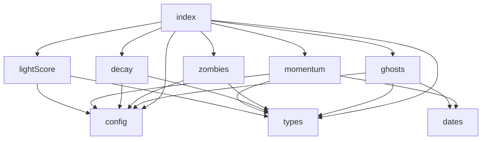
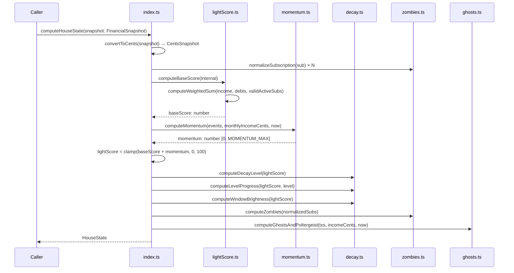

# Design Document — Haunting Engine

## Overview

The Haunting Engine (`src/lib/haunting/`) is a pure, deterministic TypeScript module. Its sole public function, `computeHouseState(snapshot: FinancialSnapshot): HouseState`, converts a financial snapshot — monthly income, debts, subscriptions, transactions, and a reference calendar date — into a `HouseState` that drives the animated house scene in CashCrypt.

The module has no side effects: no React imports, no Dexie access, no calls to `Date.now()` or `Math.random()`, and no I/O of any kind. Every numeric threshold, weight, and band boundary is sourced exclusively from `src/lib/haunting/config.ts`. All monetary amounts cross a single **Cents_Boundary** at the entry point and are thereafter integer cents throughout the computation.

---

## Architecture

The module is composed of the files below, each with a single responsibility:

```
src/lib/haunting/
├── types.ts          — All TypeScript types and interfaces
├── config.ts         — All numeric constants and validateConfig
├── lightScore.ts     — Base score formula and weighted sum
├── momentum.ts       — Momentum computation from FinancialEvents
├── decay.ts          — Decay level, levelProgress, windowBrightness
├── zombies.ts        — Subscription normalisation and zombie generation
├── ghosts.ts         — Ghost and poltergeist computation
├── dates.ts          — Pure date arithmetic: dateToJulian, isInWindow (no imports)
└── index.ts          — Public API: convertToCents + computeHouseState
```

No file imports React, Dexie, Next.js, or any browser API. The dependency graph is a strict DAG:



---

## Data Flow



**Key invariants:**
- `convertToCents` is the only site in the entire codebase that calls `Math.round(x * 100)`. Every downstream function receives and returns integer cents.
- `lightScore = min(100, baseScore + momentum)`. `baseScore` and `momentum` are both included in `HouseState` so the UI can display the breakdown (e.g. "32 base + 6 momentum").

---

## Module Design

### `types.ts`

Defines all shared types. Input types use decimal dollars; internal and output types use integer cents.

```typescript
export type Cadence = "weekly" | "monthly" | "yearly";
export type Usage   = "often" | "rarely" | "never";

export interface InputDebt {
  debtId: string;
  name: string;
  balance: number;               // dollars (decimal) at input boundary
  minimumMonthlyPayment: number; // dollars (decimal) at input boundary
  apr: number;                   // 0–1
}

export interface InputSubscription {
  subscriptionId: string;
  name: string;
  amount: number;                // dollars (decimal) at input boundary
  cadence: Cadence;
  usage: Usage;
  active: boolean;
}

export interface InputTransaction {
  transactionId: string;
  amount: number;                // dollars (decimal) at input boundary
  description: string;
  category: string;
  date: string;                  // YYYY-MM-DD
}

export type FinancialEventType =
  | "debt_payment"
  | "subscription_canceled"
  | "exorcism_action_completed";

export interface FinancialEvent {
  // Money fields are already integer cents in the public input; convertToCents
  // passes them through, sanitising non-finite or negative values to 0.
  type: FinancialEventType;
  date: string;                  // YYYY-MM-DD
  amountCents?: number;          // integer cents; used for subscription_canceled
  extraPrincipalCents?: number;  // integer cents; used for debt_payment
}

export interface FinancialSnapshot {
  monthlyIncome: number;         // dollars (decimal)
  debts: InputDebt[];
  subscriptions: InputSubscription[];
  transactions: InputTransaction[];
  events: FinancialEvent[];      // in-window events contribute to momentum
  now: string;                   // YYYY-MM-DD
}

// Internal representation — all amounts in integer cents
export interface InternalDebt {
  debtId: string;
  name: string;
  balanceCents: number;
  minimumMonthlyPaymentCents: number;
  apr: number;
}

export interface InternalSubscription {
  subscriptionId: string;
  name: string;
  monthlyCostCents: number;
  usage: Usage;
  active: boolean;
  valid: boolean;
}

export interface InternalTransaction {
  transactionId: string;
  amountCents: number;
  description: string;
  category: string;
  date: string;
}

export interface InternalSnapshot {
  monthlyIncomeCents: number;
  debts: InternalDebt[];
  subscriptions: InternalSubscription[];
  transactions: InternalTransaction[];
  events: FinancialEvent[];
  now: string;
}

// Output of the Cents_Boundary: dollars already converted to integer cents, subscriptions not yet
// normalised to a monthly cost. normalizeSubscription turns SubscriptionInCents into InternalSubscription.
export interface SubscriptionInCents {
  subscriptionId: string;
  name: string;
  amountCents: number;           // integer cents, per cadence period
  cadence: Cadence;
  usage: Usage;
  active: boolean;
}

export interface CentsSnapshot {
  monthlyIncomeCents: number;
  debts: InternalDebt[];
  subscriptions: SubscriptionInCents[];
  transactions: InternalTransaction[];
  events: FinancialEvent[];
  now: string;
}

// Output types — all amounts in integer cents
export interface Zombie {
  subscriptionId: string;
  name: string;
  monthlyCost: number;           // integer cents
  usage: Usage;
}

export interface Ghost {
  transactionId: string;
  amount: number;                // integer cents
  description: string;
  category: string;
  date: string;
}

export interface Poltergeist {
  totalAmount: number;           // integer cents
  transactionCount: number;
  byCategory: Record<string, number>; // values are integer cents; sum === totalAmount
}

export interface HouseState {
  lightScore: number;            // real number [0, 100]; = min(100, baseScore + momentum)
  baseScore: number;             // 100 / (1 + S) before momentum, or exactly 0/100 on the zero-income path; in [0, 100]
  momentum: number;              // bonus from in-window events; in [0, MOMENTUM_MAX]
  decayLevel: 1 | 2 | 3 | 4 | 5;
  windowBrightness: number;      // lightScore / 100, in [0.0, 1.0]
  levelProgress: number;         // position in current band, [0.0, 1.0]
  zombies: Zombie[];
  ghosts: Ghost[];
  poltergeist: Poltergeist | null;
}
```

---

### `config.ts`

The single source of truth for all numeric constants. No other file contains a numeric literal governing scoring, banding, cadence conversion, windowing, or creature spawning. The only literals allowed elsewhere are 0, 1 and -1; `dates.ts` is exempt because the Julian Day formula is calendar arithmetic, not a tunable constant (enforced by `tests/haunting/staticChecks.test.ts`).

```typescript
export const WEIGHT_FACTOR_A        = 1.0;   // minimumPayment / income
export const WEIGHT_FACTOR_B        = 2.5;   // balance / annualIncome
export const WEIGHT_FACTOR_C        = 0.5;   // subscriptionCost / income

// Momentum coefficients
export const MOMENTUM_MAX           = 15;    // maximum momentum bonus
export const COEFF_EXTRA_PRINCIPAL  = 30;    // weight for extraPrincipal / monthlyIncome
export const COEFF_SUB_CANCEL_COST  = 100;   // weight for canceledCost / monthlyIncome
export const COEFF_ACTIONS_COMPLETED = 1.0;  // points per completed exorcism action

export const BAND_L1_MIN            = 80;    // [80, 100]
export const BAND_L2_MIN            = 60;    // [60, 80)
export const BAND_L3_MIN            = 40;    // [40, 60)
export const BAND_L4_MIN            = 20;    // [20, 40)
export const BAND_L5_MIN            = 0;     // [0,  20)

export const SMALL_EXPENSE_THRESHOLD_CENTS = 1500; // $15.00
export const POLTERGEIST_RATIO      = 0.10;

export const CADENCE_WEEKLY_FACTOR  = 52 / 12; // ≈ 4.3333
export const CADENCE_YEARLY_FACTOR  = 1 / 12;  // ≈ 0.0833

// Supporting constants, so that no other module needs a numeric literal
export const WINDOW_DAYS            = 30;    // rolling window for ghosts and momentum
export const SCORE_MIN              = 0;     // lower bound of lightScore and baseScore
export const SCORE_MAX              = 100;   // upper bound of lightScore and baseScore
export const CENTS_PER_DOLLAR       = 100;   // used only by the Cents_Boundary in index.ts
export const MIN_INCOME_CENTS       = 100;   // incomes below this take the zero-income path ($1.00)
export const MONTHS_PER_YEAR        = 12;    // annual income = monthly income × 12 in Factor_B

export function validateConfig(config: HauntingConfig): string[] {
  const problems: string[] = [];
  if (config.WEIGHT_FACTOR_A < 2 * config.WEIGHT_FACTOR_C)
    problems.push(`WEIGHT_FACTOR_A (${config.WEIGHT_FACTOR_A}) must be ≥ 2 × WEIGHT_FACTOR_C (${config.WEIGHT_FACTOR_C})`);
  if (config.WEIGHT_FACTOR_B < 2 * config.WEIGHT_FACTOR_C)
    problems.push(`WEIGHT_FACTOR_B (${config.WEIGHT_FACTOR_B}) must be ≥ 2 × WEIGHT_FACTOR_C (${config.WEIGHT_FACTOR_C})`);
  if (config.SMALL_EXPENSE_THRESHOLD_CENTS <= 0)
    problems.push(`SMALL_EXPENSE_THRESHOLD_CENTS must be > 0`);
  if (config.POLTERGEIST_RATIO <= 0)
    problems.push(`POLTERGEIST_RATIO must be > 0`);
  if (config.MOMENTUM_MAX <= 0)
    problems.push(`MOMENTUM_MAX (${config.MOMENTUM_MAX}) must be > 0`);
  if (config.COEFF_EXTRA_PRINCIPAL < 0)
    problems.push(`COEFF_EXTRA_PRINCIPAL must be ≥ 0`);
  if (config.COEFF_SUB_CANCEL_COST < 0)
    problems.push(`COEFF_SUB_CANCEL_COST must be ≥ 0`);
  if (config.COEFF_ACTIONS_COMPLETED < 0)
    problems.push(`COEFF_ACTIONS_COMPLETED must be ≥ 0`);
  if (config.BAND_L1_MIN >= 100 || config.BAND_L1_MIN < config.BAND_L2_MIN)
    problems.push(`Band boundaries are invalid or out of order`);
  // ... remaining band checks
  return problems;
}
```

**Constraint check for shipped defaults:**
- `WEIGHT_FACTOR_A ≥ 2 × WEIGHT_FACTOR_C`: 1.0 ≥ 2 × 0.5 = 1.0 ✓
- `WEIGHT_FACTOR_B ≥ 2 × WEIGHT_FACTOR_C`: 2.5 ≥ 2 × 0.5 = 1.0 ✓

---

### `lightScore.ts`

Computes the weighted sum S and the base score formula.

```typescript
export function computeBaseScore(internal: InternalSnapshot): number;
// Returns a real number in [0, 100] representing the static financial burden (strictly inside (0, 100] whenever monthlyIncomeCents >= 100).
// Special cases: monthlyIncomeCents < 100 handled first (returns 0 or 100).
// Formula: 100 / (1 + S) where S = Wa*A + Wb*B + Wc*C.
// Result is clamped to [0, 100].

export function computeWeightedSum(
  monthlyIncomeCents: number,
  debts: InternalDebt[],
  validActiveSubs: InternalSubscription[]
): number;
// Returns S = Wa*A + Wb*B + Wc*C.
// Pure helper; exported for unit testing.
```

**Zero-income special cases** (resolved before the formula):
- If `monthlyIncomeCents < 100` and any `debt.balanceCents > 0` or any valid active subscription exists → `baseScore = 0`
- If `monthlyIncomeCents < 100` and no such debts and no valid active subscriptions → `baseScore = 100`

---

### `momentum.ts`

Computes the Momentum bonus from in-window `FinancialEvent`s. It reuses `isInWindow`, which is exported from the shared pure date helper `src/lib/haunting/dates.ts` (home of `dateToJulian` and `isInWindow`). Both `ghosts.ts` and `momentum.ts` import from `dates.ts`; `dates.ts` has no imports.

```typescript
export function filterInWindowEvents(events: FinancialEvent[], now: string): FinancialEvent[];
// Returns only events whose date is in the WINDOW_DAYS calendar days ending on now, inclusive
// (now − 29 … now). now − 30 and earlier, and future dates, are excluded.

export function computeMomentum(events: FinancialEvent[], monthlyIncomeCents: number, now: string): number;
// 1. If monthlyIncomeCents < 100 return 0 (zero-income path; preserves exact 0/100 light scores).
// 2. inWindow = filterInWindowEvents(events, now).
// 3. totalExtraPrincipal = Σ max(0, extraPrincipalCents ?? 0) over debt_payment events.
// 4. totalCanceledCost = Σ max(0, amountCents ?? 0) over subscription_canceled events.
// 5. actionsCount = count of exorcism_action_completed events.
// 6. raw = COEFF_EXTRA_PRINCIPAL * (totalExtraPrincipal / monthlyIncomeCents)
//        + COEFF_SUB_CANCEL_COST  * (totalCanceledCost   / monthlyIncomeCents)
//        + COEFF_ACTIONS_COMPLETED * actionsCount.
// 7. Return clamp(raw, 0, MOMENTUM_MAX). Never throws; non-finite inputs are treated as 0.
```

---

### `decay.ts`

Derives the three display-layer values from the clamped light score.

```typescript
export function computeDecayLevel(lightScore: number): 1 | 2 | 3 | 4 | 5;
// Applies half-open bands from config.
// Requires lightScore already clamped to [0, 100].

export function computeLevelProgress(lightScore: number, level: 1 | 2 | 3 | 4 | 5): number;
// Returns (lightScore - bandLow) / (bandHigh - bandLow), clamped to [0, 1].
// Level 1: bandLow = 80, bandHigh = 100 (inclusive upper).
// Levels 2–5: exclusive upper (e.g. L2: 60 ≤ score < 80, bandHigh = 80).

export function computeWindowBrightness(lightScore: number): number;
// Returns lightScore / 100, clamped to [0, 1].
```

---

### `zombies.ts`

Handles subscription normalisation and zombie generation.

```typescript
export function isValidSubscription(sub: InternalSubscription): boolean;
// Returns true if subscriptionId non-empty, name non-empty, monthlyCostCents > 0,
// cadence is valid, usage is valid, and active is true.

export function normalizeSubscription(sub: SubscriptionInCents): InternalSubscription;
// Receives a subscription already converted to cents by the Cents_Boundary in index.ts
// (this function never converts dollars). Computes monthlyCostCents = round(amountCents × cadence factor).
// Sets valid = isValidSubscription result. Does not throw.

export function computeZombies(subs: InternalSubscription[]): Zombie[];
// Returns one Zombie per subscription where valid === true and active === true.

export function computeFactorC(
  subs: InternalSubscription[],
  monthlyIncomeCents: number
): number;
// Returns sum(monthlyCostCents for valid active subs) / monthlyIncomeCents.
// Returns 0 if monthlyIncomeCents === 0.
```

**Cadence normalisation** (all factors from `config.ts`):
- `"monthly"` → `amount` (factor 1)
- `"weekly"` → `amount × CADENCE_WEEKLY_FACTOR` (≈ 4.3333)
- `"yearly"` → `amount × CADENCE_YEARLY_FACTOR` (≈ 0.0833)

A subscription with `active: true` that fails any validity criterion is silently excluded from both `zombies` and Factor_C without throwing.

---

### `ghosts.ts`

Computes ghosts and poltergeist using pure date arithmetic — no `Date` object construction, no `Date.now()`. `isInWindow` now lives in `dates.ts` and is imported by `ghosts.ts` (and `momentum.ts`).

```typescript
// import { isInWindow } from './dates';
// isInWindow(date: string, now: string): boolean
// True if date is one of the WINDOW_DAYS calendar days ending on now, inclusive (now − 29 … now);
// now − WINDOW_DAYS and earlier, and future dates, are outside. YYYY-MM-DD strings.

export function isSmallExpense(amountCents: number): boolean;
// Returns true if 0 < amountCents < SMALL_EXPENSE_THRESHOLD_CENTS.

export function computeGhostsAndPoltergeist(
  transactions: InternalTransaction[],
  monthlyIncomeCents: number,
  now: string
): { ghosts: Ghost[]; poltergeist: Poltergeist | null };
// 1. Filter qualifying transactions: isSmallExpense AND isInWindow.
// 2. Sum totalAmountCents.
// 3. If monthlyIncomeCents >= 100 and totalAmountCents > POLTERGEIST_RATIO * monthlyIncomeCents:
//      return { ghosts: [], poltergeist: { totalAmount, transactionCount, byCategory } }.
// 4. Else: return { ghosts: one Ghost per qualifying tx, poltergeist: null }.
```

**Ghost–Poltergeist mutual exclusion:** when `poltergeist` is non-null, `ghosts` is always `[]`. When `poltergeist` is null, `ghosts` contains exactly one entry per qualifying transaction.

**Zero-income poltergeist:** if `monthlyIncomeCents < 100`, the poltergeist threshold is not met; qualifying transactions become individual ghosts regardless of their total amount.

---

### `index.ts` (public API)

```typescript
export function computeHouseState(snapshot: FinancialSnapshot): HouseState { /* see body below */ }
export { validateConfig }    from './config';
export type { FinancialSnapshot, HouseState, Zombie, Ghost, Poltergeist, FinancialEvent } from './types';

// Internal: convertToCents(snapshot: FinancialSnapshot): CentsSnapshot
// Called once at the top of computeHouseState. Not exported.
```

`computeHouseState` is defined in `index.ts`. Its body:

```typescript
function computeHouseState(snapshot: FinancialSnapshot): HouseState {
  const internal = convertToCents(snapshot);                       // Cents_Boundary
  const normalizedSubs = internal.subscriptions.map(normalizeSubscription);
  const baseScore = computeBaseScore({ ...internal, subscriptions: normalizedSubs });
  const momentum  = computeMomentum(internal.events, internal.monthlyIncomeCents, internal.now);
  const lightScore = Math.max(SCORE_MIN, Math.min(SCORE_MAX, baseScore + momentum));
  const decayLevel       = computeDecayLevel(lightScore);
  const levelProgress    = computeLevelProgress(lightScore, decayLevel);
  const windowBrightness = computeWindowBrightness(lightScore);
  const zombies = computeZombies(normalizedSubs);
  const { ghosts, poltergeist } = computeGhostsAndPoltergeist(
    internal.transactions, internal.monthlyIncomeCents, internal.now
  );
  return { lightScore, baseScore, momentum, decayLevel, windowBrightness, levelProgress, zombies, ghosts, poltergeist };
}
```

`convertToCents` is the **only** place in the codebase that calls `Math.round(x * CENTS_PER_DOLLAR)` (`CENTS_PER_DOLLAR = 100`, from `config.ts`). It converts `monthlyIncome`, all debt `balance` and `minimumMonthlyPayment` values, all subscription `amount` values, and all transaction `amount` values in a single pass. It also converts `events`: `FinancialEvent` money fields (`amountCents`, `extraPrincipalCents`) are already integer cents in the public input (produced by the app from Dexie records), so `convertToCents` passes them through after `Math.round`-free sanitising (non-finite or negative → 0).

---

## Formula Analysis

### Base Score Formula

```
baseScore  = 100 / (1 + S)
lightScore = min(100, baseScore + momentum)

S = WEIGHT_FACTOR_A × A + WEIGHT_FACTOR_B × B + WEIGHT_FACTOR_C × C

A = Σ(debt.minimumMonthlyPaymentCents) / monthlyIncomeCents
B = Σ(debt.balanceCents) / (monthlyIncomeCents × 12)
C = Σ(validActiveSub.monthlyCostCents) / monthlyIncomeCents
```

A, B, and C are dimensionless ratios. The numerators and denominators are both integer cents; the division produces a floating-point ratio passed to the formula.

**Why strictly decreasing:** `d(baseScore)/dS = −100 / (1 + S)² < 0` for all `S ≥ 0`. Any increase in A, B, or C with positive weights increases S, which strictly decreases `baseScore`.

**Why never exactly 0 for finite input:** `100 / (1 + S) = 0` requires `S = ∞`. For any finite debt balance and `monthlyIncomeCents ≥ 100`, S is finite, so `baseScore > 0`. At `S = 1e15`, `baseScore ≈ 1e−13` — positive but practically zero.

**Clamping:** After the formula, the result is clamped to `[0, 100]` to absorb any IEEE 754 edge.

### Integer Cents Guarantee

All sums, comparisons, and output amounts (`Zombie.monthlyCost`, `Ghost.amount`, `Poltergeist.totalAmount`, `byCategory` values) are integer numbers of cents. This makes `byCategory` values sum exactly to `totalAmount` with no floating-point rounding after the Cents_Boundary.

**Valid `monthlyIncome` after conversion:** 0 (zero-income edge case) or ≥ 100 cents ($1.00). An income between 1 and 99 cents is treated as 0 (the special-case path runs).

### Momentum Formula

```
raw      = COEFF_EXTRA_PRINCIPAL  × (Σ extraPrincipalCents / monthlyIncomeCents)
         + COEFF_SUB_CANCEL_COST  × (Σ canceledCostCents   / monthlyIncomeCents)
         + COEFF_ACTIONS_COMPLETED × actionsCount
momentum = clamp(raw, 0, MOMENTUM_MAX)
```

**Rolling 30-day window:** only events dated in `[now − 29 days, now]` are summed. Events accumulate inside the window, so repeated weekly plans stack until `MOMENTUM_MAX` saturates. As events age past 30 days they drop out and momentum decays.

**Zero-income rule:** when `monthlyIncomeCents < 100`, `momentum = 0`.

| Constant | Value | Effect for L4 persona ($3,000/mo) |
|---|---|---|
| `MOMENTUM_MAX` | 15 | Caps the bonus |
| `COEFF_EXTRA_PRINCIPAL` | 30 | $300 extra (ratio 0.10) → 3.00 pts |
| `COEFF_SUB_CANCEL_COST` | 100 | $15.49 canceled (ratio 0.00516) → 0.52 pts |
| `COEFF_ACTIONS_COMPLETED` | 1.0 | 3 actions → 3.00 pts |

**Why momentum never breaks monotonicity:** momentum depends only on events and income, not on debts or subscriptions. The debt-increase, debt-payment and cancellation properties compare snapshots with identical events and identical momentum, so they reduce to properties of `baseScore`. The strict-cancellation property also survives the cap, because the original `lightScore` is below 100 and `min(100, x)` is strictly increasing below 100.

---

## Calibration Table

Default weights: `Wa = 1.0`, `Wb = 2.5`, `Wc = 0.5`.

| Scenario | monthlyIncome | Debts (bal / minPay) | Subscriptions ($/mo) | A | B | C | S | lightScore (= baseScore, no events) | Level |
|---|---|---|---|---|---|---|---|---|---|
| **L1 Pristine** | $5,000 | $3,000 / $100 | $15 | 0.0200 | 0.0500 | 0.0030 | 0.1465 | 87.22 | 1 |
| **L2 Uneasy** | $4,000 | $8,000/$200 + $2,000/$60 | $50 + $15 | 0.0650 | 0.2083 | 0.0163 | 0.5940 | 62.74 | 2 |
| **L3 Haunted** | $3,500 | $15,000/$350 + $5,000/$100 | $80 + $50 + $15 | 0.1286 | 0.4762 | 0.0414 | 1.3398 | 42.74 | 3 |
| **L4 Crumbling** *(default demo)* | $3,000 | $18,000/$400 + $6,000/$150 + $2,000/$60 | $120(never) + $60(rarely) + $50(often) + $30(often) + $15.49(never) | 0.2033 | 0.7222 | 0.0918 | 2.0548 | 32.74 | 4 |
| **L5 Condemned** | $2,500 | $35,000/$700 + $12,000/$250 + $5,000/$120 | $200 + $100 + $80 + $60 + $30 + $15 | 0.4280 | 1.7333 | 0.1940 | 4.8583 | 17.07 | 5 |

The calibration table shows baseScore only (empty `events`). Momentum is demonstrated in the next section.

---

## Demo Scenario L4 Verification

### Realistic weekly exorcism plan

Persona: $3,000/mo income; L4 subscriptions $120(never), $60(rarely), $50(often), $30(often), $15.49(never). Weekly plan: pay $300 extra principal on the $18,000 debt (above the $400 minimum), cancel the $15.49 never-used subscription, complete 3 exorcism actions. The earlier $4,000-extra-payment demo plan is removed because it is not realistic for this income.

Because the 30-day window is rolling, events from consecutive weeks stack. Trajectory (computed with Wa=1.0, Wb=2.5, Wc=0.5, Cp=30, Cs=100, Ca=1.0, MOMENTUM_MAX=15):

| Week (plan repeated) | Cumulative extra principal | baseScore | momentum | lightScore | displayed | Level |
|---|---|---|---|---|---|---|
| Start | $0 | 32.74 | 0.00 | 32.74 | 32 | L4 |
| 1 | $300 | 32.99 | 6.52 | 39.50 | 39 (+7) | L4 (levelProgress 0.98) |
| 2 | $600 | 33.22 | 12.52 | 45.73 | 45 | L3 |
| 3 | $900 | 33.45 | 15.00 | 48.45 | 48 | L3 |
| 4 | $1,200 | 33.68 | 15.00 | 48.68 | 48 | L3 |

Week-1 breakdown: momentum = 30×0.10 + 100×0.005163 + 1.0×3 = 3.00 + 0.52 + 3.00 = 6.52. The lightScore delta is +6.77, inside the required +5 to +8. The UI explains it as "39 (33 base + 6 momentum)". After four weeks at this pace the house moves up exactly one level (L4 → L3) and stays below L2 (60). Base score alone moves only +0.25 in week 1, which is why momentum exists.

### Poltergeist verification

30 transactions at $12.00 each (coffees/snacks) = $360 total.

Threshold = `POLTERGEIST_RATIO × monthlyIncome = 0.10 × $3,000 = $300`.

$360 > $300 → Poltergeist active ✓

Each $12.00 transaction qualifies as a small expense: `0 < 1200 cents < 1500 cents (SMALL_EXPENSE_THRESHOLD_CENTS)` ✓

---

## Date Arithmetic

The 30-day window is the 30 calendar days ending on `now`, inclusive: `now − 29` through `now` are inside, `now − 30` and earlier are outside, and future dates are outside. It uses no `Date` objects, no `Date.now()`, and no browser APIs. It is computed entirely from the `now` string in the Financial_Snapshot using Julian Day Number arithmetic.

Both functions below live in `src/lib/haunting/dates.ts` and are imported by `ghosts.ts` and `momentum.ts`. `dates.ts` is exempt from the no-numeric-literals rule: the Julian Day formula is calendar arithmetic, not a tunable scoring constant.

```typescript
function dateToJulian(yyyy: number, mm: number, dd: number): number {
  // Standard Julian Day Number formula — no Date API calls
  const a = Math.floor((14 - mm) / 12);
  const y = yyyy + 4800 - a;
  const m = mm + 12 * a - 3;
  return dd + Math.floor((153 * m + 2) / 5) + 365 * y + Math.floor(y / 4)
       - Math.floor(y / 100) + Math.floor(y / 400) - 32045;
}

function isInWindow(date: string, now: string): boolean {
  const [y2, m2, d2] = now.split('-').map(Number);
  const [y1, m1, d1] = date.split('-').map(Number);
  const jNow  = dateToJulian(y2, m2, d2);
  const jDate = dateToJulian(y1, m1, d1);
  // WINDOW_DAYS comes from config.ts; jNow - WINDOW_DAYS itself is outside the window
  return jDate > jNow - WINDOW_DAYS && jDate <= jNow;
}
```

This handles month/year boundaries and leap years correctly through the Julian Day Number formula, which is purely arithmetic.

---

## fast-check Arbitraries

Property-based tests use **two** generators defined in `src/lib/haunting/testArbitraries.ts` (test-only, not shipped to production).

### Realistic generator

Used for strict-monotonicity properties (Req 14 AC5):

```typescript
const realisticSnapshot = fc.record({
  monthlyIncome: fc.oneof(fc.constant(0), fc.integer({ min: 100, max: 1_000_000 })), // 0 or $1–$10,000
  debts: fc.array(fc.record({
    debtId:    fc.uuidV(4),
    name:      fc.string({ minLength: 1 }),
    balance:   fc.integer({ min: 0, max: 1_000_000_00 }), // up to $1,000,000 in cents
    minimumMonthlyPayment: fc.integer({ min: 0, max: 500_000 }), // up to $5,000
    apr:       fc.float({ min: 0, max: 0.4 }),
  }), { maxLength: 10 }),
  subscriptions: fc.array(fc.record({
    subscriptionId: fc.uuidV(4),
    name:   fc.string({ minLength: 1 }),
    amount: fc.integer({ min: 1, max: 1_000_000 }), // up to $10,000 in cents
    cadence: fc.constantFrom('weekly', 'monthly', 'yearly'),
    usage:  fc.constantFrom('often', 'rarely', 'never'),
    active: fc.boolean(),
  }), { maxLength: 10 }),
  transactions: fc.array(fc.record({
    transactionId: fc.uuidV(4),
    amount:      fc.integer({ min: 1, max: 500_000 }), // up to $5,000 in cents
    description: fc.string(),
    category:    fc.string({ minLength: 1 }),
    date:        fc.date({ min: new Date('2020-01-01'), max: new Date('2026-12-31') })
                   .map(d => d.toISOString().slice(0, 10)),
  }), { maxLength: 50 }),
  events: fc.array(fc.record({
    type: fc.constantFrom('debt_payment', 'subscription_canceled', 'exorcism_action_completed'),
    date: fc.date({ min: new Date('2020-01-01'), max: new Date('2026-12-31') })
            .map(d => d.toISOString().slice(0, 10)),
    amountCents:         fc.option(fc.integer({ min: 0, max: 1_000_000 }), { nil: undefined }),
    extraPrincipalCents: fc.option(fc.integer({ min: 0, max: 1_000_000 }), { nil: undefined }),
  }), { maxLength: 20 }),
  now: fc.date({ min: new Date('2024-01-01'), max: new Date('2026-12-31') })
         .map(d => d.toISOString().slice(0, 10)),
});
```

> Note: the generators produce integer-cent values. A test helper `centsToSnapshot` divides by 100 to build the dollar-valued `FinancialSnapshot`, so the Cents_Boundary round trip is exact.

> Note: the realistic generator should bias `now` and event dates to overlap (e.g. event date = `now` minus an integer offset in [-5, 45] days via the Julian helper) so in-window and out-of-window events are both frequent.

### Extreme generator

Used for robustness properties (Req 14 AC11):

```typescript
const extremeSnapshot = fc.record({
  monthlyIncome: fc.oneof(fc.constant(0), fc.integer({ min: 100, max: 100_000_000_00 })),
  debts: fc.array(fc.record({
    debtId:    fc.uuidV(4),
    name:      fc.string({ minLength: 1 }),
    balance:   fc.integer({ min: 0, max: 100_000_000_000_00 }), // up to $1e12 in cents
    minimumMonthlyPayment: fc.integer({ min: 0, max: 100_000_000_000_00 }),
    apr:       fc.float({ min: 0, max: 1 }),
  }), { maxLength: 20 }),
  subscriptions: fc.array(fc.record({
    subscriptionId: fc.uuidV(4),
    name:    fc.string({ minLength: 1 }),
    amount:  fc.integer({ min: 1, max: 100_000_000_000_00 }),
    cadence: fc.constantFrom('weekly', 'monthly', 'yearly'),
    usage:   fc.constantFrom('often', 'rarely', 'never'),
    active:  fc.boolean(),
  }), { maxLength: 20 }),
  transactions: fc.array(fc.record({
    transactionId: fc.uuidV(4),
    amount:      fc.integer({ min: 1, max: 100_000_000_000_00 }),
    description: fc.string(),
    category:    fc.string({ minLength: 1 }),
    date:        fc.date({ min: new Date('2020-01-01'), max: new Date('2026-12-31') })
                   .map(d => d.toISOString().slice(0, 10)),
  }), { maxLength: 100 }),
  events: fc.array(fc.record({
    type: fc.constantFrom('debt_payment', 'subscription_canceled', 'exorcism_action_completed'),
    date: fc.date({ min: new Date('2020-01-01'), max: new Date('2026-12-31') })
            .map(d => d.toISOString().slice(0, 10)),
    amountCents:         fc.option(fc.integer({ min: 0, max: 100_000_000_000_00 }), { nil: undefined }),
    extraPrincipalCents: fc.option(fc.integer({ min: 0, max: 100_000_000_000_00 }), { nil: undefined }),
  }), { maxLength: 50 }),
  now: fc.date({ min: new Date('2024-01-01'), max: new Date('2026-12-31') })
         .map(d => d.toISOString().slice(0, 10)),
});
```

### Derived-snapshot builders

Pure helpers for monotonicity tests:

```typescript
// Pay down a debt: reduce balance by deltaCents (clamped to 0)
function payDebt(snap: FinancialSnapshot, debtIndex: number, deltaCents: number): FinancialSnapshot {
  const debts = snap.debts.map((d, i) =>
    i === debtIndex ? { ...d, balance: Math.max(0, d.balance - deltaCents) } : d
  );
  return { ...snap, debts };
}

// Cancel a subscription: set active = false
function cancelSubscription(snap: FinancialSnapshot, subIndex: number): FinancialSnapshot {
  const subscriptions = snap.subscriptions.map((s, i) =>
    i === subIndex ? { ...s, active: false } : s
  );
  return { ...snap, subscriptions };
}

// Increase a debt balance
function increaseDebtBalance(snap: FinancialSnapshot, debtIndex: number, deltaCents: number): FinancialSnapshot {
  const debts = snap.debts.map((d, i) =>
    i === debtIndex ? { ...d, balance: d.balance + deltaCents } : d
  );
  return { ...snap, debts };
}

// Add an event dated exactly `snap.now` (always in-window)
function addInWindowEvent(snap: FinancialSnapshot, event: FinancialEvent): FinancialSnapshot {
  return { ...snap, events: [...snap.events, { ...event, date: snap.now }] };
}

// Add an event dated 31 days before `snap.now` (always out-of-window)
function addOutOfWindowEvent(snap: FinancialSnapshot, event: FinancialEvent): FinancialSnapshot {
  return { ...snap, events: [...snap.events, { ...event, date: shiftDays(snap.now, -31) }] };
}

// Drop every event outside [now − 29 days, now]
function removeOutOfWindowEvents(snap: FinancialSnapshot): FinancialSnapshot {
  return { ...snap, events: snap.events.filter(e => isInWindow(e.date, snap.now)) };
}
```

(`shiftDays` is a test helper built on the Julian helper from `dates.ts`.)

The strict-cancellation property (Req 14 AC5) narrows its generator: it uses `realisticSnapshot` filtered to snapshots with at least one active subscription with `monthlyCostCents ≤ 1_000_000` and `monthlyIncomeCents ≥ 100`.

---

## Components and Interfaces

### Public API

The engine exposes one function and the types below through `index.ts`:

| Export | Kind | Description |
|---|---|---|
| `computeHouseState(snapshot: FinancialSnapshot): HouseState` | Function | The single entry point. Pure, deterministic, never throws for structurally valid input. |
| `validateConfig(config): string[]` | Function | Re-exported from `config.ts`. Returns problems or `[]`. Never throws. |
| `FinancialSnapshot` | Type | Input shape (decimal dollars). |
| `HouseState` | Type | Output shape (integer cents for monetary fields). |
| `Zombie` | Type | One per valid active subscription. |
| `Ghost` | Type | One per qualifying small-expense transaction (when no poltergeist). |
| `Poltergeist` | Type | Present when small-expense total exceeds threshold. |
| `FinancialEvent` | Type | One input event; only in-window events affect momentum. |

### Internal component interfaces

Internal components interact only through pure function calls; no shared mutable state exists.

| Component | Consumes | Produces |
|---|---|---|
| `convertToCents` | `FinancialSnapshot` | `CentsSnapshot` |
| `normalizeSubscription` | `SubscriptionInCents` | `InternalSubscription` |
| `computeBaseScore` | `InternalSnapshot` | `number` |
| `computeMomentum` | `FinancialEvent[]`, `monthlyIncomeCents`, `now` | `number [0, MOMENTUM_MAX]` |
| `filterInWindowEvents` | `FinancialEvent[]`, `now` | `FinancialEvent[]` |
| `computeWeightedSum` | `monthlyIncomeCents`, `InternalDebt[]`, `InternalSubscription[]` | `number` (S) |
| `computeDecayLevel` | `lightScore: number` | `1 \| 2 \| 3 \| 4 \| 5` |
| `computeLevelProgress` | `lightScore: number`, `level` | `number [0,1]` |
| `computeWindowBrightness` | `lightScore: number` | `number [0,1]` |
| `computeZombies` | `InternalSubscription[]` | `Zombie[]` |
| `computeFactorC` | `InternalSubscription[]`, `monthlyIncomeCents` | `number` |
| `computeGhostsAndPoltergeist` | `InternalTransaction[]`, `monthlyIncomeCents`, `now` | `{ ghosts, poltergeist }` |
| `isInWindow` (defined in `dates.ts`) | `date: string`, `now: string` | `boolean` |
| `isSmallExpense` | `amountCents: number` | `boolean` |
| `isValidSubscription` | `InternalSubscription` | `boolean` |

---

## Data Models

### Decision 1 — Integer cents

All monetary amounts are stored and computed as integer cents. The public API accepts decimal dollars; a single `Cents_Boundary` function converts them with `Math.round(x * 100)`. Every sum, comparison, and output amount is an integer number of cents. This makes `byCategory` sum exactly to `totalAmount` with no floating-point rounding.

The `Cents_Boundary` lives in `src/lib/haunting/index.ts`. No other file calls `Math.round(x * 100)`.

### Decision 2 — Light score formula

`baseScore = 100 / (1 + S)` plus `lightScore = min(100, baseScore + momentum)`. The base formula is chosen because it is:
- Strictly decreasing for all `S ≥ 0`
- Always positive for finite S
- Bounded to `(0, 100]` for `S ≥ 0` (the zero-income path returns exactly 0 or 100 before the formula runs)
- Smooth and differentiable, producing gradual score changes

(These bullets describe `baseScore`.)

### Decision 3 — Calibrated default weights

Weights are set so that the five demo scenarios produce scores that fall in each of the five bands, and so that debt is weighted more heavily than subscriptions (Wa ≥ 2×Wc, Wb ≥ 2×Wc).

### Decision 4 — fast-check arbitraries

Two generators cover different test concerns: a realistic generator for logical monotonicity properties, and an extreme generator for robustness against large values and edge cases.

### Decision 5 — File layout

One file per concern; no circular dependencies; no browser or framework imports anywhere in the module.

### Decision 6 — Momentum

Momentum rewards recent effort so that realistic weekly actions are visible: base score alone moves only +0.25 for the L4 weekly plan. Momentum is capped by `MOMENTUM_MAX`, is event-driven over the rolling 30-day window, and is 0 on the zero-income path.

---

## Correctness Properties

*A property is a characteristic or behavior that should hold true across all valid executions of a system — essentially, a formal statement about what the system should do. Properties serve as the bridge between human-readable specifications and machine-verifiable correctness guarantees.*

### Property 1: Bounds invariant

*For any* structurally valid snapshot, `computeHouseState` SHALL return a `lightScore` in `[0, 100]`, a `baseScore` in `[0, 100]`, a `decayLevel` in `{1, 2, 3, 4, 5}`, a `windowBrightness` in `[0.0, 1.0]`, and a `levelProgress` in `[0.0, 1.0]`.

**Validates: Requirements 14.1**

---

### Property 2: Band consistency invariant

*For any* structurally valid snapshot, the returned `decayLevel` SHALL be the unique level whose half-open band contains the returned `lightScore`: Level 1 for `[80, 100]`, Level 2 for `[60, 80)`, Level 3 for `[40, 60)`, Level 4 for `[20, 40)`, Level 5 for `[0, 20)`. Consequently, `Math.floor(lightScore)` falls in the same band as `lightScore` itself, since the band boundaries are integers.

**Validates: Requirements 14.2, 14.14**

---

### Property 3: Output consistency invariant

*For any* structurally valid snapshot, `windowBrightness` SHALL equal `lightScore / 100` clamped to `[0.0, 1.0]`, and `levelProgress` SHALL equal `(lightScore − bandLow) / (bandHigh − bandLow)` clamped to `[0.0, 1.0]` using the config boundaries of the returned `decayLevel`. Consequently, `windowBrightness` is monotonically non-decreasing with respect to `lightScore`.

**Validates: Requirements 14.3, 14.13**

---

### Property 4: Determinism

*For any* structurally valid snapshot, calling `computeHouseState` twice with the same input SHALL produce `HouseState` objects that are structurally equal field-by-field under deep value equality.

**Validates: Requirements 14.4**

---

### Property 5: Subscription cancellation strict monotonicity

*For any* structurally valid snapshot where `monthlyIncome > 0`, the returned `lightScore` is strictly between 0 and 100, and at least one valid active subscription with `monthlyCostCents ≤ 1_000_000` exists, setting exactly one such subscription's `active` flag to `false` SHALL produce a strictly higher `lightScore` and a `zombies` array of length exactly one less than the original (the strictness survives the 100 cap because the original lightScore is below 100).

**Validates: Requirements 14.5**

---

### Property 6: Debt increase monotonicity

*For any* structurally valid snapshot with at least one debt, increasing that debt's `balance` by a finite positive amount SHALL produce a `lightScore` less than or equal to the original. Equivalently, increasing any debt's `minimumMonthlyPayment` by a finite positive amount SHALL also produce a `lightScore` less than or equal to the original.

**Validates: Requirements 14.6, 14.7**

---

### Property 7: Debt payment monotonicity

*For any* structurally valid snapshot with at least one debt whose `balance > 0`, reducing that debt's `balance` by a finite positive amount such that the result remains ≥ 0 SHALL produce a `lightScore` greater than or equal to the original.

**Validates: Requirements 14.8**

---

### Property 8: Ghost-poltergeist conservation

*For any* structurally valid snapshot where `poltergeist` is `null`, the `ghosts` array length SHALL equal the count of transactions where `amount` is strictly in `(0, SMALL_EXPENSE_THRESHOLD_CENTS)` and `date` falls in `[now − 29 days, now]`.

*For any* structurally valid snapshot where `poltergeist` is not `null`, `ghosts` SHALL be empty, `poltergeist.totalAmount` SHALL equal the integer sum of qualifying transaction amounts, `poltergeist.transactionCount` SHALL equal their count, and the values of `poltergeist.byCategory` SHALL sum exactly to `poltergeist.totalAmount`.

**Validates: Requirements 14.9, 14.10**

---

### Property 9: Robustness

*For any* structurally valid snapshot including those with zero `monthlyIncome`, empty arrays, all-zero APRs, and amounts (including event amounts) up to 1e12, `computeHouseState` SHALL complete without throwing any exception and SHALL return a `HouseState` where every numeric field is a finite number (not `NaN` or `Infinity`).

**Validates: Requirements 14.11**

---

### Property 10: Momentum bounds

*For any* structurally valid snapshot, `momentum` SHALL be in `[0, MOMENTUM_MAX]`, and `momentum` SHALL equal 0 whenever `monthlyIncome` is 0.

**Validates: Requirements 14.15, 14.19**

---

### Property 11: Event window and monotonicity

*For any* structurally valid snapshot, events dated outside the 30-day window (including future dates) SHALL have no effect on `momentum` or `lightScore`; adding any in-window event with non-negative amounts SHALL never lower `lightScore`; and all existing monotonicity properties (14.6, 14.7, 14.8, 14.5) hold because they compare snapshots with identical events.

**Validates: Requirements 14.16, 14.17, 14.18**

---

### Property 12: Zero-income zero-obligation edge case

*For any* structurally valid snapshot where `monthlyIncome` is 0, the `debts` array is empty, and no valid active subscriptions exist, `computeHouseState` SHALL return `lightScore` equal to exactly 100.

**Validates: Requirements 14.12**

---

### Property 13: Base score is positive and strictly decreasing in the weighted sum

*For any* internal snapshot with `monthlyIncomeCents ≥ MIN_INCOME_CENTS`, `computeBaseScore` SHALL return a finite value in `(0, 100]`. Increasing any single burden by at least one cent (a debt balance, a debt minimum payment, or a valid active subscription's monthly cost) SHALL strictly increase the weighted sum S and strictly decrease `baseScore`. For any two such snapshots whose weighted sums differ by more than floating-point resolution, the one with the smaller S SHALL have the strictly higher `baseScore`. Tested at the function level with realistic amounts (≤ 1e7 cents).

**Validates: Requirements 2.6**

---

## Error Handling

The engine never throws for structurally valid input. The following conditions are handled silently:

| Condition | Handling |
|---|---|
| `monthlyIncome = 0` with debts or subscriptions | `lightScore = 0` (special-case path) |
| `monthlyIncome = 0`, no debts, no subscriptions | `lightScore = 100` (special-case path) |
| Subscription with `active: true` but invalid fields | Excluded from zombies and Factor_C; no error |
| Negative debt balance or minimumMonthlyPayment | Treated as 0; no error |
| Empty `debts`, `subscriptions`, or `transactions` arrays | All computations produce 0 or empty results; no division by zero |
| `monthlyIncome = 0` with qualifying small transactions | `poltergeist = null`; ghosts returned individually |
| Amounts up to 1e12 | Formula produces finite result; clamped to `[0, 100]` |
| `events` empty or all outside window | `momentum = 0` |
| Event with negative or non-finite amount | Contributes 0 |
| `monthlyIncome` < 100 cents | `momentum = 0` |

**Division by zero prevention:** All divisions by `monthlyIncomeCents` are guarded. `computeFactorC`, `computeWeightedSum`, and the zero-income special-case check in `computeBaseScore` all handle `monthlyIncomeCents = 0` before dividing.

**Config validation:** `validateConfig` returns problems as strings and never throws. The engine does not call `validateConfig` at module initialization — this is the caller's responsibility.

---

## Testing Strategy

The testing strategy combines example-based unit tests for specific scenarios with property-based tests for universal invariants. Property-based tests use the **fast-check** library with a minimum of **100 iterations per property**.

Each property test references its design property with a tag comment:
> `// Feature: haunting-engine, Property N: <property_text>`

### Test file mapping

| File | Tests |
|---|---|
| `tests/haunting/lightScore.test.ts` | Bounds invariant (P1), determinism (P4), debt increase monotonicity (P6), base score strictly decreasing and never 0 (P13), `computeBaseScore` and `computeWeightedSum` unit tests |
| `tests/haunting/decay.test.ts` | Band consistency invariant (P2), output consistency (P3: `windowBrightness` and `levelProgress`), `computeDecayLevel` for all band boundaries, `computeLevelProgress` formula |
| `tests/haunting/zombies.test.ts` | Validity filter, cadence normalisation, Factor_C computation |
| `tests/haunting/ghosts.test.ts` | Ghost conservation (P8), poltergeist conservation (P8), 30-day window |
| `tests/haunting/momentum.test.ts` | Momentum bounds (P10), window/monotonic (P11), zero-income neutrality, the L4 weekly-plan trajectory table as exact-value unit tests |
| `tests/haunting/dates.test.ts` | `isInWindow` boundaries: `now` in, `now − 29` in, `now − 30` out, `now − 31` out, `now + 1` out, exactly `WINDOW_DAYS` days inside, leap-year and year-boundary cases |
| `tests/haunting/integration.test.ts` | Calibration scenarios, subscription cancellation strict monotonicity (P5), debt payment monotonicity (P7) |
| `tests/haunting/robustness.test.ts` | Robustness (P9), zero-income zero-obligation (P12) |
| `tests/haunting/config.test.ts` | `validateConfig` returns `[]` for shipped config (Req 1 AC5) |
| `tests/haunting/staticChecks.test.ts` | Source scan of `src/lib/haunting/`: banned APIs and imports, numeric-literal rule, single use of the cents conversion (Req 1 AC1–2, Req 12) |

### Unit testing guidance

Unit tests cover:
- All five demo scenarios from the calibration table (exact score and level)
- L4 exorcism verification (before/after scores)
- L4 weekly-plan trajectory (weeks 1–4) with exact expected scores and levels
- L4 poltergeist verification
- Zero-income special cases (lightScore = 0 and lightScore = 100)
- `isInWindow` at exact boundaries: `now`, `now − 29` (in), `now − 30`, `now − 31`, `now + 1` (out)
- Each cadence conversion factor
- `validateConfig` with valid and invalid configs

Property tests (fast-check, ≥ 100 iterations each) cover all thirteen correctness properties above.

### Static checks

`tests/haunting/staticChecks.test.ts` reads the source files in `src/lib/haunting/` with `node:fs` and fails, naming the file and line, on any of the following:

- Banned calls: `Date.now`, `new Date`, `Math.random`, `performance.now`, `crypto.getRandomValues`, `console.`, `fetch(`.
- Banned browser globals: `localStorage`, `window`, `document`.
- Banned imports: `react`, `dexie`, `next` and any `next/*` module.
- Numeric literals other than `0`, `1` and `-1` (comments and string contents are ignored). Exempt from this rule: `config.ts`, `dates.ts` and test files (`testArbitraries.ts` and everything under `tests/`).
- `Math.round(` used with the cents constant anywhere other than `index.ts`.

This is a Vitest test rather than a lint rule, so no extra tooling config is needed.
