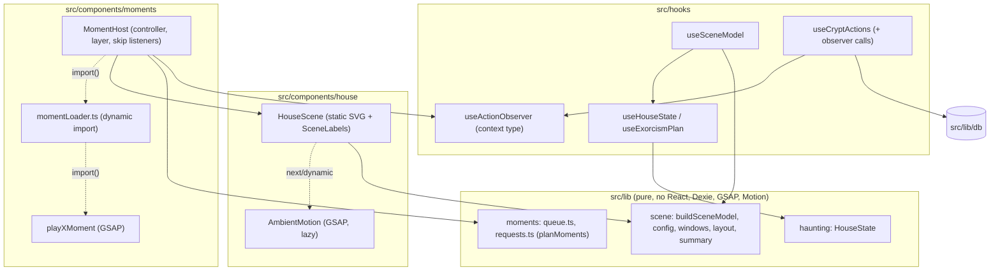
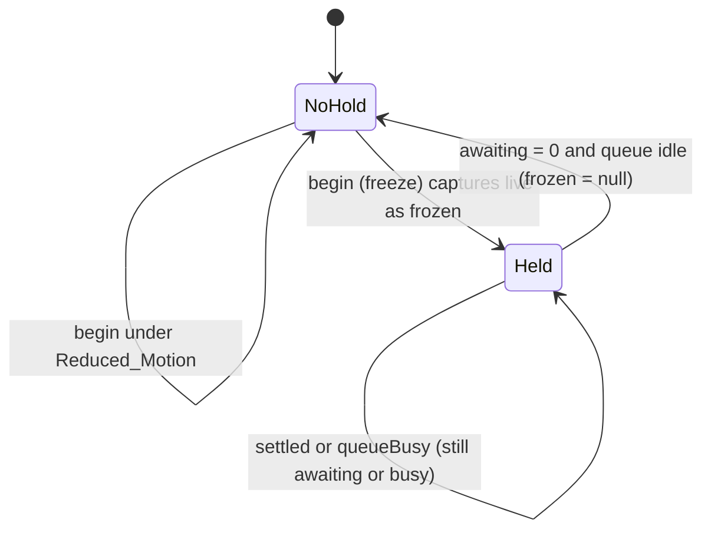

# Design Document — House Scene

## Overview

This feature replaces `ScenePlaceholder` on the Dashboard with the haunted house, its creatures and five one-shot "moments" that react to real user actions. It is built in four layers:

1. **Scene model** (`src/lib/scene/`, pure): `buildSceneModel(input, config)` turns a `HouseState`, the monthly income, the graveyard rows and the Bound_Flag into plain data: what to draw, where, in which state, plus the Scene_Summary. Every position, phase and tilt comes from a hash of the row id, never from array order, a clock or a random source.
2. **Static scene** (`src/components/house/`): one inline `<svg>` with a fixed `viewBox`, rendered from the model without any GSAP. Ambient loops (sway, orbit, pulse, fog) are a separate lazily loaded component that decorates the already painted SVG.
3. **Moments** (`src/lib/moments/`, `src/components/moments/`): a pure request planner, a pure Promise-based queue, and five GSAP `playXMoment` functions loaded on demand.
4. **Wiring**: an `ActionObserver` context, provided by the Dashboard only, which the existing action hooks call before and after a mutation. It owns the "hold" that keeps the Scene in its pre-action state while the live data already holds the post-action state.

The scene reads data and never writes it. Colors, type and chrome follow `design-system.md`; creature and level art follow `visual-language.md`. Nothing here restates the thresholds of `src/lib/haunting/config.ts`.

### Key design decisions

| # | Decision | Rationale |
|---|---|---|
| D1 | The Scene is rendered by React from the Scene_Model; GSAP only decorates it (ambient loops) or draws temporary overlays (moments). | The static house paints without GSAP (Requirement 21.2), is testable in jsdom, and the lazy GSAP boundary is a single file edge. |
| D2 | All text inside the Scene is an HTML overlay (`SceneLabels`) laid over the SVG, sized in real pixels. | A text in SVG units shrinks with the Scene. Requirement 4.3 and 5.7 need at least 12px on screen at every width; the overlay gives that for free and lets a `ResizeObserver` decide when labels fit. |
| D3 | The ViewBox is 800 by 600. Its reference width is 560px (the mobile content width), so 1 unit is 0.7px at the reference. Sizes from `visual-language.md` (px) are stored in units as `px × 800 / 560`. | One conversion rule for every creature size. |
| D4 | Moments never block input. The Scene is frozen on its pre-action model (a "Scene_Hold") from submit time until the queue is idle, while the chrome shows live data at once. A second action that begins during a hold keeps the first frozen model (D9). | Requirement 12.8 and 12.16, and no flash of the post-action state before the Moment starts. |
| D5 | Moment requests are produced by a pure function `planMoments(outcome, context)`. | It is the part with the most branching (Requirements 12 to 17); a pure function is property-testable. |
| D6 | The hook layer reports mutation outcomes to an optional context (`ActionObserver`). Only the Dashboard provides it. | Components may not import `src/lib/db/`, sheets already call `useCryptActions`, and "Dashboard only" (Requirement 12.17) becomes structural: other screens have no observer, so they cannot create a request. |
| D7 | The Window_Opacity_Curve is piecewise linear per decay level with a per-level opacity floor. | Meets Requirement 7.4 to 7.7 with a proof by table (see Window opacity). |
| D8 | A level change is detected after the live data settles, not predicted. | The post-action level is only known when the live query has recomputed the engine. |
| D9 | The hold is a pure reducer (`hold.ts`): the frozen model is captured only when no hold is active, and released only when no ticket awaits settle and the queue is idle. | Keeps the first pre-action picture while several quick actions queue Moments (Requirement 12.19) and makes the rule property-testable. |
| D10 | The payment Moment ends its windows beat with a flare (`PAYMENT_FLARE_BOOST`) instead of relying on the small real opacity step. | The real demo payment moves opacity by 0.055 only; the flare gives a 0.405 visible swing and still ends on the live value. |

### Approved deviations and clarifications

These are the places where the design does not simply restate a requirement. **F1 to F8 are approved by the project owner.** None changes an acceptance criterion.

| # | Item | Detail |
|---|---|---|
| F1 | **`MIN_SCENE_WIDTH_DESKTOP_PX` (480) is guaranteed at 1280px only.** *(approved)* | Requirement 18.1 states it for a 1280px viewport. Between 1024px and 1279px the Scene is 354 to about 520px wide (see Dashboard layout). Below 480 the tombstone labels are omitted by Requirement 5.7. Reading the 480 as a global floor would force a single column at 1024px, which contradicts Requirement 22.8. |
| F2 | **Window opacity at levels 2 to 4 is lower than the nominal "~70% / ~40% / ~15%" of `visual-language.md`.** *(approved)* | Requirement 7.6 needs a 0.15 jump between the demo scores (level 4 at 0.327, level 3 at 0.43). With the nominal mid-band values the best straight line gives about 0.13. The design uses the identity for levels 1 to 3 and a steeper line for level 4 (opacity 0.02 at the band floor, 0.40 at the top). Mid-band values become about 0.90, 0.70, 0.50 and 0.21. Requirement 7.7 allows this. `visual-language.md` should say "nominal" for those numbers. |
| F3 | **Mobile order on the Dashboard changes.** *(approved)* | To get two columns on desktop with the plan card beside the Scene, the DOM order becomes Scene, light score card, Poltergeist banner, plan card, demo controls (the banner moves after the score card). Focus order equals visual order in both layouts. Existing Dashboard tests that assert the order must be updated (Requirement 22.6). |
| F4 | **Moment modules are `.ts`, not `.tsx`.** *(approved)* | `structure.md` lists `ShovelMoment.tsx` and the others. The moment functions create no React elements (the artwork they animate is a static component, `MomentArt.tsx`, so that it never imports GSAP), so `.ts` is accurate. `structure.md` is updated when the files land. |
| F5 | **`gsap` and `@gsap/react` are not in `package.json` yet.** *(approved)* | They are added as dependencies in the first task that needs them (Requirement 1.6). |
| F6 | **The holy-water moment of the design-system catalog (tick a plan action) is not built.** *(approved)* | Requirements 12 to 17 do not list it, and Requirement 12.1 limits requests to those five. Ticking shows only the existing row state and toast. |
| F7 | **Freezing is skipped under Reduced_Motion.** *(approved)* | Requirement 20.3 says each End_State appears at once with a fade of at most 150ms, so there is nothing to hold. |
| F8 | **Level-change request merging when the merged request would return to its start.** *(approved)* | Requirement 12.6 merges two pending level requests into one going to the latest level. If that makes `from` equal `to`, the merged request is dropped, because there is no change to show. |

### Changes after approval (revision 2)

These changes follow a recomputation of the demo path with the real engine (see "Real demo path") and a geometry review. Each has a matching minimal edit in `requirements.md`.

| # | Change | Where |
|---|---|---|
| R1 | The payment Moment gets a **flare beat**: the lit windows rise to `min(1, live opacity + PAYMENT_FLARE_BOOST)` (0.35), hold for 300 ms, then settle to the live value. With the real numbers the payment alone moves window opacity only 0.380 to 0.435, too subtle for the key video moment. | Window opacity, Moments table, Requirements 2.1, 2.5, 14.3, 14.6, 18.4, 18.5, 20.3 |
| R2 | The Poltergeist anchor moves from `400,110` to `400,150` and the sigil diameter from 270 to 262, so that the sigil, its stroke, glow padding and shake stay inside the ViewBox. Every Moment art position in ViewBox units is also bounds-checked by pure geometry helpers. | Layout, Moment art geometry, Property 4, Requirements 12.18, 15.7 |
| R3 | When a second action begins during a hold, the **first frozen model is kept**. The rule is a pure reducer, so it is property-tested. | Observer, hold and settle, Property 18, Requirement 12.19 |
| R4 | The off-screen and hidden-document pause applies **only to the AmbientMotion timelines and ticker callback**, never to `gsap.globalTimeline`, so a playing Moment is never stalled. | AmbientMotion, Requirement 21.4 |

### Changes after checkpoint 2 (revision 3)
Found in the checkpoint 2 review of the deployed demo, compared with `references/house-reference-1.jpg`. Each has a matching edit in `requirements.md`.
| # | Change | Where |
|---|---|---|
| C1 | **Hash avalanche.** `hashId` adds a murmur3 fmix32 finalizer after FNV-1a. FNV-1a alone mixes trailing characters poorly: the demo ids `demo:level-2:tx:0` to `:3` got `unitFromId` values about 0.004 apart, so all four ghosts shared lane 2 and a phase near π, which puts `sin t` near 0 and every ghost near `x = 400`. | Hash and determinism |
| C2 | **Ghost spreading.** Each ghost keeps a preferred phase from its id; the builder places drawn ghosts in id order and moves a ghost forward in whole steps of `2π / GHOST_PHASE_STEPS` (24) while its rest is closer than `GHOST_MIN_REST_DISTANCE` (48) to a placed ghost. Only a crowded lane (no free step) may leave two rests closer. This narrows Requirement 3.4 and Property 2: lane and bob period never change, a lone ghost is always at its preferred phase, and ghosts with larger ids never move it. | Layout (Ghosts), Requirements 3.4, 9.7, Properties 2 and 20 |
| C3 | **True ghost total.** `totals.ghosts` adds `poltergeist.transactionCount` (the merged ghosts) to `ghosts.length`; the engine empties `ghosts` when the Poltergeist forms, so the level-4 summary used to say "no ghosts". | `buildSceneModel` step 5, Requirement 19.2, Properties 5 and 12 |
| C4 | **House proportions.** A tall, narrow central tower (`x 338..462`, walls from `y 154`, gable apex `y 28`) between two lower wings (`x 200..338` and `462..600`, walls from `y 212`). The tower is one step lighter (`SCENE_WALL_LIGHT`), the right wing one step darker; shadow bands under the eaves, a dark stone foundation band and a faint moonlit left edge give volume. Scalloped shingle rows (an SVG pattern), irregular bricks, vertical door planks, window frames with an outer lip and an inner shadow, tapered curved tree limbs, lumpy bushes, chimney smoke puffs and larger mint fog mounds give texture. | Layout zones, Window layout, SVG layers |
| C5 | **Wonk.** A monotone `wonk` value in the feature table (0.04, 0.25, 0.5, 0.75, 1) scales deterministic irregularities: wall corners and wing tops, hip and gable rotations, window rotations (≤ 5°), chimney tilt (≤ 7°), picket height and lean. | Feature table, Property 9, Requirement 6.8 |
| C6 | **Poltergeist as a spirit, beside the tower.** Size 150 at `(252, 126)` above the left wing roof, sigil 226 (ratio 1.507); the round attic window stays visible. A semi-transparent body with a bumpy head and a smoky tail, hollow eyes, a small mouth and a blurred spirit glow; the smoke swirl turns, the body only pulses. | Poltergeist and sigil geometry, Requirements 9.4, 9.6 |
| C7 | **Creatures.** Zombies 66 to 88 units tall (most of the basement), hunched, arms forward, torn shirt, eyes, with the usage badge above the head (`badgeCenter` in the model). Ghosts get a wavy curling tail, round eyes with a highlight, a light rim and an 85% opaque body (eyes solid) so a lit window shows through, and are drawn above the windows layer so no ghost hides behind a window. | Zombies, Ghosts, SVG layers, Requirement 8.2, Property 4 |
| C8 | **Grain skipped.** A full-scene `feTurbulence` overlay was considered and left out: the ghosts and the Poltergeist animate above it, and every repaint of their dirty region would re-run the filter on mobile. | — |

### Style reference

`.kiro/specs/house-scene/references/house-reference-1.jpg` is the owner-supplied style reference for the house art. It shows a house at about **decay level 3 to 4** in mood (muted, dim, windows lit but not at full brightness). It sets mood, proportions and shape language only. The SVG is original art drawn from the feature table, not a trace of the image.

**The layout follows the design zones, not the image.** Positions come from "Layout algorithms": the zombie row sits in the wide basement band (`y 400..520`, `x 60..740`), the tombstones in the graveyard band at the bottom (`y 520..590`), the Poltergeist at `POLTERGEIST_CENTER`, windows from `WINDOW_LAYOUT`. The image's narrow basement block and the tombstones beside the house are not placed from it. How many cracks, boarded windows, bats or fog layers appear at each level comes from the feature table, not from what the image happens to show.

What to take from it:

- **Flat vector, no outlines.** Shapes are filled with two or three close tones (a lit face and a shaded face). No strokes except thin details (fence, window bars, tree branches), no gradients on the house, no textures.
- **Silhouette.** A narrow two-story house with a tall central gable, a round attic window under the peak, a lower hip roof on each side, one brick chimney on the right, a small porch roof over the door, and a lantern beside the door. This matches the six-window layout (three upper, two ground flanking the door, one round attic).
- **Windows.** The brightest element at levels 1 to 4: arched or rectangular candle-colored pane with a teal frame, cross mullion and sill, a soft blurred halo (one `feGaussianBlur` filter defined once in `<defs>`), and a small cream candle with a flame instead of a dark rectangle. The model opacity `o` maps linearly to halo opacity `0.25 + 0.6·o` and pane opacity `0.6 + 0.4·o`, so 0.26 (level 4) still reads clearly lit and 0.435 (level 3) is visibly brighter. The opacity model itself is unchanged.
- **Walls.** Slate `#3F3F4B` (lit) and `#3A3A46` (shaded) at every level; `DECAY_TINTS` are only a 10% overlay. Level 1 gets a faint light veil, no level has a dark veil, so level 5 walls stay lighter than the sky. A few rounded brick accents, a floor band, teal trim and sills, a door knob.
- **Surroundings.** A flat ground line, one tree on each side at every level (full rounded teal canopy at level 1, thin at 2, bare at 3, twisted at 4, charred at 5), two bushes at the house corners, grass tufts (fewer as the garden worsens, tinted by the garden state; no overlay on the ground line), a fence at the right, soft mint mounds behind the house, and rounded mint fog bars behind and in front of it.
- **Underground.** The basement band is a cross-section: dark soil (`SCENE_SOIL`) with a rounded top edge under the ground line, faint stone-block lines, pebbles and roots. The graveyard band uses a slightly different soil tone (`SCENE_SOIL_GRAVE`).
- **Sky.** Charcoal sky `SCENE_SKY` (lighter than the page background), a few star dots and a pale mint moon (`SCENE_MOON`) with a soft blurred halo and no craters. The level 5 moonlight rule of `visual-language.md` still applies.
- **Calm and cozy.** Muted, low-saturation colors; the only warm color is window light.

Measured colors (pixel samples of the image) and what each becomes. Existing tokens are used wherever one is close, so new colors stay at a minimum:

| Reference element | Measured | Used in the scene as |
|---|---|---|
| Sky | `#22252A` | **New scene-only constant** (`SCENE_SKY`); `--surface-void` is too dark |
| Basement block | `#16171B` | `SCENE_SOIL` `#0F0F12` (basement), `SCENE_SOIL_GRAVE` `#1B1A21` (graveyard band), ground below the line `--surface-card`; `SCENE_STONE` `#2C2C34` for pebbles and roots, `SCENE_STONE_LINE` `#1E1E23` (half the contrast) for block lines; level 5 charred trees use `SCENE_CHAR` `#2E2829` with `SCENE_EMBER` `#5A2E24` cracks; bats use `SCENE_BAT` `#4A4A56` |
| Window light and candles | `#E1954A` | `--accent-candle`, at the opacity from `getWindowOpacity` |
| Walls | `#3F3F4B`, `#3A3A46` | **New scene-only constants** `SCENE_WALL` and `SCENE_WALL_SHADE` at every level; `DECAY_TINTS` of the level only as a 10% overlay; `SCENE_BRICK` `#34343F` for brick accents |
| Chimney | `#5A5667`, `#4A4758` | Same wall constants as the walls (lit and shaded face) |
| Moon | `#CEE1DD` | **New scene-only constant** (`SCENE_MOON`), with a blurred halo; the level 5 moonlight glow still uses `--text-tertiary` at 30% |
| Roof and trees | `#29464A` | **New scene-only constant** (`SCENE_TEAL`) |
| Ground line and trim | `#395F60` | **New scene-only constant** (`SCENE_TEAL_LIGHT`); no token is close (`--accent-ecto` is `#3DDC97`, far brighter) |
| Fog bars | `#B7D4CF` | **New scene-only constant** (`SCENE_FOG`): bars at 30% (back) and 20% (front), mounds at 10 to 24% |

The new hex values in `config.ts`, next to `DECAY_TINTS`, `ZOMBIE_BODY` and `ZOMBIE_CLOTHING`, are `SCENE_TEAL`, `SCENE_TEAL_LIGHT`, `SCENE_FOG`, `SCENE_SKY`, `SCENE_WALL`, `SCENE_WALL_SHADE`, `SCENE_BRICK`, `SCENE_MOON`, `SCENE_SOIL`, `SCENE_SOIL_GRAVE` and `SCENE_STONE` (all checked by `validateSceneConfig`). The module stays the only place with hex values (the color scan allows `src/lib/scene/config.ts` only, Requirement 2.3). Components read colors from the config or CSS variables, never inline hex.

### Research findings

- **GSAP licence and packages.** Since GSAP 3.13 the whole library, including the former Club plugins (DrawSVGPlugin, MotionPathPlugin, MorphSVGPlugin), ships in the public `gsap` npm package under the standard no-charge licence ([GSAP plugins docs](https://gsap.com/docs/v3/Plugins/), [npm gsap](https://www.npmjs.com/package/gsap)). Plugins are imported from the package, for example `gsap/DrawSVGPlugin`. Content was rephrased for compliance with licensing restrictions.
- **DrawSVGPlugin targets** `<path>`, `<line>`, `<polyline>`, `<polygon>`, `<rect>` and `<ellipse>` and works through `stroke-dashoffset` and `stroke-dasharray` ([DrawSVGPlugin docs](https://gsap.com/docs/v3/Plugins/DrawSVGPlugin/)). A `<circle>` is not in the list, so the sigil is an `<ellipse>` with equal radii.
- **MotionPathPlugin** animates any object along a path ([docs](https://gsap.com/docs/v3/Plugins/MotionPathPlugin/)); it moves the candle orb.
- **Lazy loading in this Next.js version** (`node_modules/next/dist/docs/01-app/02-guides/lazy-loading.md`): `next/dynamic(() => import(...), { ssr: false })` is only allowed in Client Components, and plain `import()` inside an event handler or effect loads a library on demand. The design uses `next/dynamic` for `AmbientMotion` and `import()` inside `momentLoader.ts`.
- **Container queries** are native in Tailwind v4, but the label threshold must come from `Scene_Config`, so the design measures the Scene width with a `ResizeObserver` instead of a literal `@min-[...]` class.
- **Existing code relied on:** `useHouseState` (live `HouseState` and `rows`), `useExorcismPlan` (stored plan, `toggleAction`), `useCryptActions` (`logPayment`, `cancelSubscription`), `CancelOutcome` and `LogPaymentOutcome` from `src/lib/db/mutations.ts`, `normalizeSubscription` from `@/lib/haunting`, `getLevelLabel` and `getLevelAnnouncement` from `@/lib/utils/scoreView`, `formatCentsShort` from `@/lib/utils/cents`, and the 1024px `matchMedia` switch of `AppShell`.

## Architecture

### Layers and module boundaries



Rules enforced by tests (Requirement 1):

- `src/lib/scene/*` and `src/lib/moments/*` import only `@/lib/haunting` (types and config constants), `@/lib/utils/cents` and `@/lib/utils/scoreView`, and each other. No clock, no random source.
- GSAP is imported only in `AmbientMotion.tsx` and the five moment files. Everything else in `house/` and `moments/` is GSAP free, so `HouseScene`, `MomentHost` and `momentLoader.ts` can be statically imported by the Dashboard.
- Framer Motion is not imported in `house/` or `moments/`. Level and fade transitions of the static scene are CSS transitions on `opacity` and `transform`.
- Components import no `src/lib/db/`; wiring goes through `src/hooks/`.

### Module layout

```
src/lib/scene/
  config.ts        # every constant + validateSceneConfig(config): string[]
  types.ts         # SceneInput, SceneModel and parts
  hash.ts          # hashId(id, salt) -> uint32; unitFromId(id, salt) -> [0,1)
  features.ts      # per-level feature table accessor + severity helpers
  windows.ts       # window layout, window state assignment, getWindowOpacity(), getFlareSteps()
  layout.ts        # zombie slots, ghost orbits, tombstone slots, sizes
  summary.ts       # LEVEL_NAMES, SceneSummaryParts, buildSceneSummary(parts: SceneSummaryParts): string
  momentGeometry.ts # pure ViewBox geometry of Moment art: paths, boxes, clips (bounds-tested)
  index.ts         # buildSceneModel() + re-exports (public API)
src/lib/moments/
  types.ts         # MomentRequest, ActionContext, ActionOutcome
  requests.ts      # planMoments(outcome, context): MomentRequest[]
  hold.ts          # pure holdReducer: frozen model, awaiting tickets, queue idle
  queue.ts         # createMomentQueue(options): MomentQueue
src/hooks/
  useSceneModel.ts       # live Scene_Model from useHouseState + useExorcismPlan
  useActionObserver.ts   # ActionObserver context type, useActionObserver()
  useElementWidth.ts     # ResizeObserver width of a ref (null until measured)
src/components/house/
  HouseScene.tsx         # root: container, role="img", svg, labels, ambient
  HouseBase.tsx          # sky, ground, walls, roof, chimney, basement cutaway
  DecayLayer.tsx         # cracks, stains, moss, plaster hole, boards, fog, bats by level
  WindowsLayer.tsx       # six windows with state and candle opacity
  ZombieBasement.tsx     # zombie row + overflow anchor
  GhostSwarm.tsx         # ghost figures at their rest position
  Poltergeist.tsx        # monster, sigil ring, glow
  GraveyardRow.tsx       # tombstones
  SceneLabels.tsx        # HTML overlay: "+N" markers, tombstone labels
  AmbientMotion.tsx      # GSAP loops, lazy (the only GSAP file outside moments)
src/components/moments/
  MomentHost.tsx         # provider + controller + Moment_Layer portal + skip listeners
  MomentArt.tsx          # static art: shovel, orb, flame, candles (no GSAP)
  momentLoader.ts        # kind -> () => import("./XMoment") map
  ShovelMoment.ts  CandleOrbMoment.ts  SigilMoment.ts  LevelChangeMoment.ts  ThreeCandlesMoment.ts
```

### Data flow

```mermaid
sequenceDiagram
  participant U as User
  participant S as Sheet / plan row
  participant H as useCryptActions
  participant O as ActionObserver (MomentHost)
  participant DB as mutations
  participant L as live data (Dexie, useHouseState)
  participant Q as Moment_Queue
  participant G as playXMoment (GSAP)
  U->>S: submit
  S->>H: cancelSubscription(id)
  H->>O: begin(action) -> ticket (captures context; freezes Scene only if no hold is active)
  H->>DB: mutation (one transaction)
  DB-->>H: outcome
  H->>O: resolve(ticket, outcome)
  O->>O: planMoments(outcome, context) -> requests
  O->>Q: enqueue(own), enqueue(exorcism-complete)
  L-->>O: houseState changed (settled)
  O->>Q: enqueue(level-change) if level differs
  Q->>G: play(request, signal)
  G-->>Q: resolves (or signal aborted)
  Q-->>O: onIdle
  O->>O: release hold -> Scene renders live model, cleanups run
```

Static path (no action): `useHouseState` + `useExorcismPlan` → `useSceneModel` → `buildSceneModel` → `HouseScene`. Demo load, reset, scenario switch and Skip_Week use no observed action, so they never freeze or enqueue anything (Requirement 12.2); the Scene shows the new model at once.

## Components and Interfaces

### `src/lib/scene/config.ts`

All constants are exported and gathered in `SCENE_CONFIG: SceneConfig` so `validateSceneConfig` can check a replaceable copy.

| Group | Constants |
|---|---|
| ViewBox | `VIEWBOX_WIDTH = 800`, `VIEWBOX_HEIGHT = 600`, `REFERENCE_WIDTH_PX = 560`, `UNITS_PER_REFERENCE_PX = VIEWBOX_WIDTH / REFERENCE_WIDTH_PX` |
| Caps | `MAX_VISIBLE_ZOMBIES = 6`, `MAX_VISIBLE_GHOSTS = 12`, `MAX_VISIBLE_TOMBSTONES = 6` |
| Windows | `WINDOW_COUNT = 6`, `WINDOW_FAILURE_ORDER = [3, 1, 4, 0, 5, 2]`, `MIN_VISIBLE_WINDOW_DELTA = 0.15`, `OPACITY_FLOOR_BY_LEVEL = { 1: 0.8, 2: 0.6, 3: 0.4, 4: 0.02, 5: 0 }`, `PAYMENT_FLARE_BOOST = 0.35` |
| Sizes (units) | zombie height 66 to 88, ghost 34 to 80, Poltergeist 150 at `POLTERGEIST_CENTER = (252, 126)`, `SIGIL_DIAMETER = 226`, `SIGIL_STROKE = 4`, `SIGIL_GLOW_PAD = 8`, `SIGIL_SHAKE = 6`, badge 18 with `ZOMBIE_BADGE_GAP = 3`; `ZOMBIE_FULL_RATIO = 0.1` (monthly cost over income at which a zombie is largest); ghost spreading `GHOST_MIN_REST_DISTANCE = 48`, `GHOST_PHASE_STEPS = 24` (module constants) |
| Moment art (units) | `SHOVEL_HEIGHT = 180`, `SHOVEL_BOUND_RADIUS = 100`, `SHOVEL_START = (700, 140)`, `BAT_HALF_SIZE = 20`, `BAT_START = (520, 70)`, `BAT_END = (750, 40)`, `ZOMBIE_SINK_SCALE = 1.4`, `ZOMBIE_SINK_CLIP`, `TOMBSTONE_CLIP`, `CANDLE_BOX = 24 by 80`, `CANDLE_ROW_ORIGIN = (60, 40)`, `CANDLE_SPACING = 60`, `SHUTTER_WIDTH = 24`; screen pixels for HTML layer art: `FLAME_PX = 32`, `ORB_PX = 28` |
| Layout | basement band `y 400..520`, zombie baseline `515`, graveyard band `520..590`, tombstone box 64 by 56, three ghost lanes (see Layout) |
| Motion data | zombie tilt `±5°`, sway amplitude 3px and period 3000 to 5000ms, ghost bob 6px and period 2500 to 3500ms, ghost spawn 300ms, level transition 1200ms, window interpolation 600ms, Poltergeist pulse 1500ms and rotation 8000ms |
| Moments | `MOMENT_DURATION_MS = { cancel: 1400, payment: 1200, sigil: 1200, levelBetter: 1600, levelWorse: 1000, exorcismComplete: 1200 }`, `MOMENT_HARD_CAP_MS = 2500`, `MOMENT_INPUT_UNBLOCK_MS = 300`, `MOMENT_GAP_MS = 200`, `MOMENT_BEAT_MIN_MS = 300`, `MOMENT_QUEUE_MAX_PENDING = 4`, `REDUCED_MOTION_FADE_MS = 150`, `SETTLE_TIMEOUT_MS = 800` |
| Labels | `MIN_SCENE_WIDTH_DESKTOP_PX = 480`, `MIN_LABEL_PX = 12`, `TOMBSTONE_LABEL_MIN_SLOT_PX = 64`, derived `TOMBSTONE_LABEL_MIN_SCENE_WIDTH_PX = ceil(TOMBSTONE_LABEL_MIN_SLOT_PX × VIEWBOX_WIDTH / TOMBSTONE_SLOT_UNITS)` (about 453) |
| Scene-only colors | `DECAY_TINTS` (five), `ZOMBIE_BODY`, `ZOMBIE_CLOTHING`, `SCENE_TEAL`, `SCENE_TEAL_LIGHT`, `SCENE_FOG`, `SCENE_SKY`, `SCENE_WALL`, `SCENE_WALL_SHADE`, `SCENE_BRICK`, `SCENE_MOON`, `SCENE_SOIL`, `SCENE_SOIL_GRAVE`, `SCENE_STONE`, `SCENE_STONE_LINE`, `SCENE_CHAR`, `SCENE_EMBER`, `SCENE_BAT` (from "Style reference"; the only hex values in the module) |
| Feature table | `LEVEL_FEATURES: Record<DecayLevel, LevelFeatures>` (see Decay levels) |

`validateSceneConfig(config: unknown): string[]` never throws. It checks: caps are integers of at least 1; ViewBox sides are positive and finite; every moment duration is within 600 and `MOMENT_HARD_CAP_MS`; `MOMENT_INPUT_UNBLOCK_MS` is below each duration; opacity floors are finite, in 0 to 1 and non-increasing as the level worsens; every level opacity from `getWindowOpacity` stays in 0 to 1; `getWindowOpacity(3, 0.43) − getWindowOpacity(4, 0.327) ≥ MIN_VISIBLE_WINDOW_DELTA`; the feature table is monotone and its levels are pairwise distinct; size ranges have `min ≤ max`; `PAYMENT_FLARE_BOOST` is finite and in the range above 0 up to 1; the sigil extent (`SIGIL_DIAMETER / 2 + SIGIL_STROKE / 2 + SIGIL_GLOW_PAD` around `POLTERGEIST_CENTER`, plus `SIGIL_SHAKE` horizontally) lies inside the ViewBox, does not intersect the chimney box, and `SIGIL_DIAMETER ≥ 1.5 × Poltergeist size`.

### Scene_Model types (`src/lib/scene/types.ts`)

```ts
export type GraveyardEntry = {
  subscriptionId: string;
  name: string;
  monthlyCostCents: number;   // normalized, integer cents
  canceledOn: string;         // YYYY-MM-DD
};

export type SceneInput = {
  houseState: HouseState;
  monthlyIncomeCents: number;
  graveyard: readonly GraveyardEntry[];
  bound: boolean;             // Bound_Flag
};

export type Box = { x: number; y: number; w: number; h: number };      // ViewBox units
export type Point = { x: number; y: number };

export type WindowState = "lit" | "boarded" | "broken";
export type SceneWindow = {
  index: number;              // 0..WINDOW_COUNT-1
  shape: "arched" | "square" | "round";
  box: Box;
  state: WindowState;         // shape of the cover differs per state
  opacity: number;            // candlelight, 0 for boarded and broken
};

export type RoofState = "intact" | "missingShingles" | "sagging" | "partialCollapse" | "collapsed";
export type GardenState = "green" | "browning" | "dead" | "bare" | "scorched";
export type LanternState = "lit" | "dim" | "unlit";
export type TreeState = "full" | "thin" | "bare" | "twisted" | "charred";
export type LevelFeatures = {
  crackCount: number; stainCount: number; plasterHole: boolean;
  boardedWindows: number; brokenWindows: number;
  roof: RoofState; moss: boolean; garden: GardenState; lantern: LanternState;
  tree: TreeState; fence: "intact" | "broken"; structure: "sound" | "collapsing";
  fog: 0 | 1 | 2 | 3 | 4; bats: boolean; fireflies: boolean; shadowPass: boolean;
  darkness: number;           // overlay opacity 0..1
};

export type Usage = "often" | "rarely" | "never";
export type SceneZombie = {
  id: string; usage: Usage;
  posture: "upright" | "leaning" | "slumped";      // often, rarely, never
  badge: "flame" | "hourglass" | "skull";
  slot: number; box: Box; heightUnits: number;
  tiltDeg: number; swayPhase: number; swayPeriodMs: number;
};
export type SceneGhost = {
  id: string; sizeUnits: number; phase: number; bobPeriodMs: number;
  lane: 0 | 1 | 2; orbit: { cx: number; cy: number; rx: number; ry: number };
  rest: Point;                // position at phase, used by the static render
};
export type ScenePoltergeist = {
  state: "awake" | "bound"; center: Point; sizeUnits: number;
  sigil: { cx: number; cy: number; r: number };
};
export type SceneTombstone = {
  id: string; slot: number; box: Box; name: string; ripText: string;   // "R.I.P. $22.99/mo"
};
export type Lighting = "candle" | "poltergeistGlow" | "moonlight";

export type SceneModel = {
  level: DecayLevel; levelName: string; features: LevelFeatures; lighting: Lighting;
  windows: SceneWindow[]; zombies: SceneZombie[]; ghosts: SceneGhost[];
  poltergeist: ScenePoltergeist | null; tombstones: SceneTombstone[];
  totals: { zombies: number; ghosts: number; tombstones: number };
  overflow: { zombies: number; ghosts: number; tombstones: number };
  summary: string;
};
```

`lighting` is `"candle"` for levels 1 to 4, and at level 5 it is `"poltergeistGlow"` when the Poltergeist is not null (bound or awake) and `"moonlight"` otherwise (Requirement 6.4 and 6.5).

### Hash and determinism (`hash.ts`)

`hashId(id, salt)` is 32-bit FNV-1a over `salt + "\u0000" + id`, followed by the murmur3 fmix32 finalizer (C1). `unitFromId` divides by 2³². Every value that looks random derives from it: zombie tilt, sway phase and period, ghost phase, bob period and lane, label-free details. The salts used in `layout.ts` are `"tilt"`, `"swayPhase"` and `"swayPeriod"` for zombies, and `"lane"`, `"ghostPhase"` and `"bobPeriod"` for ghosts. No function reads input array order. Selection and slot assignment sort by explicit keys with the id as the final tie-breaker (`localeCompare` is avoided; ids compare by `<`).

### `buildSceneModel(input, config = SCENE_CONFIG): SceneModel`

1. **Sanitize** every number to a finite non-negative value (`NaN`, `±Infinity` and negatives become 0). Counts and amounts are never recomputed from the engine.
2. **Level and features**: `level = houseState.decayLevel` (clamped to 1 to 5), `features = LEVEL_FEATURES[level]`.
3. **Windows** (see Window opacity): layout is fixed; states come from the feature table and `WINDOW_FAILURE_ORDER`; `opacity` is `getWindowOpacity(level, windowBrightness)` for lit windows and 0 otherwise.
4. **Zombies**: sort `houseState.zombies` by `monthlyCost` descending then `subscriptionId` ascending; draw the first `MAX_VISIBLE_ZOMBIES`; `overflow.zombies = total − drawn`.
5. **Ghosts**: if `houseState.poltergeist !== null`, draw none (the overflow is also 0, the figures have merged); otherwise sort by `amount` descending then `transactionId`, draw the first `MAX_VISIBLE_GHOSTS`. `totals.ghosts` is always the true count `houseState.ghosts.length + poltergeist.transactionCount` (a non-finite or negative count counts as 0, a fraction is floored), so the merged ghosts are counted (C3).
6. **Poltergeist**: `null` when the engine reports none, else `state = bound` if `input.bound` else `awake`.
7. **Tombstones**: sort the graveyard by `canceledOn` descending then `subscriptionId` ascending, draw the first `MAX_VISIBLE_TOMBSTONES`.
8. **Summary**: `buildSceneSummary(parts: SceneSummaryParts): string` with `SceneSummaryParts = { level, levelName, totals, poltergeist }`, where `totals` are the true totals (not the drawn counts) and `poltergeist` is `"awake" | "bound" | null`. The text is `Level <n>, <name>.` followed by the clauses in this order: zombies, ghosts, Poltergeist (omitted when `null`), tombstones, joined by `, ` with no trailing period. Example: `Level 3, Haunted. 4 zombies, 30 ghosts, Poltergeist awake, 1 tombstone`. A count of 1 is singular and a count of 0 reads `no zombies`, `no ghosts` or `no tombstones`.

The function copies what it needs and never writes to its input (Requirement 3.5).

### Layout algorithms (`layout.ts`)

All coordinates are ViewBox units (800 by 600).

**Zones**

| Zone | Rectangle |
|---|---|
| Sky and garden backdrop | `0,0` to `800,400` |
| House walls | wings `x 200..338` and `x 462..600`, `y 212..400`; tower `x 338..462`, `y 154..400`, gable apex `y 28`; chimney box `x 555..595, y 105..165` on the right wing |
| Basement cutaway | `x 60..740`, `y 400..520` |
| Graveyard band | `x 60..740`, `y 520..590` |
| Poltergeist anchor | center `252,126`, size 150 (spans `x 177..327`, `y 51..201`, above the left wing roof and clear of the attic window `x 380..420, y 92..132`; see the sigil table below) |

**Poltergeist and sigil geometry (R2, revised by C6).** The R2 anchor `400,150` covered the attic window of the taller tower. The current numbers:

| Item | Value |
|---|---|
| Poltergeist | center `252,126`, size 150 (radius 75); at the pulse peak (×1.08) radius 81, so `x 171..333`, `y 45..207` (the first window below starts at `y 223` with its frame) |
| Sigil circle | diameter 226 (radius 113), ratio `226 / 150 = 1.507` (≥ 1.5) |
| Sigil vertical extent | `126 ± (113 + stroke/2 + glow pad) = 126 ± (113 + 2 + 8) = 3..249` (margin 3 above the ViewBox top) |
| Sigil horizontal extent | `252 ± (123 + shake 6) = 123..381` |
| Roof and chimney | the body overlaps the left hip roof (ridge `y 170`) partly; the chimney box `x 555..595` is far from the sigil (max `x 381`) |
| House layout | tower and wings as in the zones table; the attic window keeps a clearance of more than the pulse radius from the body (tested) |
| On screen at 1280px | Poltergeist 105px, sigil 159px |

The ring is drawn at 60% opacity over the roof and the upper windows. It carries no text and the windows beneath stay visible, so it hides no information. Because the ring is a stroke drawn in front of the roof, it may cross roof and window art but never the chimney box, which `validateSceneConfig` checks (Requirement 15.7).

**Zombies.** Slot width `ZOMBIE_SLOT_UNITS = 680 / 6 ≈ 113`. For `n` drawn zombies sorted as above, slot `i` has center `x = 60 + (6 − n)·slot/2 + (i + 0.5)·slot`, so the row stays centered. Height is `lerp(66, 88, clamp(cost / income / ZOMBIE_FULL_RATIO, 0, 1))` (0 when income is 0, so the zombie is the smallest). Width is 0.625 of height, always below the slot width, so slot boxes never overlap (Property 7). The box bottom is the baseline `515`; the tallest zombie (88) tops out at `y 427`, and its usage badge (`badgeCenter`, 18 units, 3 above the head) spans `y 406..424`, inside the basement band (Property 4). Posture is a total map `often → upright`, `rarely → leaning`, `never → slumped`; badge `flame`, `hourglass`, `skull`. Tilt is `lerp(−5, 5, unitFromId(id, "tilt"))`.

When another zombie is added or canceled, ranks shift and the row re-centers. The Scene tweens `transform` between old and new slots over 300ms (CSS transition, none under Reduced_Motion). This is acceptable because a zombie's identity is its `data-part="zombie:<id>"` key, not its slot.

**Ghosts.** Three figure-eight lanes (Gerono lemniscate: `x = cx + rx·sin t`, `y = cy + ry·sin t·cos t`):

| Lane | `cx` | `cy` | `rx` | `ry` |
|---|---|---|---|---|
| 0 | 400 | 250 | 320 | 140 |
| 1 | 400 | 300 | 280 | 110 |
| 2 | 400 | 200 | 340 | 90 |

`lane = floor(unitFromId(id, "lane") × 3)`, `preferred = 2π·unitFromId(id, "ghostPhase")`. Drawn ghosts are placed in id order: a ghost takes the first of `preferred + k·2π/24` (`k = 0..23`) whose rest point is at least 48 units from every ghost already placed; when no step is free (a crowded lane) it takes the step with the largest clearance, the earliest on ties. `rest = point at phase`; AmbientMotion starts the orbit from the same phase (C2). Size is `lerp(34, 80, clamp(amount / SMALL_EXPENSE_THRESHOLD_CENTS, 0, 1))`. The extreme of each lane plus half the largest ghost stays inside the ViewBox (lane 2: `x 400 ± 340 ± 40 = 20..780`). A ghost keeps its lane and bob period in every model; its phase is its preferred phase when drawn alone, and drawn ghosts with larger ids never move it (Property 2). Rests are spread unless a lane is crowded (Property 20).

**Tombstones.** Slot width is the same 113 units, centers from the left of the graveyard band, newest first at the left. Box 64 by 56, baseline `y 585`.

**Overflow markers.** `"+N"` anchors: zombies at the right end of the basement row, ghosts at the top-right of the sky, tombstones at the right end of the graveyard band. They are HTML overlay text (D2). `getOverflowAnchors(config)` returns them: zombies at the right end of the basement band (`x = BASEMENT_BAND.x + BASEMENT_BAND.w`, `y = ZOMBIE_BASELINE_Y`), tombstones at the right end of the graveyard band (`x = GRAVEYARD_BAND.x + GRAVEYARD_BAND.w`, `y = TOMBSTONE_BASELINE_Y`) and ghosts at `GHOST_OVERFLOW_ANCHOR = (750, 30)`. Property 4 covers the bounds of all three anchors, the ghost anchor included.

**Layout and motion constants outside `SceneConfig`.** `GHOST_OVERFLOW_ANCHOR`, `ZOMBIE_TILT_DEG`, `ZOMBIE_SWAY_PERIOD_MIN_MS`, `ZOMBIE_SWAY_PERIOD_MAX_MS`, `GHOST_BOB_PERIOD_MIN_MS`, `GHOST_BOB_PERIOD_MAX_MS`, `FULL_TURN_RADIANS`, `HALF`, `NO_COUNT` and `SLOT_FIRST` are module constants exported from `config.ts`. They are not fields of `SceneConfig` and `validateSceneConfig` does not check them, so a test config cannot vary them.

**Public layout API** (`layout.ts`, used by the house components and `buildSceneModel`; every function that takes `config` defaults it to `SCENE_CONFIG`):

| Function | Signature |
|---|---|
| `layoutZombies` | `(zombies: readonly Zombie[], monthlyIncomeCents: number, config?) => { drawn: SceneZombie[]; overflow: number }` |
| `layoutGhosts` | `(ghosts: readonly Ghost[], hasPoltergeist: boolean, config?) => { drawn: SceneGhost[]; overflow: number }` |
| `layoutTombstones` | `(graveyard: readonly GraveyardEntry[], config?) => { drawn: SceneTombstone[]; overflow: number }` |
| `layoutPoltergeist` | `(poltergeist: Poltergeist \| null, bound: boolean, config?) => ScenePoltergeist \| null` |
| `getLanePoint` | `(lane: { cx; cy; rx; ry }, t: number) => Point` |
| `getOverflowAnchors` | `(config?) => { zombies: Point; ghosts: Point; tombstones: Point }` |

### Window opacity (`windows.ts`)

Six windows: three on the upper floor, two on the ground floor flanking the door, one round attic window. `WINDOW_FAILURE_ORDER = [3, 1, 4, 0, 5, 2]` ranks which window fails first. At a level with `b` boarded and `k` broken windows, the first `b + k` windows of the order have failed: the first `k` are broken, the next `b` are boarded, the rest are lit. A window never improves as the level worsens (the order is fixed and `b`, `k` are non-decreasing), and boarded (crossed planks) and broken (jagged glass) have different shapes, so state is not shown by brightness alone (Requirement 7.3).

**Curve.** Let `bandMin[L]` be `BAND_Lx_MIN / 100` from the haunting config (0.8, 0.6, 0.4, 0.2, 0) and `bandMax[L] = bandMin[L−1]` (1 for level 1).

```
getWindowOpacity(level, brightness):
  b = clamp(finiteOrZero(brightness), 0, 1)
  if level == 5: return 0
  lo = OPACITY_FLOOR_BY_LEVEL[level]
  hi = level == 1 ? 1 : OPACITY_FLOOR_BY_LEVEL[level - 1]
  t  = clamp((b - bandMin[level]) / (bandMax[level] - bandMin[level]), 0, 1)
  return clamp(lo + t * (hi - lo), 0, 1)
```

With floors `0.8, 0.6, 0.4, 0.02, 0` the curve is the identity at levels 1 to 3 and a steeper line at level 4.

| Check | Value |
|---|---|
| Level 3, brightness 0.43 | `0.4 + ((0.43 − 0.4)/0.2) × (0.6 − 0.4) = 0.43` |
| Level 4, brightness 0.327 | `0.02 + ((0.327 − 0.2)/0.2) × (0.4 − 0.02) = 0.2613` |
| Difference | **0.169 ≥ MIN_VISIBLE_WINDOW_DELTA (0.15)**, margin 0.019 |
| Level 4 slope | 1.9 per unit of brightness (levels 1 to 3: 1). Within level 4 an opacity step is 1.9 times the brightness step |
| Within a level | `t` is non-decreasing in `b`, `hi ≥ lo`, so opacity is non-decreasing (Requirement 7.4) |
| Across levels | `lo[L] = hi[L+1]`, so the top of level L+1 equals the bottom of level L: opacity of a better level is always at least that of a worse one (Requirement 7.5); level 5 is 0 and every floor is at least 0 |
| Demo path | The real numbers are in "Real demo path" below: the level-4 flow takes brightness from 0.327 to 0.435 and window opacity from 0.262 to 0.435; the payment alone moves it only 0.380 to 0.435, which the payment flare (below) makes visible |

The unit test for Requirement 7.6 is a single example; the monotonicity checks are properties (Property 10).

### Real demo path (measured, not estimated)

The level-4 Demo Crypt (`src/lib/demo/seed.ts`, demo date 2025-06-02, income $3,000) was run through the real mutations in the order the UI uses: `cancelSubscription` on Wraithcast (this auto-completes its plan action), `completePlanAction` on the Coffee action, then `logPayment` of the $300 extra on Scarlet Moth Card (auto-completes the third action). After each step `computeHouseState(toFinancialSnapshot(...))` was read, and window opacity comes from the chosen curve (floors `0.8, 0.6, 0.4, 0.02, 0`). The throwaway test that produced the numbers was deleted. The numbers match `tests/demo/calibration.test.ts` (start 32.74, after week 1 43.49).

| Step | Light score | Base | Momentum | Level | `windowBrightness` | Window opacity | Poltergeist |
|---|---|---|---|---|---|---|---|
| Start (level-4 seed) | 32.7353 | 32.7353 | 0 | 4 | 0.32735 | 0.2620 | present |
| Cancel Wraithcast (plan action 1 done) | 37.9511 | 32.9511 | 5 | 4 | 0.37951 | 0.3611 | present |
| Tick "Cut Coffee by $60" (action 2 done) | 38.9511 | 32.9511 | 6 | 4 | 0.38951 | 0.3801 | present |
| $300 extra payment (action 3 done, 3 of 3) | 43.4875 | 33.4875 | 10 | **3** | 0.43487 | 0.4349 | present |

Three things follow for the Scene:

- The payment crosses the 40 boundary, so the same action changes level 4 to 3. The Moments it creates, in order (Requirement 12.5), are payment (1200 ms), exorcism complete (1200 ms, three of three done) and level change "dawn" (1600 ms), with 200 ms gaps: 4400 ms in total.
- The payment moves window opacity by only `0.4349 − 0.3801 = 0.055`. The flare below turns that into a visible beat.
- The Coffee tick moves brightness by 0.010 and the cancel by 0.052, so the sigil and shovel Moments carry no window change of their own.

### Payment flare (R1)

`PAYMENT_FLARE_BOOST = 0.35` is a Scene_Config constant. The pure helper `getFlareSteps(previousOpacity, liveOpacity, boost)` in `windows.ts` returns `{ from, peak, final }` with `from = clamp(previousOpacity, 0, 1)`, `peak = min(1, liveOpacity + boost)` and `final = liveOpacity`. The payment Moment tweens the lit windows `from → peak` (100 ms), holds the peak for `MOMENT_BEAT_MIN_MS` (300 ms) while the crack flashes, then tweens `peak → final` (150 ms), so the End_State equals the live model.

| Case | previous | live | peak | Visible swing (peak − previous) |
|---|---|---|---|---|
| Level-4 demo payment | 0.3801 | 0.4349 | 0.7849 | 0.405 (2.7 × `MIN_VISIBLE_WINDOW_DELTA`) |
| Same payment without the flare | 0.3801 | 0.4349 | 0.4349 | 0.055 (barely visible) |
| Level 1 payment, near full | 0.95 | 0.97 | 1 | 0.05 (the house is already bright) |

Why 0.35: with the real demo the peak is 0.785, clearly brighter than the old and the new steady state, and still below 1, so the window glow keeps its shape. A boost of 0.2 gives a 0.255 swing, which was judged weak next to the 1.9-slope level-4 curve; 0.5 would reach 0.935 and flatten the glow. At levels 1 and 2 the peak is capped at 1 and the swing shrinks, which is acceptable: those houses are already lit. Under Reduced_Motion there is no flare (Requirement 20.3).

### Decay levels: feature table (`features.ts`)

Source of truth for Requirement 6; text follows `visual-language.md`.

| Feature | L1 Pristine | L2 Uneasy | L3 Haunted | L4 Crumbling | L5 Condemned |
|---|---|---|---|---|---|
| crackCount | 0 | 1 | 2 | 3 | 4 |
| stainCount | 0 | 0 | 1 | 2 | 3 |
| plasterHole | no | no | no | yes | yes |
| boarded / broken windows | 0 / 0 | 0 / 0 | 1 / 0 | 2 / 1 | 3 / 3 |
| roof | intact | missingShingles | sagging | partialCollapse | collapsed (chimney only) |
| moss | no | no | yes | yes | yes |
| garden | green | browning | dead | bare | scorched |
| lantern | lit | dim | unlit | unlit | unlit |
| tree (one on each side) | full | thin | bare | twisted | charred |
| fence | intact | intact | intact | broken | broken |
| structure | sound | sound | sound | sound | collapsing (leaning walls, exposed beams) |
| fog (0 to 4) | 0 | 1 | 2 | 3 | 4 |
| bats | no | no | no | yes | yes |
| fireflies | yes | no | no | no | no |
| shadowPass | no | no | yes | yes | no |
| darkness | 0 | 0.05 | 0.15 | 0.35 | 0.5 |
| wonk | 0.04 | 0.25 | 0.5 | 0.75 | 1 |

"Severity" is the ordinal of each field (`crackCount`, `stainCount`, `plasterHole`, boarded plus broken, `roof`, `moss`, `garden`, `lantern`, `tree`, `fence`, `structure`, `fog`, `bats`, `darkness`, `wonk`). `fireflies` and `shadowPass` are ambient flags excluded from the monotone set. The property checks that every ordinal is non-decreasing as the level worsens and that each pair of levels differs in at least one feature (Property 9).

Level 5 darkness (0.5, so the silhouette stays readable) is an SVG `mask` overlay, with no outline around the house: the walls stay slightly lighter than the sky (no dark veil), and a faint `SCENE_MOON` edge (1.5 units, 28% opacity) follows only the top edges of the collapsed roof, gable and chimney, keeping the -2° lean. The windows layer is drawn above the darkness overlay so lit windows stay the brightest element; windows that give no light are dimmed by `1 − darkness`. With `lighting = poltergeistGlow` the mask has a radial hole at the Poltergeist center, so its glow is the only light; with `moonlight` the mask has a faint `--text-tertiary` moon glow at 30% opacity.

### SVG layer structure

One `<svg viewBox="0 0 800 600" preserveAspectRatio="xMidYMid meet" aria-hidden="true">`. Layers from back to front; each is a `<g data-part="…">` so ambient code and moments can find it.

| z | Layer (`data-part`) | Contents | Driven by |
|---|---|---|---|
| 1 | `sky` | `SCENE_SKY` backdrop, stars, moon with halo | level (tint) |
| 2 | `atmosphere-back` | back fog, fireflies, bats | features, AmbientMotion |
| 3 | `garden` | ground, grass, fence, lantern, tree | features |
| 4 | `house` | slate walls (decay tint overlay), foundation, roof, chimney, attic | features, tint |
| 5 | `decay` | cracks (`crack:0..3`), stains, moss, plaster hole, shutters | features |
| 6 | `windows` | `window:0..5`: candle glow, boards, broken glass | `windows[]` |
| 7 | `basement` | cutaway, `zombie:<id>`, `zombie-overflow` anchor | `zombies[]` |
| 8 | `graveyard` | `tombstone:<id>` | `tombstones[]` |
| 9 | `ghosts` | `ghost:<id>`; drawn after `windows` (C7), so no ghost hides behind a window | `ghosts[]` |
| 10 | `poltergeist` | body, `sigil` ellipse (hidden when awake), glow | `poltergeist` |
| 11 | `atmosphere-front` | front fog | features |
| 12 | `darkness` | level-5 mask overlay, `incoming-level` slot | `lighting`, `darkness` |

Window halos, the moon halo and the lantern glow use SVG blur filters defined once in `<defs>` (ids from `useId`); creature glows use the same approach. In z-order the `windows` layer is drawn after the `darkness` layer. Level tints come from `DECAY_TINTS`; all other fills are design-system tokens through CSS variables (`var(--accent-candle)` and so on), so no new hex values appear in `house/`.

The container is `<div role="img" aria-label={summary} class="@container" style={{ aspectRatio: "4 / 3" }}>` with the `<svg>` and the label overlay as children. `aspect-ratio` reserves the height before any script runs (Requirement 5.2).

### `HouseScene` (static, GSAP free)

```ts
export type HouseSceneProps = {
  model: SceneModel;          // what is drawn (live, or the frozen model during a Moment)
  summary: string;            // always the live summary
  motionEnabled: boolean;     // false under Reduced_Motion
  incomingLevel?: DecayLevel; // set by MomentHost while a level-change Moment prepares
  className?: string;         // layout only
};
```

- Memoised sub-layers keyed by id, so a model change re-renders only the changed elements and never unmounts the `<svg>` (Requirement 21.7).
- Window opacity and level changes without a Moment are CSS transitions on `opacity` (600ms for windows; level layers cross-fade for 1200ms or are applied at once, see below). Requirement 6.7 says a level change without an action is instant; the design therefore applies the new level layer without transition and only fades an unchanged-position element by `REDUCED_MOTION_FADE_MS`.
- `SceneLabels` is an `aria-hidden` absolutely positioned overlay inside the container. It places `+N` markers (always, 12px text, token colors) and tombstone labels (name truncated with an ellipsis, then `R.I.P. $X/mo` wrapping onto two lines inside the slot). Tombstone labels render only when `useElementWidth` reports at least `TOMBSTONE_LABEL_MIN_SCENE_WIDTH_PX` (about 453), measured width `null` before the first measurement means "hidden", so first paint never shifts (Requirement 5.7 and 11.2).
- `AmbientMotion` is loaded with `next/dynamic(() => import("./AmbientMotion"), { ssr: false })` from `HouseScene`, mounted only when `motionEnabled`. Under Reduced_Motion the module is never requested (Requirement 21.3).

### `AmbientMotion` (GSAP, lazy)

Uses `useGSAP({ scope })` from `@gsap/react`; every timeline is created inside it (Requirement 1.8). All its tweens are children of one `ambientRoot` timeline created in that context, and its ticker callback is added and removed through the same context, so pausing is a matter of `ambientRoot` and that callback only. It queries the static SVG by `data-part` and animates only `transform` and `opacity`:

- zombie sway (amplitude 3px, per-zombie period and phase from the model, `power2.inOut`, `yoyo`, `repeat: -1`);
- ghost figure-eight with `MotionPathPlugin` or an equivalent parametric `gsap.ticker` callback, vertical bob 6px, phase from the model;
- Poltergeist rotation (360° over 8s) and pulse (1.0 → 1.08, 1500ms); both stopped while `state = bound`;
- fog drift, fireflies, bats, window flicker for levels 2 and 3 (4s cycle at level 2, 200ms flickers at level 3);
- an `IntersectionObserver` and a `visibilitychange` listener call `ambientRoot.pause()` and `ambientRoot.resume()` and remove or re-add the ticker callback while the Scene is off screen or the document is hidden (Requirement 21.4, R4). Nothing calls `gsap.globalTimeline.pause()` or touches any timeline that does not belong to `AmbientMotion`, so a Moment that is playing keeps progressing and finishing on its own schedule while the Scene is off screen.

On unmount `useGSAP` reverts the context, and the ticker callback and listeners are removed (Requirement 21.8). When the matchMedia preference flips, `HouseScene` re-evaluates `motionEnabled` at the next Moment boundary (idle queue), never mid-Moment (Requirement 20.5).

### Moment requests (`src/lib/moments/types.ts`, `requests.ts`)

```ts
export type RectLike = { left: number; top: number; width: number; height: number };

export type MomentRequest =
  | { kind: "cancel"; subscriptionId: string; name: string; monthlyCents: number; target: "zombie" | "overflow" }
  | { kind: "payment"; origin: RectLike | null; hasCrack: boolean }
  | { kind: "sigil" }
  | { kind: "exorcismComplete" }
  | { kind: "level"; from: DecayLevel; to: DecayLevel };

export type ActionOutcome =
  | { kind: "cancel"; subscriptionId: string; changed: boolean; monthlySavedCents: number; completedActionId: string | null }
  | { kind: "payment"; extraPrincipalCents: number; completedActionId: string | null; origin: RectLike | null }
  | { kind: "planToggle"; actionId: string; next: boolean };

export type ActionContext = {            // captured by the observer at begin()
  level: DecayLevel;
  poltergeistPresent: boolean;
  drawnZombieIds: readonly string[];
  crackCount: number;
  subscriptionNames: Readonly<Record<string, string>>;
  planActions: readonly { id: string; kind: string; done: boolean }[];
};
```

`planMoments(outcome, ctx): MomentRequest[]` is pure and returns, in this order:

1. **Own moment**
   - `cancel`: only when `changed` is true. `target = "zombie"` when `subscriptionId ∈ drawnZombieIds`, else `"overflow"` (Requirement 13.5). `name` from `subscriptionNames`; `monthlyCents = monthlySavedCents`.
   - `payment`: only when `extraPrincipalCents > 0` (Requirement 14.2); carries `origin` and `hasCrack = ctx.crackCount > 0` (Requirement 14.7).
   - `planToggle` with `next = true`: a `sigil` request when the action's `kind` is `reduce_small_expenses`, it was not done, and `ctx.poltergeistPresent` (Requirement 15.1, 15.2, 15.6). `next = false` creates nothing; the Scene returns to awake through data (Requirement 10.4).
   - Auto_Completion of `completedActionId` creates no sigil (Requirement 15.2): sigil only comes from `planToggle`.
2. **`exorcismComplete`** when the done count reaches 3 from fewer than 3. The count after is `before + 1` when the outcome newly completed an action (`planToggle next=true` on an undone action, or `completedActionId` pointing at an undone action, or a `cancel` or `payment` with a not-done `completedActionId`), otherwise unchanged (Requirement 17.1, 17.7).
3. The `level` request is **not** produced here; the observer appends it after the live data settles (D8).

Mutation failure produces no outcome (`fail(ticket)`), so no request exists (Requirement 12.3).

### `src/lib/moments/queue.ts` (pure)

```ts
export type MomentOutcome = "completed" | "skipped" | "dropped";

export type MomentQueueOptions = {
  play: (request: MomentRequest, signal: AbortSignal) => Promise<void>;
  isTargetMounted: () => boolean;
  shouldDrop?: (request: MomentRequest) => boolean;   // e.g. sigil with no Poltergeist
  gapMs: number; hardCapMs: number; maxPending: number;
  onBusy?: () => void;   // idle -> busy on an enqueue; the observer maps it to `queueBusy`
  onIdle?: () => void;   // every return to idle, including a lone dropped request; maps to `queueIdle`
};

export type MomentQueue = {
  enqueue(request: MomentRequest): Promise<MomentOutcome>;
  skipAll(): void;               // current + pending end at their End_State
  destroy(): void;               // same as skipAll, then ignores further calls
  readonly state: "idle" | "playing" | "gap";
  readonly pendingCount: number;
};
```

No React, no DOM types except `AbortSignal` (a Web standard also present in Node). Timers are `setTimeout`, so Vitest fake timers drive it.

**State machine**

```mermaid
stateDiagram-v2
  [*] --> idle
  idle --> playing: enqueue (target mounted, not dropped)
  idle --> idle: enqueue dropped (no target / shouldDrop); onBusy then onIdle fire so a hold is released
  playing --> gap: play resolved, pending > 0
  playing --> idle: play resolved, pending = 0 (onIdle)
  playing --> idle: skipAll / hard cap with pending = 0
  playing --> gap: hard cap, pending > 0
  gap --> playing: gap timer fired, next request
  gap --> idle: skipAll / destroy (pending drained, onIdle)
```



Rules:

- **Order**: FIFO; one request plays at a time; `gapMs` between two Moments, none after the last (Requirement 12.4).
- **Pending limit**: after an enqueue, while `pendingCount > maxPending` the oldest pending request is resolved as `"skipped"` without playing (its End_State is the data, which the released hold shows). Level merging runs first (Requirement 12.6).
- **Level merge**: enqueueing a `level` request when a `level` request is already pending replaces it with `{ from: first.from, to: latest.to }`; the earlier promise resolves `"skipped"`. If `from === to` the merged request is dropped (F8). A `level` request is never merged with the one currently playing.
- **Drop**: checked at dequeue. `!isTargetMounted()` or `shouldDrop(request)` resolves `"dropped"` and the queue continues (Requirement 12.11, 15.6). A dropped request is never replayed.
- **Hard cap**: each play is raced with a `hardCapMs` timer; on expiry the queue aborts the signal, settles the entry as `"skipped"` and moves on (Requirement 12.12).
- **Skip**: `skipAll()` aborts the current signal, resolves every pending entry `"skipped"`, clears the gap timer, goes idle and calls `onIdle` once (Requirement 12.9, 12.10).
- **Busy/idle pairing**: an enqueue while idle calls `onBusy` first. Every return to idle calls `onIdle`, including when every request is dropped at dequeue, so `onBusy` and `onIdle` strictly alternate and a hold started by `begin()` is never stuck. `enqueue` after `destroy` resolves `"dropped"` with no callbacks (the host is unmounted).
- **Exactly once**: every entry has a `settled` flag; the promise returned by `enqueue` resolves on the first of completed, skipped or dropped, and later events (a late `play` resolution after abort) are ignored (Requirement 12.13). If `play` rejects, the entry settles `"skipped"` and the queue continues.

`playMoment(request, target, signal)` in `momentLoader.ts` is the `play` option: under Reduced_Motion it resolves after `REDUCED_MOTION_FADE_MS` without importing GSAP; otherwise it `import()`s the moment module, awaits its `prepare` step if any, and calls `playXMoment(target, options)`. If the import rejects it resolves, which ends the Moment at its End_State (see Error handling).

### `playXMoment` contract (`src/components/moments/`)

```ts
export type MomentTarget = {
  scene: HTMLElement;        // the HouseScene container
  layer: HTMLElement;        // Moment_Layer, fixed, pointer-events none, aria-hidden
  getLiveModel: () => SceneModel;   // post-action data (the Scene shows the frozen model)
  registerCleanup: (fn: () => void) => void;   // run when the hold is released
};
export type MomentOptions<R extends MomentRequest> = { request: R; signal: AbortSignal; durationMs: number };

export function playShovelMoment(target: MomentTarget, options: MomentOptions<CancelRequest>): Promise<void>;
// likewise playCandleOrbMoment, playSigilMoment, playLevelChangeMoment, playThreeCandlesMoment
```

Each function creates a `gsap.context(() => { … }, target.scene)` and one `gsap.timeline()` inside it (never in module scope), animates only `transform` and `opacity`, registers `ctx.revert` through `registerCleanup`, and resolves when the timeline completes. When `signal` aborts it calls `timeline.progress(1)` and resolves. Skip and hard cap therefore both land on the End_State of the timeline.

| Moment | File | Sequence and beats (durations from the catalog) | Key numbers at 1280px (Scene 562px wide, 1 unit = 0.70px) |
|---|---|---|---|
| Cancel (1400ms) | `ShovelMoment.ts` | shovel swoops in on a quadratic arc from `SHOVEL_START` to the strike point (positions from `momentGeometry.ts`; `MotionPathPlugin`, `power2.inOut`, 0–500ms) → bonk beat held 300ms with the subscription name next to the zombie → zombie wobbles and sinks (`translateY`, `opacity`, under `ZOMBIE_SINK_CLIP`) → tombstone rises under `TOMBSTONE_CLIP` with `R.I.P. $X/mo` → end. `target = "overflow"` aims the shovel at the `+N` marker and tweens its text down by one. | shovel 180 units tall = 126px (≥ quarter of Scene height 105px); sinking zombie scaled ×1.4 so the 24-unit badge reads 24px; tombstone label 12px in the overlay |
| Payment (1200ms) | `CandleOrbMoment.ts` | 0–250 flame flickers at `origin` (or bottom-center of the layer when `origin` is null) → 250–650 orb travels a curved `MotionPathPlugin` path to the window target (`power2.inOut`) → 650–750 lit windows rise from the frozen opacity to the flare peak `min(1, live + PAYMENT_FLARE_BOOST)` (`power2.out`) → 750–1050 **flare beat**: peak held 300ms (`MOMENT_BEAT_MIN_MS`) while one crack flashes in `--accent-ecto` (skipped if `hasCrack` is false) → 1050–1200 windows settle to the live opacity (`power2.inOut`). A skip jumps the timeline to its end, which is the live value. Reduced_Motion: no flare, 150ms fade to the live value | flame 32px, orb 28px (both ≥ 24px) in the layer, outside the SVG so it is not clipped; demo peak 0.785 vs 0.380 before |
| Sigil (1200ms) | `SigilMoment.ts` | 0–600 `<ellipse class="sigil">` (radii 131) draws with `DrawSVGPlugin` (`drawSVG: "0% → 100%"`) → 600–900 closing beat held 300ms → 900–1000 Poltergeist shakes once (`x` ±`SIGIL_SHAKE` = 6 units) → 1000–1200 settles bound (opacity 0.55, rotation and pulse stop) with one `--text-primary` flash at 40% opacity | circle diameter 262 units vs Poltergeist 171 units = 1.53× (≥ 1.5×); extent `x 253..547`, `y 9..291` (inside the ViewBox) |
| Level change (1600 better, 1000 worse) | `LevelChangeMoment.ts` | better (dawn): background warms one step, fog thins, one bat flies away; worse (creak): one crack draws across the wall, one shutter swings once. A `prepare` step makes `MomentHost` render the incoming level layer in `incoming-level` (opacity 0) and wait one frame; the Moment cross-fades old to new. | transition step at the midpoint; the new level is in the DOM when it ends |
| Weekly plan completed (1200ms) | `ThreeCandlesMoment.ts` | three candles above the Scene light one after another (≈ 250ms apart, flame scale and opacity) → hold → fade out; the completion card text is independent and already visible (Requirement 17.5) | no leftover elements: the candles live in the layer and are removed by the cleanup |

#### Moment art geometry (`src/lib/scene/momentGeometry.ts`, R2)

Every position or extent of Moment art that is expressed in ViewBox units comes from a pure helper in `src/lib/scene/momentGeometry.ts`. The GSAP files only read those numbers (path samples, boxes, clips), so the bounds can be tested without GSAP or a DOM. Art drawn in the HTML Moment_Layer in screen pixels (the flame and the orb at the control) is outside the ViewBox by design; only its Scene-side endpoint is a ViewBox position.

| Art | Helper output | Inside-the-ViewBox rule |
|---|---|---|
| Shovel | `shovelArc(target)`: 33 samples of a quadratic Bézier from `SHOVEL_START` (700,140), control `((Sx+Ex)/2, max(100, min(Sy,Ey) − 40))`, end = strike point `(zombie center x, max(100, zombie top − 60))` or the overflow marker; each sample is a bound circle of `SHOVEL_BOUND_RADIUS` (100) | every center clamped to `x 100..700`, `y 100..500`, so each bound circle is inside |
| Zombie sink | scaled ×1.4 box at its slot, sink path under `ZOMBIE_SINK_CLIP` (`x 60..740, y 340..520`) | the scaled box (at most 100 by 160, base at 515) is inside the ViewBox; the clip is inside the ViewBox |
| Tombstone rise | start box 56 units below its final box, clipped by `TOMBSTONE_CLIP` (`x 60..740, y 520..590`) | the final box and the clip are inside; the unclipped start is never drawn outside the clip |
| Sigil | circle extent `9..291` by `253..547` including stroke, glow padding and shake (see the geometry table) | inside; does not intersect the chimney box |
| Bat (dawn) | `batPath()`: quadratic Bézier from `BAT_START` (520,70) through control (650,30) to `BAT_END` (750,40), 17 samples, each a box of `2 × BAT_HALF_SIZE` (40); opacity fades to 0 over the last 30% | every sample inside `x 20..780`, `y 20..580`; the bat fades out before leaving instead of flying off the edge |
| Orb end and flame fallback | orb endpoint = center of the first lit window box; flame fallback start `(400, 600 − FLAME_PX / min scale)`; each extended by `ORB_PX / 2` converted at the smallest Scene scale (288px wide: 0.36 px per unit, so 39 units) | inside the ViewBox |
| Crack flash | one crack polyline inside the wall box `x 200..600, y 190..400`, inset by its stroke | inside the walls |
| Shutter (creak) | window box widened by `SHUTTER_WIDTH` (24) on its swing side | inside |
| Candles | three boxes of `CANDLE_BOX` (24 by 80) at `CANDLE_ROW_ORIGIN` (60,40) with `CANDLE_SPACING` 60: `x 60..204`, `y 40..120` | inside, in the left sky, clear of the Poltergeist body |

`getMomentExtents(model, request)` returns a list of `{ name, boxes, clip? }`; Property 4 samples it for every request shape (cancel at every drawn zombie slot and at the overflow marker, payment with and without an origin, every ordered pair of levels, sigil, exorcism complete) and asserts that each box is inside `0..800` by `0..600` or, where a `clip` is present, that the clip is inside the ViewBox and the final (unclipped) box is inside the clip.

All art in `MomentArt.tsx` is original, rounded, cartoon and has no gore; it renders hidden (opacity 0) in the Moment_Layer only while a request of its kind is active.

### Observer, hold and settle (`MomentHost`, `useActionObserver`)

```ts
// src/hooks/useActionObserver.ts
export type ObservedAction =
  | { kind: "cancel"; subscriptionId: string }
  | { kind: "payment"; debtId: string }
  | { kind: "planToggle"; actionId: string; next: boolean };
export type ActionTicket = { id: number };
export type ActionObserver = {
  begin(action: ObservedAction): ActionTicket;
  resolve(ticket: ActionTicket, outcome: ActionOutcome): void;
  fail(ticket: ActionTicket): void;
};
export const ActionObserverContext: React.Context<ActionObserver | null>;
export function useActionObserver(): ActionObserver | null;
```

- `useCryptActions` wraps `cancelSubscription` and `logPayment`, and `useExorcismPlan.toggleAction` wraps its two calls, with the same three steps: `begin` (before the mutation), then `resolve` with the mapped outcome on success or `fail` on a rejected result. With no provider (`null`) they behave exactly as today.
- `MomentHost` implements the observer. It sits in `Dashboard` around the whole `<main>` content, so the sheets (portals keep React context) are covered, and only the Dashboard mounts it (Requirement 12.17, 22.7).
- **`begin`** (synchronous, before the mutation starts): reads the latest *live* model, plan and level from refs updated on every render and builds the `ActionContext` from the live data (so a second action sees the data after the first one). It then dispatches `begin` to the pure `holdReducer` (see Hold state machine): **a frozen model is captured only when no hold is active; when a hold is already active the existing frozen model is kept** (R3, Requirement 12.19). It also stores the `liveVersion`, and for `payment` captures `origin` as the bounding rect of `document.activeElement` when it is an element (the submit button), else `null`. Under Reduced_Motion `begin` freezes nothing (F7).
- **`resolve`**: maps the outcome, calls `planMoments`, enqueues the requests. It then waits for the live data to settle: `liveVersion` greater than the one captured at `begin` (the live `houseState` has been recomputed) or `SETTLE_TIMEOUT_MS`. At settle, if the live level differs from the **level cursor** it enqueues one `level` request (`from` = cursor, `to` = live level; Requirement 16.1, 16.4, 16.6) and moves the cursor to `to`. The cursor is the level the Scene will show after every level request already enqueued: it starts at the live level when a hold begins and is reset when the hold is released. With two quick actions the second one therefore sees no change (its context level already equals the cursor) and never enqueues a duplicate level Moment. The level request is enqueued last, after the own and exorcism-complete requests (Requirement 12.5).
- **`fail`** or a `resolve` that produced no request and no level change: the hold is released at settle (immediately for `fail`).
- **Hold lifecycle**: the Scene renders `displayModel = frozen ?? liveModel`, where `frozen` comes from `holdReducer` (`src/lib/moments/hold.ts`, pure). The hold is released only when no ticket awaits settle and the queue is idle (`onIdle`). On release React renders the live model, and a `useLayoutEffect` in `HouseScene` runs the registered cleanups (`gsap.context.revert`, layer art removal) in the same commit, so there is no frame with both states.

```ts
export type HoldState<M> = { frozen: M | null; awaiting: number; queueIdle: boolean };
export type HoldEvent<M> =
  | { type: "begin"; live: M; freeze: boolean }   // freeze is false under Reduced_Motion
  | { type: "settled" }                            // a ticket resolved, failed or timed out
  | { type: "queueBusy" }
  | { type: "queueIdle" };
// begin:     awaiting += 1; frozen = state.frozen ?? (freeze ? live : null)   // never replaced
// settled:   awaiting = max(0, awaiting - 1); release check
// queueBusy: queueIdle = false
// queueIdle: queueIdle = true; release check
// release check: if awaiting === 0 && queueIdle then frozen = null
```



Example: the user cancels Wraithcast (frozen = the level-4 model at that moment), and while the shovel Moment plays ticks Coffee. The second `begin` keeps the first frozen model; both actions' Moments play against it, and the Scene jumps to the live model only when both are settled and the queue is idle.
- **Why this is truthful**: the toast, `LightScoreBar`, lists and live `summary` show live data from the first frame (Requirement 12.8, 12.16). Only the drawn creatures and windows lag, for at most one Moment sequence, and a skip releases the hold at once.
- **Skip listeners**: while the queue is not idle, `MomentHost` adds `pointerdown` and `keydown` listeners on `document` (capture, passive, never `preventDefault` or `stopPropagation`) and a `visibilitychange` listener, each calling `queue.skipAll()`. On unmount it calls `queue.destroy()` (Requirement 12.9, 12.10).
- **Target mounted**: `isTargetMounted` is true between the `MomentHost` layout effect that registers the Scene and layer refs and its cleanup. A request dequeued while unmounted is dropped (Requirement 12.11).
- **No Moment on load**: nothing calls `enqueue` except `resolve` and the settle step, so page load, reload, route change, demo load, reset, scenario switch and Skip_Week create none (Requirement 12.2).

### `useSceneModel` (hook)

```ts
export type SceneModelResult =
  | { status: "loading"; model: null }
  | { status: "ready"; model: SceneModel; houseState: HouseState; boundFlag: boolean };
```

Calls `useHouseState()` and `useExorcismPlan()`; builds `SceneInput`: `monthlyIncomeCents = rows.profile?.monthlyIncomeCents ?? 0`; `graveyard` = inactive subscriptions with a `canceledOn`, mapped through `normalizeSubscription` for the monthly cost; `bound` = the stored plan has an action of kind `reduce_small_expenses` with `done === true`. It memoises the model on those inputs. The Dashboard already calls `useExorcismPlan`, so the extra live query is cheap and `ensureWeeklyPlan` is idempotent.

### Dashboard layout (Requirements 18.1, 22.8 to 22.11, F1, F3)

**Existing shell, read from code.** `AppShell` at `≥1024px` renders `Sidebar` (`w-64` = 256px) and a content column whose wrapper is `max-w-5xl` (1024px), `px-page` (24px at lg), `pt-6` (24px), `gap-gap` (12px). The Dashboard `<main>` spans both columns of the shell grid and currently holds `PageHeader` (38px title line + 16px bottom padding = 54px) and an inner grid.

**Numbers at a 1280 by 720 viewport**

| Item | Value |
|---|---|
| Content column | `1280 − 256 = 1024` (cap `max-w-5xl` = 1024, no change) |
| Inner width | `1024 − 2×24 = 976` |
| Inner grid at `xl` (≥1280px) | `grid-cols-[7fr_5fr]`, gap 12 → columns `(976−12)×7/12 = 562.3` and `401.7` |
| Scene | width 562.3, height `562.3 × 3/4 = 421.7`, scale 0.703 px per unit |
| Grid top | `24 (pt) + 54 (PageHeader) + 12 (gap) = 90` |
| Scene bottom | `90 + 422 = 512` (≤ 720, whole Scene visible, with 208px to spare) |
| Right column | Poltergeist banner (about 64) + 12 + plan card (padding 20×2 + title ≈ 28 + 12 + three rows of ≈ 112 including the Do it button) ≈ 416 → plan bottom ≈ `90 + 64 + 12 + 416 = 582` (≤ 720, heading and three actions visible; also fits a 590px tall window) |
| Left column below the Scene | light score card from y 524 (hero number visible at about y 570 to 620; the quick actions fall below the fold at 720 and need a small scroll) |

With a 15px classic scrollbar the content is 1009px wide, the Scene is 553.6px and every figure above holds within a few pixels; the minimum is still 480 (F1, Requirement 18.1).

**Other widths**

| Viewport | Layout | Scene width | Notes |
|---|---|---|---|
| < 1024 | one column, `max-w-content` 560, `px` 16 | `min(560, vw − 32)`; 288 at 320px | stacked, no horizontal scroll |
| 1024 to 1279 | `lg:grid-cols-2`, equal columns | `(vw − 256 − 48 − 12)/2`: 354 at 1024, 520 at 1279 | tombstone labels shown from 453px (about 1167px viewport) |
| ≥ 1280 | `xl:grid-cols-[7fr_5fr]` | 562 (capped by `max-w-5xl`) | also the width at 1920 |

At 1024 the plan card is 354px wide (314px inner), which keeps action titles on at most two lines. The 7fr/5fr split starts only at 1280, where the plan card is 402px.

**Markup**

```tsx
<main className="flex flex-col gap-3">
  <PageHeader title="Your crypt" />
  <p className="sr-only" aria-live="polite" role="status">…unchanged…</p>
  <MomentHost>
    <div className="flex flex-col gap-3 lg:grid lg:grid-cols-2 xl:grid-cols-[7fr_5fr] lg:items-start">
      <div className="contents lg:flex lg:flex-col lg:gap-3">      {/* left column */}
        <HouseScene … />
        <Card>…light score, LightScoreBar, QuickActions…</Card>
      </div>
      <div className="contents lg:flex lg:flex-col lg:gap-3">      {/* right column */}
        {poltergeist ? <PoltergeistBanner /> : null}
        <Card title="This week's exorcism">…</Card>
        <DemoControls />
      </div>
    </div>
  </MomentHost>
  <LogPaymentSheet … />   <AddExpenseSheet … />   {/* inside MomentHost's context */}
</main>
```

`contents` makes the column wrappers transparent below 1024px, so mobile is a single flex column in DOM order Scene, score card, banner, plan card, demo controls (F3). Only layout utilities are used on primitives, which the className scan allows. `lg:items-start` keeps columns from stretching. The Scene container keeps `aspect-ratio: 4 / 3` in both layouts (Requirement 22.10); no `max-height` or `object-fit` is used, so the aspect ratio is never broken.

**Why this layout.** Alternatives considered: (a) full-width Scene on top: 976 × 0.75 = 732px, so the plan card starts at y 834, below the fold (fails 18.1); (b) a wide Scene capped at 360px tall (changes the 4:3 ratio, violating 5.1 and 22.10); (c) Scene beside the plan in a 1:1 grid: 482px Scene, 361px tall, but the plan card has the same 482px width as the Scene, which wastes it and shrinks the Moments. The 7fr/5fr split gives the Scene the largest possible 4:3 size while the plan card stays comfortably readable (402px wide) and everything required is inside the first 590px.

**Demo moments legibility at 1280px** (Requirement 18.2 to 18.5, scale 0.703 px per unit)

| Moment | Element | Units | On screen |
|---|---|---|---|
| Cancel Wraithcast | shovel | 180 tall | 127px (Scene height 422 → quarter 105px) |
| | sinking zombie badge | 18 × 1.4 scale | 18px |
| | tombstone label | HTML overlay | 12px |
| | bonk beat | held 300ms | visible for 9 frames at 30fps |
| Cut Coffee (Poltergeist bound) | sigil circle | 226 diameter | 159px; Poltergeist 150 → 105px; ratio 1.507 |
| | closing beat | held 300ms | |
| $300 extra payment | flame / orb | HTML layer | 32px / 28px |
| | window flare | opacity 0.380 → peak 0.785 (held 300ms) → 0.435 | swing 0.405, well above `MIN_VISIBLE_WINDOW_DELTA` (0.15); the brightness step itself is 0.045 |
| | level 4 → 3 | exorcism complete (1200ms) then level Moment 1600ms | follows the payment, which crosses 40 (43.49) |

Zombie heights at 1280 are 32px to 80px (46 to 114 units × 0.703), the range `visual-language.md` asks for.

## Data Models

No Dexie change and nothing new is persisted (Requirement 11.5). The graveyard is derived from `SubscriptionRow` where `active === false` and `canceledOn` is set.

| Model | Where | Notes |
|---|---|---|
| `SceneInput`, `SceneModel` and parts | `src/lib/scene/types.ts` | Plain data, JSON-serializable, integer cents only in `GraveyardEntry` |
| `SceneConfig` | `src/lib/scene/config.ts` | Immutable constants plus `validateSceneConfig` |
| `MomentRequest`, `ActionOutcome`, `ActionContext` | `src/lib/moments/types.ts` | Plain data; `RectLike` is a structural copy of the DOM rect (no DOM type) |
| `ActionObserver` | `src/hooks/useActionObserver.ts` | Interface plus context, no state |
| Hold state | `HoldState<SceneModel>` reduced by `holdReducer` in `src/lib/moments/hold.ts`, held in `MomentHost` | `{ frozen, awaiting, queueIdle }` plus `incomingLevel` and the level cursor; never persisted |

### Additive changes to existing code

| File | Change | Why |
|---|---|---|
| `src/components/dashboard/Dashboard.tsx` | Replace `ScenePlaceholder`; new layout; wrap in `MomentHost` | Requirement 22 |
| `src/components/dashboard/ScenePlaceholder.tsx` | Delete | Requirement 22.1 |
| `src/hooks/useCryptActions.ts` | `logPayment` and `cancelSubscription` call the optional observer | D6 |
| `src/hooks/useExorcismPlan.ts` | `toggleAction` calls the optional observer | D6 |
| `src/hooks/useExorcismPlan.ts` (or caller) | Expose nothing new; the Bound_Flag is derived from `plan.actions` in `useSceneModel` | Requirement 10.5 |
| `package.json` | Add `gsap`, `@gsap/react` | F5 |
| `.kiro/steering/structure.md` | List the new files and the `.ts` moment modules | F4 |
| `tests/ui/*Dashboard*` | Replace placeholder assertions with Scene assertions; update order | Requirement 22.6, F3 |

## Delivery phasing

Phases are labeled A to E. The art style is reviewed by hand in the browser at the end of phases A, B and D, before the next layer of work builds on it.

| Phase | Scope | Exit check |
|---|---|---|
| **A. Static house with five levels** | `src/lib/scene/` (config with `validateSceneConfig`, hash, features, windows with the opacity curve and `getFlareSteps`, a model with empty creature lists and a level-aware summary), `HouseBase`, `DecayLayer`, `WindowsLayer`, `HouseScene` (no labels, no ambient), `useSceneModel`, and the Dashboard layout with `HouseScene` mounted in place of `ScenePlaceholder` (no `MomentHost` yet). Level tints, windows, level 5 darkness and moonlight, the Poltergeist anchor and chimney position. The `ScenePlaceholder` file stays unused until phase E; Dashboard tests that assert its text are updated as they break. | Unit and property tests for the model and config (Properties 3, 4 (model part), 9, 10, 11, 13). **Checkpoint 1 (manual review in the browser):** open the Demo Crypt, jump through levels 1 to 5 with the scenario switcher, and check 320, 768, 1280 and 1920px, with and without Reduced_Motion. Adjust the art before continuing. |
| **B. Creatures, graveyard and ambient motion** | Zombies with usage badge and posture, ghosts, Poltergeist awake and bound, tombstones, `SceneLabels` overlay, overflow markers, full summary; then `AmbientMotion` (lazy, its own `gsap.context` and `ambientRoot`), flicker, fog, fireflies, bats, the off-screen pause that touches only its own timelines, reduced motion. `gsap` and `@gsap/react` are added to `package.json` here (F5). | Property tests 1, 2, 5 to 8 and 12; GSAP-mock component tests, including the global-timeline pause test. **Checkpoint 2 (manual):** review the five demo scenarios plus a crowded input (many subscriptions, ghosts, tombstones), with motion on and off. |
| **C. Moment infrastructure** | `queue.ts`, `requests.ts`, `hold.ts`, `momentGeometry.ts`, the observer context and `MomentHost` (layer, skip listeners, level cursor, hold), `momentLoader.ts` with a fake or no-op `play`, and the wiring in `useCryptActions` and `useExorcismPlan.toggleAction`. No GSAP choreography yet. | Properties 4 (full, with moment geometry), 14 to 19; `MomentHost` tests with a fake `play`, including the second-`begin` hold case. |
| **D. The Moments and the full level-4 demo** | The five moments in this order: cancel, payment (with the flare beat), sigil, level change, three candles, plus `MomentArt.tsx`. | Flare, geometry and Reduced_Motion tests. **Checkpoint 3 (manual):** the full level-4 demo at 1280 by 720: cancel Wraithcast, tick Coffee, $300 extra payment (flare), exorcism complete, level 4 to 3; check the sizes and held beats in the legibility table. |
| **E. Polish, audit and cleanup** | Source scans, axe in three states, performance and off-screen checks, manual checklist (Requirement 24.9), deletion of `ScenePlaceholder.tsx` and of any remaining old placeholder assertions and references, `structure.md` update. | `npm test`, `npm run lint` and `npm run typecheck` green; the Requirement 24.9 checklist in the task summary. |

Phases A and B do not touch the queue or the Moments. `gsap` and `@gsap/react` are added in phase B; phase A needs no `package.json` change.

## Correctness Properties

*A property is a characteristic or behavior that should hold true across all valid executions of a system-essentially, a formal statement about what the system should do. Properties serve as the bridge between human-readable specifications and machine-verifiable correctness guarantees.*

Reflection on the prework: the items on determinism and permutation invariance are combined into Property 1. Caps and conservation (Property 5) subsume the "drawn at most the cap" checks of Requirements 4.1 and 21.6. The Poltergeist-versus-ghost exclusivity and the bound state are combined into Property 8. Window checks for the range, the level 5 value and both monotonicity statements are combined into Property 10. Summary count and clause checks are combined into Property 12. The demo window step (Requirement 7.6) and the real demo numbers are single examples, not properties. Property 4 is extended with the Moment art geometry. The hold rule (Property 18) and the flare steps (Property 19) are new in revision 2.

### Property 1: Determinism and permutation invariance

*For any* valid Scene_Input, building the model twice gives deeply equal results, and *for any* permutation of `houseState.zombies`, `houseState.ghosts` and `graveyard`, the model is deeply equal to the model of the unpermuted input.

**Validates: Requirements 3.2, 3.3**

### Property 2: Stable ghost phase

*For any* Scene_Input and any ghost id present in two models built from inputs that both contain it (with different companions, counts or income), the ghost's `lane` and `bobPeriodMs` are equal in both models, and its `phase` is its preferred phase `2π·unitFromId(id, "ghostPhase")` plus a whole number of steps of `2π / GHOST_PHASE_STEPS`. A ghost drawn alone is exactly at its preferred phase, and adding drawn ghosts whose ids are larger never changes the phase of a drawn ghost.

**Validates: Requirements 3.4, 9.4**

### Property 3: No mutation and no throw on hostile numbers

*For any* Scene_Input, including those whose numeric fields are `NaN`, `±Infinity`, negative, or whose arrays are empty, building the model does not throw, returns a valid model (finite coordinates, `level` in 1 to 5, opacity in 0 to 1), and leaves the input deeply equal to a clone taken before the call.

**Validates: Requirements 3.5, 3.6, 10.7**

### Property 4: Everything stays inside the ViewBox

*For any* valid Scene_Input, every drawn window, zombie, tombstone and Poltergeist box, every ghost orbit extreme at any phase (extended by half the ghost size), and every overflow anchor lies inside `0..800` by `0..600`; each zombie's usage badge is centered above its box, ends above the box top and starts inside the basement band. The sigil ellipse (diameter, stroke, glow padding and shake offset) lies inside the ViewBox and does not intersect the chimney box. For every Moment request shape (cancel at every drawn zombie slot and at the overflow marker, payment with and without an origin, every ordered pair of levels, sigil, exorcism complete), every sampled Moment art extent returned by `getMomentExtents` (shovel arc samples with their bound circle, the scaled sinking zombie, the bat path samples, the orb endpoint and flame fallback, the crack flash, the shutter and the candles) lies inside the ViewBox, and every extent that has a clip region has the clip inside the ViewBox and its final box inside the clip.

**Validates: Requirements 3.8, 12.18, 15.7**

### Property 5: Caps and conservation

*For any* valid Scene_Input and each kind (zombies, ghosts, tombstones), the number drawn is at most the cap, and `totals` equal the true row counts of the input. For zombies and tombstones, and for ghosts without a Poltergeist, drawn plus `overflow` equals `totals`. While a Poltergeist exists, the drawn ghost count is 0, the ghost `overflow` is 0 (so drawn plus overflow does not equal the total), and `totals.ghosts` equals `houseState.ghosts.length` plus the Poltergeist's sanitized `transactionCount`.

**Validates: Requirements 4.1, 4.2, 4.8, 9.1, 9.2, 21.6**

### Property 6: Drawn items are the best-ranked prefix

*For any* valid Scene_Input, the drawn zombie ids equal the first N ids of the zombies sorted by monthly cost descending then id ascending; the drawn ghost ids (when no Poltergeist) equal the first N of the ghosts sorted by amount descending then id ascending; the drawn tombstone ids equal the first N of the graveyard sorted by cancellation date descending then id ascending.

**Validates: Requirements 4.5, 4.6, 4.7, 11.1**

### Property 7: Zombie slots are distinct and sizes are bounded and monotone

*For any* valid Scene_Input, the boxes of the drawn zombies are pairwise disjoint, each zombie height lies in the configured range, and *for any* two zombies with the same income, the one with the larger monthly cost is at least as tall. Zombie and ghost sizes are non-decreasing in cost over income and in amount.

**Validates: Requirements 5.5, 5.6**

### Property 8: Poltergeist, bound state and posture

*For any* Scene_Input, the model has a Poltergeist exactly when `houseState.poltergeist` is not null; its state is `bound` exactly when the Poltergeist exists and `bound` is true; with no Poltergeist no bound state appears whatever the flag says. *For any* two zombies of different usage the postures differ, each usage maps to one badge (`often` flame, `rarely` hourglass, `never` skull), and every tilt is within ±5 degrees.

**Validates: Requirements 8.2, 8.3, 8.4, 9.2, 10.1, 10.3**

### Property 9: Level feature table is monotone and distinct

*For any* pair of levels `a < b` in 1 to 5, every severity ordinal of the feature table at `b` is greater than or equal to the one at `a`, the two feature sets differ in at least one field, and the number of boarded plus broken windows in the built model equals the table value for the level, with boarded and broken windows carrying different states.

**Validates: Requirements 6.2, 6.3, 7.3**

### Property 10: Window opacity range, level 5 and monotonicity

*For any* level and any finite or non-finite brightness, `getWindowOpacity` is within 0 to 1; it is 0 at level 5; *for any* two brightnesses `b1 ≤ b2` at the same level the opacity is non-decreasing; *for any* levels `a < b` (a better than b) and any brightnesses `x` and `y`, `getWindowOpacity(a, x) ≥ getWindowOpacity(b, y)`. Lit windows in the built model carry this opacity, boarded and broken windows carry 0.

**Validates: Requirements 7.1, 7.2, 7.4, 7.5, 7.7**

### Property 11: Level and lighting follow the engine

*For any* Scene_Input, `model.level` equals `houseState.decayLevel`, and `lighting` is `candle` for levels 1 to 4; at level 5 it is `poltergeistGlow` when the Poltergeist exists and `moonlight` otherwise.

**Validates: Requirements 3.7, 6.4, 6.5**

### Property 12: Scene summary states the true figures

*For any* valid Scene_Input, the summary starts with `Level <n>, <name>.`, contains the true zombie, ghost (including the ghosts merged into the Poltergeist) and tombstone totals with correct singular and plural forms (`no zombies`, `no ghosts`, `no tombstones` for zero), contains `Poltergeist awake` or `Poltergeist bound` exactly when the Poltergeist exists in that state, and contains no Poltergeist clause when it is null.

**Validates: Requirements 4.8, 8.6, 10.6, 19.2**

### Property 13: Config validation never throws and flags broken configs

*For any* value passed to `validateSceneConfig` (including non-objects, missing fields, `NaN`, negative or fractional caps, durations outside 600 to the hard cap, reversed opacity floors), the function returns a list without throwing, and the list is empty for the shipped config.

**Validates: Requirements 2.4, 2.5**

### Property 14: Queue order, no overlap, gap and pending limit

*For any* sequence of enqueue and time-advance operations on a queue whose `play` takes arbitrary durations, at most one request plays at any time, requests start in enqueue order (after level merging), the start of one request is at least `gapMs` after the end of the previous, the number of pending requests never exceeds `maxPending` after an enqueue, and at most one `level` request is pending.

**Validates: Requirements 12.4, 12.6, 18.6**

### Property 15: Queue settles every promise exactly once

*For any* sequence of enqueue, `skipAll`, target-unmount, `shouldDrop` and time-advance operations, including plays that never resolve (hard cap), plays that reject, and late resolution after an abort, every promise returned by `enqueue` resolves exactly once with `completed`, `skipped` or `dropped`; after `skipAll` the queue is idle with no pending request and `onIdle` has been called once; a request dequeued with no mounted target is dropped and never replayed; no entry plays longer than `hardCapMs`.

**Validates: Requirements 12.9, 12.10, 12.11, 12.12, 12.13, 15.6**

### Property 16: Request planning follows the action outcome

*For any* action outcome and context, `planMoments` returns: a `cancel` request iff a cancel outcome has `changed = true` (with `target = "overflow"` iff the subscription is not among the drawn zombies); a `payment` request iff `extraPrincipalCents > 0`; a `sigil` request iff a tick on a `reduce_small_expenses` action that was not done while the Poltergeist exists; an `exorcismComplete` request iff the done count goes from fewer than 3 to 3 (so again after an untick and a tick); never more than one request of each kind; the own request before `exorcismComplete`; and no request for a rejected, unchanged or untick outcome.

**Validates: Requirements 12.1, 12.3, 12.5, 13.1, 13.2, 13.5, 14.1, 14.2, 15.1, 15.2, 17.1, 17.7**

### Property 17: Level request only when the level changed

*For any* pair of before and after levels, the observer's level step produces one `level` request iff the levels differ (one request even when they differ by more than one step), with `from` and `to` equal to the pair, and none otherwise.

**Validates: Requirements 16.1, 16.4, 16.6**

### Property 18: The hold keeps the first frozen model

*For any* sequence of hold events (`begin` with or without freezing, `settled`, `queueBusy`, `queueIdle`) applied to `holdReducer`, a `begin` applied while `frozen` is not null leaves `frozen` as the same model (never replaced by the live one); a `begin` with `freeze = true` while `frozen` is null sets it to the live model; `awaiting` never goes below 0; and after every event, `frozen` is null whenever `awaiting` is 0 and the queue is idle.

**Validates: Requirements 12.19**

### Property 19: The flare peaks at most at 1, never below the live value, and ends on it

*For any* previous opacity and live opacity in 0 to 1 and any boost in the range above 0 up to 1, `getFlareSteps` returns `from` in 0 to 1, `peak` equal to `min(1, live + boost)` (so `peak ≤ 1` and `peak ≥ live`), and `final` equal to `live`.

**Validates: Requirements 14.3, 14.6**

### Property 20: Ghost rests are spread unless the lane is crowded

*For any* set of drawn ghosts (ids from a shared prefix and a counter, as the demo and the app produce them, or uuids), every two rest points are at least `GHOST_MIN_REST_DISTANCE` apart, except when the ghost with the larger id is crowded: every candidate rest of it (its preferred phase plus each whole step on its own lane) is closer than the minimum to a drawn ghost with a smaller id. The level-2 demo ghosts, an example rather than a property, use more than one lane.

**Validates: Requirements 3.4, 9.4, 9.7**

## Error Handling

| Situation | Behavior |
|---|---|
| Hostile or inconsistent data (`NaN`, negative, huge counts, level outside 1 to 5, brightness outside 0 to 1) | The model builder sanitizes to 0 or clamps; it never throws (Property 3). The Scene renders a valid, possibly sparse house. |
| `ResizeObserver` or `IntersectionObserver` missing (old browser, jsdom) | `useElementWidth` returns `null`, so tombstone labels stay hidden; ambient loops simply keep running. No exception. |
| `matchMedia` missing | Treated as no preference for motion in tests, and as reduced motion when the call throws, so no GSAP loads. |
| `gsap` or a moment module fails to load (`import()` rejects, offline first load) | `playMoment` resolves; the queue settles the entry `completed`, the hold is released, and the Scene shows the live End_State. Nothing is shown to the user; the toast and chrome already carry the result. `AmbientMotion` failing to load leaves the static Scene as is. |
| A moment function throws or its timeline errors | `playMoment` catches, calls `signal` cleanup, resolves; the queue continues with the next request (Property 15, rejected plays). |
| A Moment overruns | After `MOMENT_HARD_CAP_MS` (2500) the queue aborts it, the timeline jumps to its end, and the next request starts after the gap. |
| Mutation rejects, or a cancel resolves with `changed: false` | `fail(ticket)` or an empty plan releases the hold at once; no request is created (Requirements 12.3, 13.2). |
| Live data never settles after a mutation | `SETTLE_TIMEOUT_MS` (800) ends the wait; the level step runs against the model at that time and the hold is released. |
| The Dashboard unmounts or the document is hidden during a Moment | `destroy()` or `skipAll()` runs; cleanups run on the next commit or at unmount; no listener or timeline remains (Requirement 21.8). |
| Origin control gone before the payment Moment starts (sheet closed) | `origin` is `null` or its rect is zero-sized, so the flame starts at the bottom center of the Moment_Layer (Requirement 14.4). |
| Poltergeist disappears while its sigil request is pending | `shouldDrop` returns true and the request is dropped (Requirement 15.6). |
| Preference for reduced motion flips during a Moment | The running Moment finishes as it started; the next `begin` and the ambient loops use the new value (Requirement 20.5). |
| Flare peak capped at 1 (levels 1 and 2, live opacity near 1) | `getFlareSteps` returns `peak = 1`; the beat is shorter in swing but still ends on the live value. No error. |
| A second action begins while a hold is active | `holdReducer` keeps the first frozen model; `awaiting` counts both tickets and the hold releases when both have settled and the queue is idle. |
| Scene off screen or document hidden during a Moment | Only `ambientRoot` and the ambient ticker callback pause; the Moment timeline keeps progressing (and the queue skips it on `visibilitychange`, Requirement 12.10). |
| Config edited into an invalid state | `validateSceneConfig` reports it in the config test; nothing at runtime reads an unvalidated config. |
| Window width smaller than the label threshold | Tombstone labels are omitted; the summary and the Graveyard card carry the same figures (Requirement 5.7). |

## Testing Strategy

Property-based testing applies to the pure parts (scene model, config validation, Moment art geometry, the flare steps, the hold reducer, the moment queue and the request planner). It does not apply to SVG art, layout, GSAP choreography or the observer wiring, which use example-based component tests, source scans and a manual checklist.

**Library and rules.** `fast-check` (already a dependency) with `{ numRuns: 100 }` or more per property. Each property is one test in `tests/scene/properties/pNN-<slug>.test.ts` (queue, planner and hold properties in `tests/moments/properties/`; flare and geometry properties in `tests/scene/properties/`), tagged `// Feature: house-scene, Property N: <text>`. Property numbers are those of this document. Generators live in `tests/scene/arbitraries.ts` (not under `src/`): valid inputs with up to 40 zombies, 60 ghosts and 20 graveyard entries, hostile numbers, permutations, and for the queue a command language (`enqueue(kind)`, `advance(ms)`, `skipAll`, `unmount`, `resolvePlay`, `rejectPlay`, `neverResolve`) run against fake timers.

**Unit and example tests**

- `tests/scene/config.test.ts`: shipped config passes `validateSceneConfig`; each rule has a failing example; the demo step (Requirement 7.6) `getWindowOpacity(3, 0.43) − getWindowOpacity(4, 0.327) ≥ MIN_VISIBLE_WINDOW_DELTA`; the label-width threshold; `PAYMENT_FLARE_BOOST` rejected when `NaN`, 0, negative or above 1, and at least `MIN_VISIBLE_WINDOW_DELTA` in the shipped config; the sigil extent for the shipped config (`y 9..291`, `x 253..547`) is inside the ViewBox and clear of the chimney box, and a config that moves the Poltergeist center to `y 110` is reported (the old overflow).
- `tests/scene/demoPath.test.ts`: the level-4 demo flow through the real mutations and `computeHouseState` (fake-indexeddb, as in `tests/demo/calibration.test.ts`) asserts the four rows of "Real demo path" to 2 decimals (light 32.74, 37.95, 38.95, 43.49; levels 4, 4, 4, 3; window opacity 0.262, 0.361, 0.380, 0.435) and that the flare peak minus the previous opacity is at least `MIN_VISIBLE_WINDOW_DELTA`.
- `tests/scene/momentGeometry.test.ts`: the shipped arc, bat and candle numbers, and one failing example per bounds rule.
- `tests/scene/summary.test.ts`: the example string of Requirement 19.2, singular and plural forms, zero counts, the three Poltergeist clauses.
- `tests/scene/features.test.ts`: the table against `visual-language.md` for each level.
- `tests/moments/requests.test.ts`: the full level-4 demo flow (cancel Wraithcast, tick Cut Coffee, pay $300 extra, third completion, level request) produces the expected ordered requests.
- `tests/moments/queue.test.ts`: fake-timer examples for gap length, skip, hard cap and merge when `from === to` (F8).

**Component tests (jsdom project, Testing Library)**

- `HouseScene`: exactly one `role="img"` with `aria-label` equal to the live summary; the label updates when data changes; the SVG and Moment_Layer are `aria-hidden`; no focusable element and no handler in the Scene; `+N` markers present only for overflow; tombstone labels follow the measured width (mock `ResizeObserver`); the SVG is not remounted when the model changes.
- Reduced motion (`tests/ui/helpers/motion.ts`): a `vi.mock("gsap")` records timeline and ticker creation; with the preference on, none are created and `AmbientMotion` is never imported; with it off, loops start after the lazy import. A flare test with the GSAP mock: with the preference on, the payment Moment records no flare tween and sets the windows to the live opacity with a fade of at most `REDUCED_MOTION_FADE_MS`; with it off, the recorded steps are `from → peak → final`, the peak is at most 1 and at least the live opacity, the hold lasts `MOMENT_BEAT_MIN_MS`, and `timeline.progress(1)` (skip) leaves the live opacity.
- Ambient pause (`AmbientMotion` with real `gsap` core and a mocked `IntersectionObserver`): start a separate Moment-like timeline, mount `AmbientMotion`, report the Scene as off screen and advance the ticker; assert `ambientRoot` is paused, `gsap.globalTimeline.paused()` is false, `gsap.globalTimeline.pause` was never called, and the in-flight Moment timeline keeps progressing and completes. A source scan also fails on any `globalTimeline` pause call in `src/components/`.
- `MomentHost` with a fake `play`: the observer creates requests for each trigger (cancel, payment with extra principal, tick of the Poltergeist action, third completion, level change) and none for no-op cases, page load, demo load, reset and Skip_Week; the hold keeps the Scene on the pre-action model until idle and then shows the live model; skip on `pointerdown` and `keydown` finishes everything and does not stop the event; unmount drops pending requests. Hold case: with an action A in flight (frozen model F1 captured), a second `begin` for action B while A's Moment plays keeps F1 as the displayed model (not the live model), the Scene switches to the live model only after both tickets have settled and the queue is idle, and the level cursor prevents a second level Moment when both actions see the same level change. The same sequence under Reduced_Motion freezes nothing.
- Hook tests: `useCryptActions` and `useExorcismPlan.toggleAction` call `begin`, `resolve` and `fail` in order and behave unchanged with no provider; `/subscriptions` and `/exorcism` mount no observer (Requirement 12.17).
- Dashboard: Scene replaces the placeholder in "empty real crypt", "demo level 4" and "loading" (with `aria-busy` and the Scene aspect ratio); the two-column classes (`lg:grid-cols-2`, `xl:grid-cols-[7fr_5fr]`) and the single column below 1024px; one `hero` number and at most one primary button; axe passes in the three states (Requirement 19.9).

**Source scans** (`tests/scene/staticChecks.test.ts`, `tests/moments/staticChecks.test.ts`)

- Forbidden imports (React, Next, Dexie, GSAP, Motion) and `Math.random`, `Date.now`, `new Date` in `src/lib/scene/` and `src/lib/moments/`; no `canvas`, `getContext`, `WebGL` or `three` anywhere under `src/`.
- GSAP imported only in `AmbientMotion.tsx` and the five moment files; no Framer Motion in `house/` or `moments/`; no `MorphSVGPlugin`.
- A static import walk from `Dashboard.tsx` follows `import` and `export … from` edges (not `import()`), and fails if any reached file imports `gsap`.
- Numeric literals other than 0, 1 and arithmetic identities in `src/lib/scene/` outside `config.ts`; hex colors in `house/` and `moments/` only from the scene-only palette; no image or font asset imports.
- GSAP timelines are only created inside `useGSAP` or a `playXMoment` function (no `gsap.timeline` at module scope).

**Manual checklist** (recorded in the task summary, Requirement 24.9): all five levels at 320, 768, 1280 and 1920px, with and without Reduced_Motion; the full level-4 demo at 1280 by 720 checking that the Scene and the three plan actions are in the first viewport, the shovel, sigil circle, flame and orb sizes of the legibility table, the held beats, and the level 4 to 3 crossing with the Poltergeist still bound.

**Commands.** `npm test`, `npm run lint` and `npm run typecheck` stay green after every phase.
